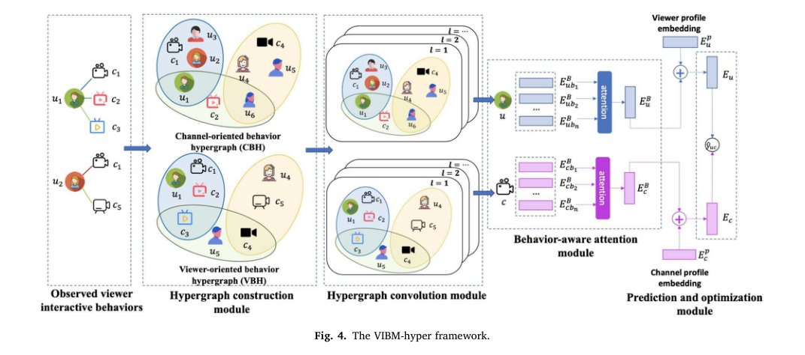
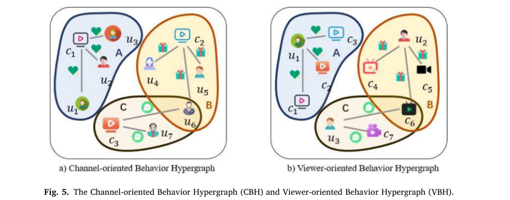

# Live streaming channel recommendation based on viewers' interaction behavior: A hypergraph approach

| 项目 | 内容 |
|---|---|
| 原题 | Live streaming channel recommendation based on viewers' interaction behavior: A hypergraph approach |
| 作者 | Li Yu、Wei Gong、Dongsong Zhang |
| 发表 | Decision Support Systems，184（2024），114272 |
| 在线发表 | 2024 年 7 月 1 日 |
| DOI | [10.1016/j.dss.2024.114272](https://doi.org/10.1016/j.dss.2024.114272) |
| 方法名称 | Viewers' Interaction Behavior Modeled by Hypergraphs (VIBM-Hyper) |
| Keywords | Interaction behavior; Live streaming; Recommender systems; Hypergraph; Graph neural networks |

## 一、研究现象：直播互动如何反映观众兴趣？

### 1.1 现实起点：频道不断增加，观众如何找到感兴趣的直播？

直播（Live Streaming）平台同时提供游戏、音乐、日常分享和商品销售等内容。对于观众而言，选择困难不仅来自频道数量多，还来自频道之间的差异：同样是游戏直播，不同主播的讲解风格、互动方式和观众氛围也不同。平台需要据此开展个性化推荐（Personalized Recommendation），帮助不同观众找到与自身兴趣相匹配的频道。

观众对频道的偏好（Preference）通常不会通过一份完整评分表直接表达，而是分散在实际行为中。观看直播内容（Watching Live Content）、发送弹幕（Danmaku）、赠送虚拟礼物（Virtual Gifts）、订阅频道（Subscribing to a Channel）和购买商品（Purchasing an Item），都可能提供不同角度的兴趣线索。因此，平台面对的直接问题是：**如何从观众已经发生的互动中，判断其对尚未选择的频道的兴趣？**

### 1.2 从单次互动到群体关联

考虑一个具体场景：观众甲在频道 A 和频道 B 送过礼物，观众乙也在这两个频道送过礼物；与此同时，两人在其他频道主要发送弹幕。这里包含两种可供推荐利用的关联。

第一种是**观众之间的关联**。甲与乙在相同频道具有相似的互动方式，意味着他们可能在主播风格、内容类型或参与方式上具有共同兴趣。第二种是**频道之间的关联**。A 与 B 被同一观众以相同方式参与，意味着二者可能共同满足该观众某方面的需求。

这些关联具有集合性质：一个频道可以联系多位观众，一位观众也可以联系多个频道；同一个人又可以同时属于多个行为集合。因此，一条“观众甲在频道 A 送礼”的记录，既是一次个体互动，也是更大范围偏好关联中的组成部分。

### 1.3 从行为是否发生，进一步关注行为类型与强度

不同互动方式提供的偏好线索并不相同。例如，同一位观众可以在某类频道频繁发言，在另一类频道赠送礼物。即使行为类型相同，其强度也可能不同：发送一次弹幕与连续发送多次弹幕、赠送不同价值的礼物，反映的参与程度具有差别。

由此形成三个递进的观察层次：**互动记录提供基本关联，行为类型揭示偏好的不同侧面，行为强度进一步细化这些侧面。** 推荐模型需要把这些信息转化为可计算、可比较的偏好表示。

## 二、研究问题：如何利用多行为群体关系推荐频道？

### 2.1 应用层面的研究目标

本研究要完成的任务是：给定观众的历史交互行为（Historical Interaction Behaviors）及观众画像（Viewer Profile）和频道画像（Channel Profile）信息，预测该观众对候选频道的兴趣程度，并生成前 K 项推荐（Top-K Recommendation）。

设观众集合为 $U$，频道集合为 $C$，行为集合为 $B$。一条历史记录可写为 $(u,c,b)$，表示观众 $u$ 在频道 $c$ 实施行为 $b$。模型输出评分 $\hat y(u,c)$，分数越高，频道越优先推荐给该观众。

这项任务的关键不只是累积更多行为记录，而是组织其中的关系：谁与谁具有类似偏好、哪些频道具有共同吸引力，以及不同互动方式应如何共同参与判断。

### 2.2 两个相互衔接的研究问题

**研究问题一：如何表示群体层面的观众—频道关联？**

需要同时表达“某频道联系的一组观众”和“某观众联系的一组频道”，并保留行为类型及强度所提供的区分信息。它解决的是历史互动如何组织的问题。

**研究问题二：如何基于这些关联学习偏好并进行推荐？**

在关系结构建立后，需要通过表示学习（Representation Learning）将其中的信息转化为向量，再融合不同行为的贡献，最终计算观众与频道的匹配程度。它解决的是关系结构如何转化为推荐能力的问题。

两个问题构成一条连续路径：**先组织关系，再学习表示，最后完成排序。**

## 三、科学问题与设计原理：从业务关系到可学习机制

### 3.1 从应用问题抽象出科学问题

从交互记录形成推荐结果，需要依次解决关系表达、信息传播与偏好整合三个科学问题。

| 层次 | 科学问题 | 需要建立的机制 |
|---|---|---|
| 关系表达 | 如何把异质交互行为中的多实体关联表示为统一结构？ | 保留成员集合、行为类别及关联方向的结构表示 |
| 信息传播 | 如何让个体通过共享集合获得其他成员提供的偏好信息？ | 沿群体关系进行信息聚合与传播 |
| 偏好整合 | 如何将不同行为和不同匹配视角整合为一个排序依据？ | 行为加权融合与互补评分 |

这里的高阶关联（Higher-Order Relations）指一个关联同时涉及多个实体，例如一个频道及在其中发送弹幕的一组观众。其研究意义在于：个体偏好可以通过共享行为集合得到补充，而不必仅依赖个体自身有限的直接记录。

### 3.2 设计原理一：用超边保留群体关系

超图（Hypergraph）由节点（Vertex）与超边（Hyperedge）构成。一条超边可以同时联系多个节点，因此适合表达“一个关联包含一组成员”的结构。

将共同参与某一频道、某一行为的观众组织为集合后，模型能够围绕该集合聚合信息；将同一观众参与过的多个频道组织为集合后，模型又能够从另一侧学习频道之间的联系。两个视角来自同一批交互记录，但强调不同的共享关系。

### 3.3 设计原理二：通过双视角传播，补充观众和频道的表示

频道视角把多位观众连接起来，使观众表示能够吸收同组成员的信息；观众视角把多个频道连接起来，使频道表示能够吸收同组频道的信息。

在此基础上，超图卷积（Hypergraph Convolution）执行“节点 → 超边 → 节点”的信息传播：先形成集合层面的概括，再将概括传回成员。多层传播使信息能够经过相互交叠的集合逐步扩散。

### 3.4 设计原理三：按行为加权，再结合两种匹配视角

多种行为分别学习表示后，行为感知注意力（Behavior-Aware Attention）决定它们在融合中的相对权重。这样，最终表示同时包含多种互动信号，并允许不同实体具有不同的行为权重。

在评分环节，一条路径考察观众整体表示与候选频道的匹配程度；另一条路径考察候选频道与该观众历史互动频道的关联程度。两种视角共同构成推荐依据。

由此，整个设计逻辑可以写为：

> **多行为互动现象 → 双视角群体关系 → 超图结构 → 群体信息传播 → 行为加权表示 → 双路径评分 → 个性化排序。**

## 四、方法速览：整体怎样设计，每个模块解决什么问题？

### 4.1 整体思路：从互动记录到频道排序

VIBM-Hyper 的设计围绕一个目标展开：**同时利用“哪些观众具有共同兴趣”和“哪些频道具有共同吸引力”，判断一位观众可能喜欢什么频道。**

模型先将历史互动组织为两类行为群体，再通过群体关系学习观众和频道的特征；随后融合不同行为及画像信息，从整体偏好和历史频道两个角度评分，最终生成推荐列表。

框架图可以分为三段理解。左侧回答“如何组织历史互动”：同一批记录分别按照频道和观众分组。中间回答“如何从关系中学习”：通过超图卷积（Hypergraph Convolution）传播群体信息，再用行为感知注意力（Behavior-Aware Attention）融合不同行为。右侧回答“如何形成推荐”：结合观众画像（Viewer Profile）和频道画像（Channel Profile），得到匹配分数。

图中上方逐步形成观众表示，下方逐步形成频道表示；叠层表示多轮信息传播，小长条表示学到的特征向量，加号表示画像特征与行为特征的融合。两条信息流最终共同参与频道评分。

### 4.2 双视角构图：从两个方向组织同一批交互

**频道导向行为超图（Channel-Oriented Behavior Hypergraph，CBH）**先固定频道，再聚集在该频道实施同类行为的观众。例如，多位观众都在某个频道赠送虚拟礼物（Virtual Gifts），便形成一个行为集合。这一设计为观众提供共享兴趣线索：一个人的偏好可以从同组观众的互动中得到补充。

**观众导向行为超图（Viewer-Oriented Behavior Hypergraph，VBH）**先固定观众，再聚集其实施同类行为的频道。例如，同一位观众在三个频道赠送礼物，这三个频道便形成一个行为集合。这一设计为频道提供关联线索：多个频道可能因为满足同一观众某方面的兴趣而联系起来。

两个视角分别围绕观众相似性和频道关联性展开。同一观众或频道可以属于多个集合，因此模型能够利用集合之间的重叠，连接原本分散的互动。行为强度还可以进一步细分这些集合，例如区分不同送礼价值或弹幕发送次数。

### 4.3 卷积与注意力：从群体关系学习偏好

构图完成后，模型需要把关系转化为能够计算和比较的向量。超图卷积先汇总一个行为集合内的成员特征，再将汇总信息传回成员。经过多轮传播，观众可以吸收共同参与者提供的偏好信息，频道也可以吸收相关频道提供的特征信息。

不同互动方式分别形成相应的表示。例如，一个频道在弹幕视角下的特征，与送礼视角下的特征可以不同。行为感知注意力再为这些表示分配权重，加权形成综合行为表示。它解决的是**多种行为如何共同参与判断**的问题，让模型能够协调各类信号的贡献。

### 4.4 画像融合与双路径评分：既看整体偏好，也看历史选择

画像信息提供基本特征，行为信息提供历史互动中学到的偏好特征。例如，频道类型与简介说明其内容定位，观众在其中的参与则提供实际兴趣线索。模型将两类特征结合，形成观众和频道的最终表示。

推荐评分包含两条互补路径：

- **整体匹配路径**：比较观众与候选频道的最终表示，判断频道是否符合其整体偏好。
- **历史关联路径**：比较候选频道与该观众过去互动过的频道，判断它是否与历史选择具有共同特征。

两路得分加权合并后，模型对候选频道排序。训练采用贝叶斯个性化排序（Bayesian Personalized Ranking，BPR），使观测到交互的频道尽量排在采样的未交互频道前面，从而让各模块围绕同一个排序目标共同学习。

### 4.5 模块与设计意图对应表

| 模块 | 要解决的问题 | 设计方式 | 产生的结果 |
|---|---|---|---|
| 双视角超图构建 | 如何组织多观众、多频道的行为关联？ | 按频道聚集观众，按观众聚集频道，并区分行为 | 两类互补的群体关系结构 |
| 超图卷积 | 如何利用群体关系补充个体信息？ | 在成员与集合之间多轮传播特征 | 不同行为下的观众和频道表示 |
| 行为感知注意力 | 多种互动信号如何共同参与判断？ | 对不同行为表示计算权重并融合 | 综合行为表示 |
| 画像融合 | 如何兼顾实体基本特征和互动偏好？ | 将画像表示与行为表示相加 | 最终观众和频道表示 |
| 双路径评分 | 如何综合整体兴趣与历史选择？ | 融合观众—频道匹配及候选—历史频道关联 | 个性化推荐分数 |
| 排序优化 | 如何使整个模型服务于推荐目标？ | 提高观测交互频道相对采样未交互频道的得分 | 面向频道排序学习的模型参数 |

## 五、实验结果：多行为与超图分别带来什么作用？

### 5.1 数据与比较设置

研究使用两个不同应用场景的数据集（Dataset）：一个来自虚拟主播（VTuber）直播，另一个来自直播电商（Live Streaming E-Commerce）。

| 数据集 | 场景 | 观众数 | 频道数 | 交互记录数 |
|---|---|---:|---:|---:|
| Bilibili-VTuber | 游戏、唱歌和日常分享等直播 | 21,040 | 1,040 | 163,200 |
| MOGU | 服装、美妆和珠宝等直播电商 | 186,539 | 2,620 | 7,165,582 |

数据按 8:1:1 随机划分为训练集（Training Set）、验证集（Validation Set）和测试集（Test Set），训练采用随机负采样。比较对象包括单行为模型（Single-Behavior Models）和多行为模型（Multi-Behavior Models），其中包含 LightGCN、MBGCN、DHCN、DualHGCN 等图学习或超图学习方法。

评估采用召回率（Recall@K）与归一化折损累计增益（Normalized Discounted Cumulative Gain，NDCG@K）。召回率关注相关频道有多少进入前 K 项；归一化折损累计增益还考虑命中位置，相关频道越靠前，评价越高。实验取 $K=20,40,80$。

### 5.2 整体推荐结果

下面列出完整模型及主要比较模型的结果。

| 数据集 / 方法 | Recall@20 | NDCG@20 | Recall@40 | NDCG@40 | Recall@80 | NDCG@80 |
|---|---:|---:|---:|---:|---:|---:|
| Bilibili / MBGCN | 0.069 | 0.023 | 0.092 | 0.035 | 0.114 | 0.041 |
| Bilibili / MC-BPR | 0.065 | 0.018 | 0.079 | 0.037 | 0.108 | 0.040 |
| Bilibili / VIBM-Hyper | **0.082** | **0.031** | **0.103** | **0.040** | **0.121** | **0.046** |
| MOGU / MBGCN | 0.058 | 0.025 | 0.083 | 0.031 | 0.121 | 0.037 |
| MOGU / VIBM-Hyper | **0.061** | **0.027** | **0.090** | **0.032** | **0.123** | **0.043** |

完整模型在两个数据集的各项展示指标上取得最高值。这说明，将多行为信息组织为群体关系并用于表示学习，能够在所采用的评估设置下提高频道推荐质量。

### 5.3 多行为的作用

消融实验（Ablation Study）比较完整模型与仅使用一种行为的版本：CS 对应观看或加购，GP 对应送礼或购买，DF 对应弹幕或收藏。

| 方法 | Bilibili Recall@20 | Bilibili NDCG@20 | MOGU Recall@20 | MOGU NDCG@20 |
|---|---:|---:|---:|---:|
| 完整模型 | **0.082** | **0.031** | **0.061** | **0.027** |
| CS 单行为 | 0.075 | 0.019 | 0.040 | 0.012 |
| GP 单行为 | 0.077 | 0.026 | 0.050 | 0.021 |
| DF 单行为 | 0.072 | 0.021 | 0.044 | 0.017 |

在两个数据集上，整合多种行为均优于只使用单一行为。其含义是：不同互动方式提供了可以共同利用的偏好线索，融合这些线索后，模型能够获得更完整的观众和频道表示。

### 5.4 超图结构与传播深度的作用

| 结构 | Bilibili Recall@20 | Bilibili NDCG@20 | MOGU Recall@20 | MOGU NDCG@20 |
|---|---:|---:|---:|---:|
| 完整超图模型 | **0.082** | **0.031** | **0.061** | **0.027** |
| 替换为传统图结构 | 0.064 | 0.020 | 0.052 | 0.019 |

采用超图结构的版本具有更高的推荐指标，与模型利用群体关联补充偏好信息的设计思路相呼应。

在传播深度方面，卷积层数从一层增加到三层时效果上升，继续增加到五层后下降；三层在所考察的设置中表现较好。这个结果说明，适当增加传播层数，可以让模型获取更充分的关联信息。

## 六、进阶解析：关系结构、数学符号与公式推导

### 6.1 整体框架

框架图同时包含两条并行的信息流：上方逐步形成观众表示，下方逐步形成频道表示。两条信息流都经过构图、卷积和注意力融合，最后在右侧汇合，用于计算观众对频道的偏好分数。

**第一步：把交互记录组织成两类关系。** 最左侧以 $u$ 标记观众、以 $c$ 标记频道。一个观众连接多个频道，表示其在这些频道发生过互动；不同的图标和连线辅助区分交互对象与行为。进入超图构建模块后，同一批记录被重新组织为两个视角：上方固定频道，将相关观众放入同一集合；下方固定观众，将相关频道放入同一集合。椭圆形区域表示这些集合，区域相互交叠则表示不同集合共享成员。

**第二步：让成员通过共同关系交换信息。** 中部标有 $\ell=1,2,\ldots$ 的叠层表示连续的超图卷积。每一层都更新成员的特征，而不是增加一批新观众或新频道。例如，一位观众与其他人参与同一个行为集合，更新后的向量就会纳入这些成员提供的信息；下一层再以更新后的向量继续传播。

**第三步：融合不同的行为视角。** 注意力模块左侧的小长条表示嵌入（Embedding），即用一组可学习的数值概括实体特征。上方的 $E^B_{ub_1},E^B_{ub_2},\ldots$ 分别对应观众在不同行为下的表示；下方的 $E^B_{cb_1},E^B_{cb_2},\ldots$ 对应频道在不同行为下的表示。注意力沿行为维度计算权重，将多个向量融合为观众行为表示 $E_u^B$ 和频道行为表示 $E_c^B$。

**第四步：将画像信息与行为信息结合。** 最右侧的观众画像嵌入（Viewer Profile Embedding）$E_u^p$ 与频道画像嵌入（Channel Profile Embedding）$E_c^p$，分别从实体自身的描述文本提取特征。图中的加号表示它们与行为表示逐元素相加，得到最终向量 $E_u$ 和 $E_c$；最右侧连接两者的评分环节据此输出匹配结果。

因此，这张图的核心对应关系是：**椭圆描述关系属于谁，叠层描述信息如何传播，小长条描述学到了什么，注意力描述如何融合，加号描述如何补充画像信息。**

### 6.2 双视角行为超图：怎样读懂节点、锚点和区域？

两个面板展示的是同一类交互数据的不同组织方式。人物图标旁的 $u_1,u_2,\ldots$ 表示观众，播放或视频图标旁的 $c_1,c_2,\ldots$ 表示频道；礼物、对话等图标提示行为类型。标记为 A、B、C 的封闭区域表示超边，每个区域把一组相关实体纳入同一个关系。字母仅用于区分区域，行为含义要结合区域内的交互理解。

**左图：频道导向行为超图（Channel-Oriented Behavior Hypergraph，CBH）。**

左图的组织方式是：先选定一个频道和一种行为，再找出实施该行为的观众。频道是分组的依据，观众是被联系起来的成员。

- 区域 A 围绕频道 $c_1$ 联系观众 $u_1,u_2,u_3$，表示三位观众在该频道观看直播内容形成的关联。
- 区域 B 围绕频道 $c_2$ 联系观众 $u_4,u_5,u_6$，图中的礼物标记对应他们在该频道赠送礼物形成的关联。
- 区域 C 围绕频道 $c_3$ 联系观众 $u_6,u_7$，呈现另一组频道互动关系。

其中，$u_6$ 同时位于 B 和 C 中，说明同一位观众可以参与不同频道的行为集合。B 中的其他成员可以先通过共同关系影响 $u_6$ 的表示，更新后的信息又能经由 $u_6$ 参与的另一条关系继续传播。这种重叠使独立的互动集合形成相互联系的网络。

图中的频道位于相应区域内，标明该组互动围绕哪个频道发生。就观众偏好学习而言，关键是**共同参与同一频道、同类行为的观众能够通过该集合分享信息**。即使某位观众自身的记录不多，也能从同组观众的历史中获得补充线索。

**右图：观众导向行为超图（Viewer-Oriented Behavior Hypergraph，VBH）。**

右图将分组依据反转：先选定一位观众和一种行为，再找出该观众实施该行为的频道。观众是组织中心，频道是被联系起来的成员。

- 区域 A 以观众 $u_1$ 为中心，联系频道 $c_1,c_2,c_3$，呈现同一观众与多个频道的互动关系。
- 区域 B 以观众 $u_2$ 为中心，联系频道 $c_4,c_5,c_6$，表示这位观众在三个频道赠送礼物形成的关联。
- 区域 C 以观众 $u_3$ 为中心，联系频道 $c_6,c_7$，形成另一组频道关系。

频道 $c_6$ 同时属于 B 和 C：它既与 $u_2$ 的一组历史互动相联系，也与 $u_3$ 的历史互动相联系。因此，$c_6$ 的表示能够汇集来自不同观众行为集合的频道信息，其他频道也能沿这些重叠关系获得间接联系。

这种组织方式将“同一个人为什么会选择多个频道”转化为可学习的频道关联。例如，$c_4,c_5,c_6$ 都吸引 $u_2$ 赠送礼物，模型便在送礼这一行为视角下联合学习它们的表示。

| 图示视角 | 先固定的对象 | 收集的成员 | 集合重叠的例子 | 主要学习的信息 |
|---|---|---|---|---|
| 频道导向行为超图 | 频道及行为类型 | 在该频道实施该行为的观众 | 观众 $u_6$ 同属 B、C | 观众之间的共享偏好 |
| 观众导向行为超图 | 观众及行为类型 | 该观众实施该行为的频道 | 频道 $c_6$ 同属 B、C | 频道之间的行为关联 |

两种超图构成互补：前者利用“共同选择某个频道的人”理解观众，后者利用“被同一个人选择的频道”理解频道，再将两侧表示用于推荐。

两种分组可以分别表示为观众集合和频道集合：

$$
\mathcal U_{c,b}=\{u\in U:\text{观众 }u\text{ 在频道 }c\text{ 实施行为 }b\},
\tag{1}
$$
$$
\mathcal C_{u,b}=\{c\in C:\text{观众 }u\text{ 在频道 }c\text{ 实施行为 }b\}.
\tag{2}
$$

前者是频道视角下的观众集合，后者是观众视角下的频道集合。它们用于概括分组依据：**固定频道看观众，固定观众看频道。**

行为子类别（Behavior Subcategories）进一步按强度细分集合。例如，将赠送礼物按价值区间划分，将弹幕按发送次数划分，使同一行为之下不同参与程度的关系也能被表达。

### 6.3 初始表示：观众和频道画像如何进入模型？

模型利用词向量模型（Word2Vec）编码观众与频道的画像文本。观众端使用个人简介，频道端使用频道类型、标题与简介等信息，分别得到观众画像表示 $E_u^p$ 与频道画像表示 $E_c^p$。

画像表示提供观众和频道的基础特征：个人简介描述观众的兴趣与身份特征，频道类型、标题和简介描述其内容定位。超图传播进一步补充历史交互揭示的行为特征。两类表示分别承载内容信息和协同关系，在最终评分前进行融合。

### 6.4 超图卷积：一个公式怎样完成群体信息传播？

模型采用以下更新规则：

$$
X^{(\ell+1)}=
\sigma\!\left(
D_v^{-1/2}HWD_e^{-1}H^TD_v^{-1/2}
X^{(\ell)}\Theta^{(\ell)}
\right).
\tag{3}
$$

设节点数为 $n$、超边数为 $m$，各符号含义如下。

| 符号 | 含义 | 在计算中的作用 |
|---|---|---|
| $X^{(\ell)}$ | 第 $\ell$ 层的节点表示矩阵 | 存放当前每个节点的特征向量 |
| $H\in\mathbb R^{n\times m}$ | 关联矩阵（Incidence Matrix） | $H_{ve}$ 表示节点 $v$ 是否属于超边 $e$ |
| $W$ | 超边权重矩阵（Hyperedge Weight Matrix） | 调整不同关系集合的传播贡献 |
| $D_v$ | 节点度矩阵（Vertex Degree Matrix） | 记录节点参与关联的总程度 |
| $D_e$ | 超边度矩阵（Hyperedge Degree Matrix） | 记录每条超边包含的成员数量 |
| $\Theta^{(\ell)}$ | 可训练的特征变换矩阵 | 学习下一层应保留和组合哪些特征 |
| $\sigma$ | 非线性激活函数（Nonlinear Activation Function） | 对传播后的特征进行非线性变换 |

按常见的二值关联矩阵定义，超边度为 $\delta(e)=\sum_vH_{ve}$，加权节点度为 $d(v)=\sum_ew_eH_{ve}$；二者分别组成 $D_e$ 与 $D_v$ 的对角元素。

**第一步：调节节点输入。** 令 $\widetilde X=D_v^{-1/2}X^{(\ell)}$。参与多个关系集合的节点，其输入先按度进行缩放，从而在传播中协调不同活跃程度节点的贡献。

**第二步：节点汇入超边。** 计算 $Z=D_e^{-1}H^T\widetilde X$。其中 $H^T$ 按超边收集成员向量，$D_e^{-1}$ 再按成员数归一化（Normalization）。对一条含三个成员的超边而言，这一步相当于汇总三个成员的特征并求平均。

**第三步：超边传回节点。** 计算 $Y=D_v^{-1/2}HWZ$。$W$ 先调节每条超边的贡献，$H$ 再把超边向量发送给其成员。若一个节点属于多个超边，它就接收多个关系集合的信息。

**第四步：学习特征组合。** 计算 $X^{(\ell+1)}=\sigma(Y\Theta^{(\ell)})$，将收集到的信息映射到下一层表示空间。

将矩阵式展开到单个节点，可以更直观地看到传播路径：

$$
x_v^{(\ell+1)}=
\sigma\!\left[
\sum_{e:v\in e}\sum_{v'\in e}
\frac{w_e}{\sqrt{d(v)}\,\delta(e)\,\sqrt{d(v')}}
x_{v'}^{(\ell)}\Theta^{(\ell)}
\right].
\tag{4}
$$

这个展开式说明：节点 $v$ 接收与自己共享超边的节点 $v'$ 的信息，贡献大小由超边权重、集合规模以及两个节点的度共同决定。如果两个观众共同参与多个行为集合，其信息可以通过多个路径传递。

堆叠多层后，节点不仅吸收直接共享集合的成员信息，还能沿交叠集合获取更远的关联。最终得到行为 $b$ 下的观众表示 $E^B_{ub}$ 和频道表示 $E^B_{cb}$。

### 6.5 行为感知注意力：不同互动如何形成统一表示？

超图卷积提供了多个行为视角的向量。为了将它们融合，模型先计算频道在各行为下的平均表示：

$$
\bar E_c^B=\frac1{|B|}\sum_{b\in B}E_{cb}^B.
\tag{5}
$$

这里，$|B|$ 表示行为类别数，$E_{cb}^B$ 表示频道 $c$ 在行为 $b$ 下的向量，$\bar E_c^B$ 是所有行为共同形成的参照向量。它将用于比较每一类行为与整体行为特征的关联程度。

接着，通过内积（Inner Product）计算关联分数：

$$
s(b,c)=(E_{cb}^B)^T\bar E_c^B.
\tag{6}
$$

如果某个行为向量与参照向量在方向和数值上更一致，其内积通常更大。随后，归一化指数函数（Softmax Function）将这些分数转化为可加权的比例：

$$
w(b,c)=\frac{\exp[s(b,c)]}{\sum_{b'\in B}\exp[s(b',c)]}.
\tag{7}
$$

分母遍历全部行为类别，使权重为正且总和为 1。最终行为表示为：

$$
E_c^B=\sum_{b\in B}w(b,c)E_{cb}^B.
\tag{8}
$$

例如，假设三种行为的分数为 $0,\ln 2,0$，指数变换后得到 $1,2,1$，于是权重为 $0.25,0.50,0.25$。第二类行为便以较大比例参与最终表示。

观众端采用相应的行为融合思路，得到 $E_u^B$。由此，模型既保留多行为信息，也能够依据学到的表示调节不同信号的贡献。

### 6.6 画像与行为融合：如何得到最终实体向量？

最终表示采用以下形式：

$$
E_u=E_u^p+E_u^B,\qquad E_c=E_c^p+E_c^B.
\tag{9}
$$

$E_u^p,E_c^p$ 表达画像特征，$E_u^B,E_c^B$ 表达交互关系中提取的行为特征。相加将两类信息融合到同一个表示空间，形成后续匹配使用的观众和频道向量。

### 6.7 第一条评分路径：观众与频道整体是否匹配？

第一条路径使用余弦相似度（Cosine Similarity）：

$$
\hat y_1(u,c)=\frac{E_u\cdot E_c}{\|E_u\|\|E_c\|}.
\tag{10}
$$

分子计算两个向量的内积，分母用向量长度进行归一化，因此该分数主要描述它们的方向一致程度。若观众和频道在学习到的兴趣空间中方向接近，得分就较高。

这条路径把问题转化为：**综合画像和行为信息后，这个频道是否符合该观众的整体偏好？**

### 6.8 第二条评分路径：候选频道是否与历史频道相关？

第二条路径直接比较候选频道与观众历史互动过的频道：

$$
\hat y_2(u,c)=
\sum_{b\in B}\sum_{c_j\in N_b(u)}
(E_{cb}^B)^TM_bE_{c_jb}^B.
\tag{11}
$$

| 符号 | 含义 |
|---|---|
| $c$ | 当前需要评分的候选频道 |
| $N_b(u)$ | 观众 $u$ 曾实施行为 $b$ 的频道集合 |
| $c_j$ | 该历史集合中的一个频道 |
| $E_{cb}^B,E_{c_jb}^B$ | 候选频道和历史频道在同一行为视角下的表示 |
| $M_b$ | 行为相关的可训练关系矩阵 |

先看最内层 $(E_{cb}^B)^TM_bE_{c_jb}^B$。这是一种双线性匹配（Bilinear Matching）：$M_b$ 学习怎样组合两个频道向量的各个维度，再输出它们在行为 $b$ 下的相关程度。

随后，对同一行为下的所有历史频道求和，得到该行为视角的历史支持；再对不同行为求和，汇总多个视角。例如，某观众在两个游戏频道送过礼物，候选频道与这两个频道在送礼行为表示上都相关，它便可以从该历史集合中获得较高评分。

这条路径回答的是：**候选频道与这位观众过去实际互动过的频道，是否具有相通之处？**

### 6.9 两条路径如何合成为一个推荐分数？

最终分数是线性组合（Linear Combination）：

$$
\hat y(u,c)=\lambda\hat y_1(u,c)+(1-\lambda)\hat y_2(u,c).
\tag{12}
$$

$\lambda\in[0,1]$ 控制两种评分在最终函数中的系数。模型采用 $\lambda=0.5$，即将整体偏好匹配和历史频道关联共同纳入决策。随后，对同一观众的候选频道按 $\hat y(u,c)$ 降序排列，取前 K 项。

### 6.10 模型训练：如何让感兴趣的频道排在前面？

模型采用贝叶斯个性化排序（Bayesian Personalized Ranking，BPR）损失：

$$
\mathcal L=
\sum_{(u,c,c')\in O}
-\log\sigma\!\left(\hat y(u,c)-\hat y(u,c')\right)
+\beta\|\Theta\|_2^2.
\tag{13}
$$

$O$ 是训练三元组集合。每个三元组包含观众 $u$、观测到交互的频道 $c$，以及通过负采样（Negative Sampling）选取的未交互频道 $c'$。这里 $\sigma$ 为逻辑函数（Sigmoid Function），$\Theta$ 表示可训练参数，$\beta$ 为正则化（Regularization）系数。

令分数差为 $\Delta=\hat y(u,c)-\hat y(u,c')$。单组三元组的排序损失等价于：

$$
\ell(\Delta)=-\log\sigma(\Delta)=\log(1+e^{-\Delta}).
\tag{14}
$$

当 $\Delta=0$ 时，两者没有区分，损失约为 $0.693$；当 $\Delta=2$ 时，交互频道得分更高，损失降至约 $0.127$；当 $\Delta=-2$ 时，排序方向相反，损失约为 $2.127$。因此，优化会推动交互频道获得更高的相对得分。

其对分数差的导数为：

$$
\frac{\partial\ell}{\partial\Delta}=\sigma(\Delta)-1.
\tag{15}
$$

当排序方向错误或差距较小时，更新推动更强；当正样本已经明显领先时，推动逐渐减弱。参数通过这一损失反向传播（Backpropagation）得到更新，连同超图特征变换和评分矩阵一起学习。正则化项则约束参数规模，使表示学习兼顾排序拟合和参数控制。

## 参考文献

Yu, L., Gong, W., & Zhang, D. (2024). Live streaming channel recommendation based on viewers' interaction behavior: A hypergraph approach. *Decision Support Systems, 184*, 114272. [https://doi.org/10.1016/j.dss.2024.114272](https://doi.org/10.1016/j.dss.2024.114272)
