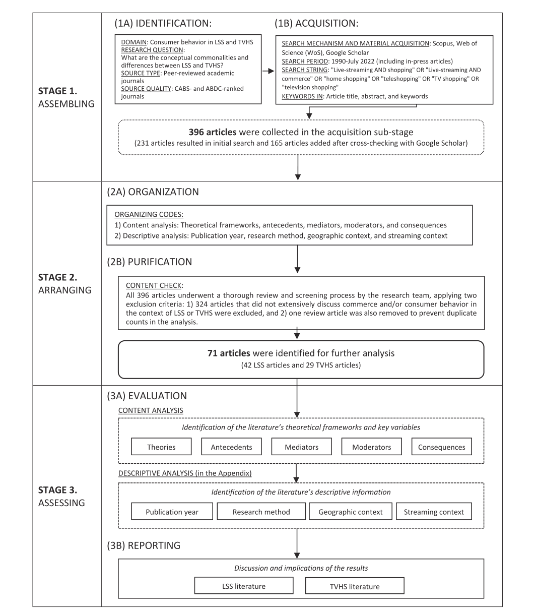
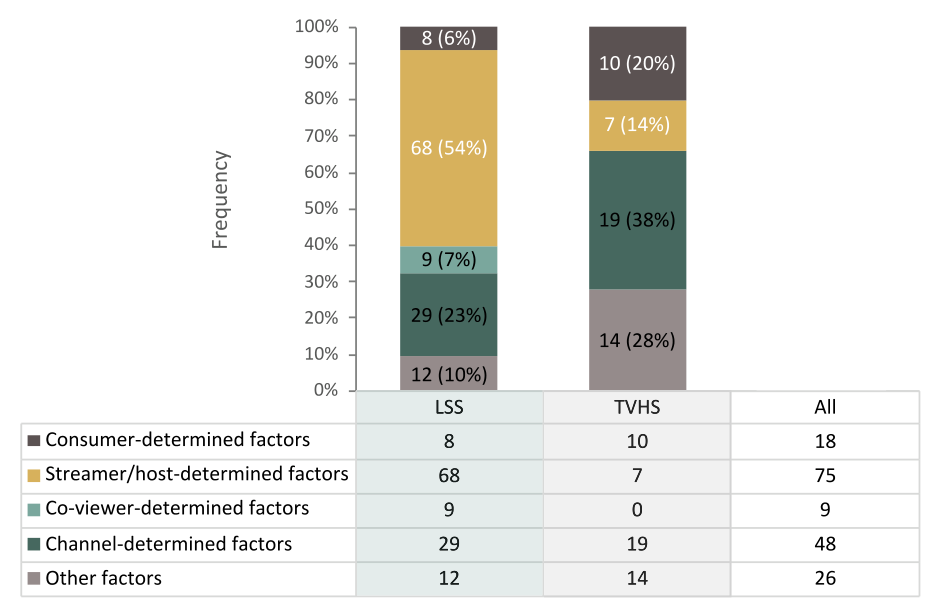

**表 1　论文基本信息**

| 项目 | 内容 |
|---|---|
| 原题 | Is livestream shopping conceptually new? A comparative literature review of livestream shopping and TV home shopping research |
| 作者 | Chung-Wha (Chloe) Ki, Ashley Chenn, Sze Man Chong, and Erin Cho |
| 发表 | Journal of Business Research, 174, 114504 (2024) |
| 在线发表 | 13 January 2024 |
| Keywords | Livestreaming, Livestream shopping, Live streaming commerce, Live commerce, Influencers in livestream and TV home shopping |
| DOI | [10.1016/j.jbusres.2024.114504](https://doi.org/10.1016/j.jbusres.2024.114504) |

**图 1　Elsevier 出版版论文首页（刊头、题名及作者）**

## 一、研究现象：同样隔着屏幕买衣服，观众能做的事有什么不同？

设想两位观众都在家里看一件针织衫的商品演示。她们都能看到衣服的颜色、版型和上身效果，也都能在看完之后下单。第一位观众在看电视购物节目。主持人介绍了几个尺码，但她想知道衣服的袖口到底有多紧。节目接下来可能恰好讲到这点，她也可能等不到答案。如果节目开放电话或短信，她可以把问题发过去，是否在接下来的演示中得到回应，则取决于主持人和节目团队的安排。

第二位观众在看购物直播，也有同样的疑问。她在评论区请主播把袖口拉近一点，再试着卷起来。主播如果看见这条留言，可以当场补拍细节。同场观众也能看见问题，有人可能刚买过同款，会补充自己穿着时的感受。这样的交流不保证每个问题都会得到回答，但它给观众提供了一个机会：让自己关心的问题进入正在进行的展示，也让别人的问题和经验成为自己的购物线索。

这两个场景分别说明电视居家购物（TV Home Shopping，TVHS）和直播购物（Livestream Shopping，LSS）有何关联。二者都借助动态影像和讲解，把商品展示带进消费者家中。在电视购物节目里，商品讲解通常由节目方组织并播出。在直播间，讲解也可以经过事先准备，不过当场的问答有机会改变接下来演示什么、补充哪些信息。两种渠道都让人看见远处的商品，论文要追问的是，**谁能参与讲解，谁的反馈能被别人看见，以及这些变化是否改变了消费者形成判断的过程。**

## 二、研究问题：怎样判断直播购物在概念上是否新颖？

如果按“有主持人、有视频、能在家下单”来定义，直播购物和电视居家购物很接近。评价这两种渠道时，消费者也可能在意同样的事情，比如信息是否足够、购买是否方便、价格是否合适。不过，同样在看一件商品，观众有时靠节目提供的资料作决定，有时会根据主播对问题的回应、其他观众的经验和持续互动形成判断。研究上的区别，要从这些判断是怎样产生的来理解。

作者因此回到已有的研究模型，看两组文献各自把什么视为消费者反应的起点，又用什么解释消费者为什么会买、会继续观看或愿意与他人分享。研究一整理 42 篇直播购物论文，研究二整理 29 篇电视居家购物论文。两组文献接受同样的比较，最后被放到一个整合框架中。这个做法给出的证据来自**两组已有研究如何定义渠道、选择理论和解释行为**。论文的产出是对概念及其机制的比较，没有安排同一批消费者在两类渠道中完成购物任务。

## 三、科学问题与比较思路

**表 2　概念比较的三个层次**

| 比较层次 | 具体问题 | 在文献中寻找什么 |
|---|---|---|
| 沟通结构 | 谁在介绍商品，观众能以什么方式回应，其他人能否看到这些回应？ | 发送者、媒介、接收者及信息流向 |
| 行为形成过程 | 观众为什么会相信商品信息，或愿意继续参与？这种关系在哪些条件下会改变？ | 理论、前因（Antecedents）、中介（Mediators）和调节变量（Moderators） |
| 结果 | 研究关心的是看了多久、是否购买，还是与主播或其他观众建立了联系？ | 购买、观看、满意、参与、分享等结果（Consequences） |

例如，在上面的袖口问题里，“观众能实时提问”属于沟通结构。主播是否针对这条问题给出有效答复，可以成为解释消费者反应的前因。消费者因此更相信主播给出的建议，或更确定衣服符合自己的需求，是两种可能的中介过程。继续留在直播间看展示、关注主播或下单，则是不同的结果。把这几个层次逐一展开，就能看出，同样一次购买背后可能存在不同的行为过程。

这也说明，比较两组文献时不能只看它们是否使用同一个词。“信任”（Trust）在两组文献中都出现，但信任主持人、信任商品、信任交易渠道，指的是三种不同的判断。作者同时关注研究中使用的变量名称、变量所指的对象，以及它在解释链条中发挥的作用。

## 四、研究方法与整合框架速览

### 4.1 两组研究如何进入同一个比较框架？

**图 2　系统综述流程概览**

作者采用系统性文献综述（Systematic Literature Review），按 SPAR-4-SLR 的汇集、整理和评估三个阶段完成。图 2 从上往下读。最上方先界定目标文献，即 1990 年至 2022 年 7 月间发表或待刊、研究两种购物形式中消费者行为的英文同行评审论文。期刊范围依据 CABS 或 ABDC 名录。Scopus 和 Web of Science 初步检索去重后得到 231 篇，补充检索 Google Scholar 后再增加 165 篇，共 396 篇进入审查。

图中间说明如何从 396 篇缩小到 71 篇。团队排除 324 篇主题不符的文章，例如讨论游戏直播但并未研究商品销售的论文。另外排除一篇综述，以免重复计入其中转述的研究变量。筛选的意义在于把比较对象限定在两种**购物**情境内。单纯的电视节目观看和一般直播参与即使也涉及主持人或观众，都属于不同的问题。

纳入后，作者用同一套分类记录每篇论文采用的理论、前因、中介、调节和结果，并登记年份、研究方法、市场及平台。随后通过内容分析（Content Analysis）比较两组文献中的解释方式。举例而言，一篇论文可能研究“主播回复速度”与“消费者信任”，另一篇可能研究“信息传递质量”与“消费者信任”。统一整理可以保留它们共享的概念，也能保留一个从人际回应出发、另一个从媒介功能出发的差异。

### 4.2 怎样读懂发送者、媒介与接收者的整合框架？

**图 3　整合框架：LSS 与 TVHS 文献比较**

图 3 的上下两部分都从发送者（Sender）、媒介（Media）、接收者（Receiver）三个位置来说明购物过程。上半部分里，双向箭头表示信息可以来回流动。主播能介绍商品，观众也能主动提问、提出要求，还可以参考同场观众（Co-viewers）的反馈。研究涉及专门的直播平台，也涉及电商网站和社交平台内置的直播功能。由于这些媒介允许不同形式的参与，作者在右侧将直播购物概括为一种促进参与的营销工具（Marketing Tool for Engagement）。商品销售仍是其中的目标，维持与观众的关系也是研究者关心的结果。

下半部分的箭头以从主持人到观众的方向为主。电视节目能提供演示、集中讲解产品，并为不便外出的人提供购物便利。某些节目接收观众来电或短信，但个别反馈进入节目，仍依赖节目方的选择。观众通常以接收节目内容为主。框架右侧因此突出电视居家购物作为直销渠道（Direct Selling Channel）的用途：借助节目组织和传达商品信息，让消费者能够远程完成购买。

从图的左侧走到右侧，可以看到作者如何连接两项判断。先比较沟通结构，再考察已有研究究竟把行为归因于什么。双向箭头和单向箭头画的是信息流向，后面列出的理论与变量才是作者用来判断研究重心的材料。

## 五、比较结果

### 5.1 两种形式共享一套购物基础

先看两组文献重合的部分。消费者都可能因为在家就能看见商品演示、获得有用信息并方便下单而选择这种购物方式。研究者因此都会考察实用价值（Utilitarian Value）、便利性（Convenience）或享乐价值（Hedonic Value），也都会观察购买意向、满意度和忠诚度。两组文献都使用过精细加工可能性模型（Elaboration Likelihood Model）和媒介丰富度理论（Media Richness Theory）。电视居家购物成为有效的参照，正是因为这类基础条件本来就存在于两种渠道中。

### 5.2 行为从哪里发起：一边多从主播出发，一边多从渠道功能出发

**图 4　LSS 与 TVHS 文献中的前因**

图 4 左边的柱子对应直播购物文献。在 126 项前因编码中，有 68 项和主播有关，占 54%。例如，有研究从主播的专业能力、亲和力和回应质量解释观众为什么愿意继续互动。还有 9 项涉及同场观众，例如其他人的反馈或情绪是否会改变自己对直播和商品的看法。后一类编码出现在纳入的直播购物文献中，电视居家购物这一组未见相应编码。

右边是电视居家购物文献。在 50 项前因编码中，最大的类别与渠道有关，共 19 项，占 38%。典型问题是节目能否充分展示商品、消费者觉得通过电视购物是否便利，以及支付流程是否顺畅。两根柱子的对比说明的是研究者习惯从哪里切入：解释直播购物时，主播和同场观众常成为行为发生的起点。解释电视购物时，更常从媒介如何提供信息并完成购物任务出发。

### 5.3 行为如何形成：主播关系与渠道评价各自发挥什么作用？

**图 5　LSS 与 TVHS 文献中的中介机制**

看到主播回复，并不等于消费者立即决定购买。中间可能发生的是，回复让观众觉得主播了解自己的需求，从而更愿意信任主播。它也可能让双方在不长的互动里建立相互理解，这就是一些研究所说的快速关系（Swift Guanxi）。直播购物文献还讨论拟社会互动（Parasocial Interaction），即观众对媒介人物产生的主观互动体验。这一概念可以和聊天中的真实回复共同进入模型，分别描述观众感受到的关系与实际发生的交流。在 75 项直播购物中介编码中，主播相关类别为 29 项，占 39%。

电视居家购物的例子是，一位外出购物不便的消费者能通过节目看到商品演示，因而觉得这一购物渠道很便利。便利性感受又能解释为什么这位消费者对电视购物更满意。另一类解释涉及对购物渠道的信任或感知风险（Perceived Risk）。在 25 项中介编码中，渠道相关中介为 7 项，占 28%，是该组最大的类别。其余三类各占 24%，分布较接近。所以，当作者概括电视购物的渠道侧重时，还结合了理论与前因的证据。

### 5.4 哪些条件会改变关系，研究又用什么衡量结果？

直播购物研究中的调节变量常与观看场景有关。例如，当直播间人数很多，或者观众熟悉这一直播间时，同样程度的互动是否更容易让人形成紧密联系？电视居家购物研究则更常从消费者的特点提问，例如，不同文化背景、观看经验或孤独感水平的人，会不会以不同方式接受这一购物渠道？两组文献都研究购买、满意和忠诚。直播购物研究另外把分享、持续参与、赠礼意愿等行为纳入结果，借此观察主播与观众的关系在交易之外如何延续。

**表 3　两组文献的主要比较结果**

| 维度 | 直播购物文献 | 电视居家购物文献 |
|---|---|---|
| 理论取向 | 混合取向（Mixed Orientation）是最大的编码类别，社会交换、依恋和拟社会互动也用于解释关系机制 | 使用理论的研究较常采用媒介取向（Media Orientation）。29 篇中有 19 篇未明确使用理论 |
| 常见前因 | 主播的专业能力、亲和力与互动方式，也研究同场观众 | 渠道的信息丰富度、便利性和支付体验 |
| 常见中介 | 主播信任、快速关系、拟社会互动 | 渠道便利、购物依赖、渠道信任、感知风险 |
| 调节因素举例 | 平台类型、直播间热度、观看时长、会员资历 | 文化、性别、使用经验、孤独感 |
| 结果侧重 | 购买与满意，也关注参与、分享、黏性和赠礼意愿 | 购买与满意，也关注节目观看和购买频率 |

作者认为直播购物在概念上具有新颖性，依据来自两方面。一方面，同步交流和公开反馈改变了谁能参与商品信息的生成。另一方面，两组文献中的理论和变量体现了不同的解释重心：直播购物强调观众如何同主播和其他观众形成关系，电视居家购物强调媒介如何帮助消费者获得信息并完成购买。概念上的区分就建立在这些过程上。

## 六、进阶解析

### 6.1 怎样读文献频数，才不会把它读成消费者效应？

图 4 中的 54% 容易让人误以为“超过一半的直播购物论文都研究主播”。实际的分母是 126 项前因编码，不是 42 篇论文。一篇论文如果同时考察主播专业性、亲和力和同步性，就会为主播类和渠道类都贡献编码。这个比例能说明纳入文献的变量分布。如果想回答有多少篇研究过主播，就需要另行统计至少使用过一个主播变量的论文数。

理论的比例也需要这样读。42 篇直播购物论文使用了 29 种不同理论，其中刺激–机体–反应框架（Stimulus–Organism–Response，S–O–R）被使用 7 次。混合取向占理论分类记录的 44.2%，社会取向占 21.2%。混合框架本身可以同时研究媒介、主播和消费者，还能把人际关系嵌入其解释链条。所以，“混合取向是最大的理论类别”和“直播购物研究强调社交与关系过程”可以同时成立。前一句描述采用的框架，后一句描述这些框架在解释什么。

频数和效应量（Effect Size）回答的问题也不同。68 项主播相关前因意味着研究时常选用这类变量。要比较主播回应和支付便利性谁对实际购买影响更大，还需要能够比较的结果和效应估计。本文通过整理文献说明为什么两种购物形式各有值得研究的机制。

### 6.2 怎样把同一个概念放回原来的模型？

以“信任”为例。在直播购物的一条解释链里，观众认为主播耐心回答了关于尺码的问题，因而更相信主播提供的建议，这种信任又与购买意向有关。这里的前因是互动质量（Interaction Quality），中介是对主播的信任，结果是购买意向（Purchase Intention）。若再问“直播间热度是否会改变互动与关系强度的联系”，就转入调节问题。此时要看的是同一关系在不同条件下是否更强或更弱。

把例子换到电视购物，有研究关心节目的信息是否丰富、付款是否方便，以及消费者因此对这一渠道有多信任。即使两项研究都采用“信任”作为中介，给主播增加回复机会与简化支付流程所改变的仍是不同的环节。先确认概念指向谁，再问它在模型中解释哪一步，可以更准确地将旧理论用于新的直播场景。

### 6.3 即时互动在什么条件下会让消费者获得更多控制？

从发送者、媒介、接收者的框架出发，直播提供了一种技术可供性（Technological Affordance）：消费者有机会发问，其他人有机会看见或补充答案。消费者赋权（Consumer Empowerment）则需要进一步观察消费者是否真正从这一过程中获得更多发言权与信息控制。以袖口演示为例，评论能够发出去是一层，主播能够看见并回应又是一层，回答是否帮助消费者作判断还有待确认。

这样区分后，研究设计就可以分别测量几个环节。例如记录观众有没有提问、问题有没有得到回应，以及得到回复的人是否更容易找到所需信息。接下来才有条件检验这种控制感是否连接到参与或购买。这条路径也是论文从概念比较推向后续研究的一个例子。

### 6.4 作者提出了哪些可进一步检验的问题？

**表 4　作者提出的直播购物研究方向**

| 方向 | 可以进一步研究的问题 |
|---|---|
| 细分直播购物机制 | 比较平台类型、主播身份、商品类别和内容形式。相同的互动方式放到不同情境中，是否仍能促进参与或购买？ |
| 验证消费者赋权 | 观察消费者获得的信息和控制感，检验它们能否解释互动功能与参与、购买之间的关系 |
| 结合实际销售数据与新方法 | 将观看、互动与订单在时间上对齐。也可以用图像或视频分析识别与参与有关的展示特征 |
| 开展跨文化研究（Cross-cultural Research） | 检验相同的主播沟通方式和反馈安排在不同语言及市场环境中是否得到类似反应 |
| 研究监管与消费者保护 | 检验商业披露和治理措施如何影响消费者识别促销信息、形成信任和作出购买判断 |

理解这组方向，可以回到综述最开始的场景。相比只问实时直播能否多卖几件衣服，研究者还可以问：观众关心的尺码问题是谁提出的，谁作出回应，其他人能否看见答案，以及回应是否改善了后续商品判断。把问题逐步具体化，才能检验论文所说的沟通和关系机制。

## 参考文献

Ki, C.-W. (C.), Chenn, A., Chong, S. M., & Cho, E. (2024). Is livestream shopping conceptually new? A comparative literature review of livestream shopping and TV home shopping research. *Journal of Business Research, 174*, 114504. [https://doi.org/10.1016/j.jbusres.2024.114504](https://doi.org/10.1016/j.jbusres.2024.114504)
