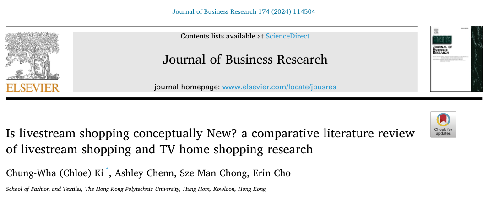
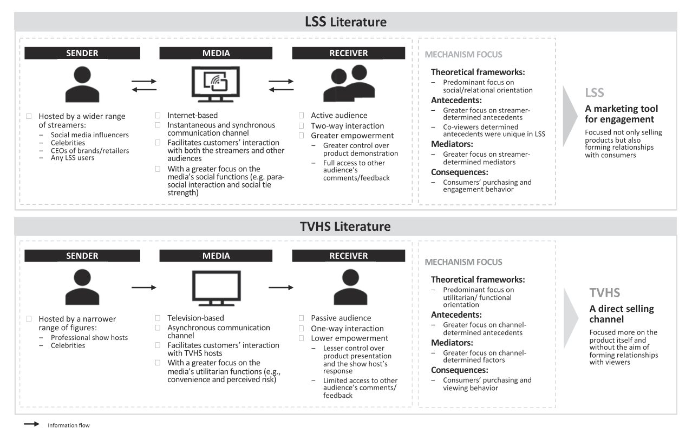
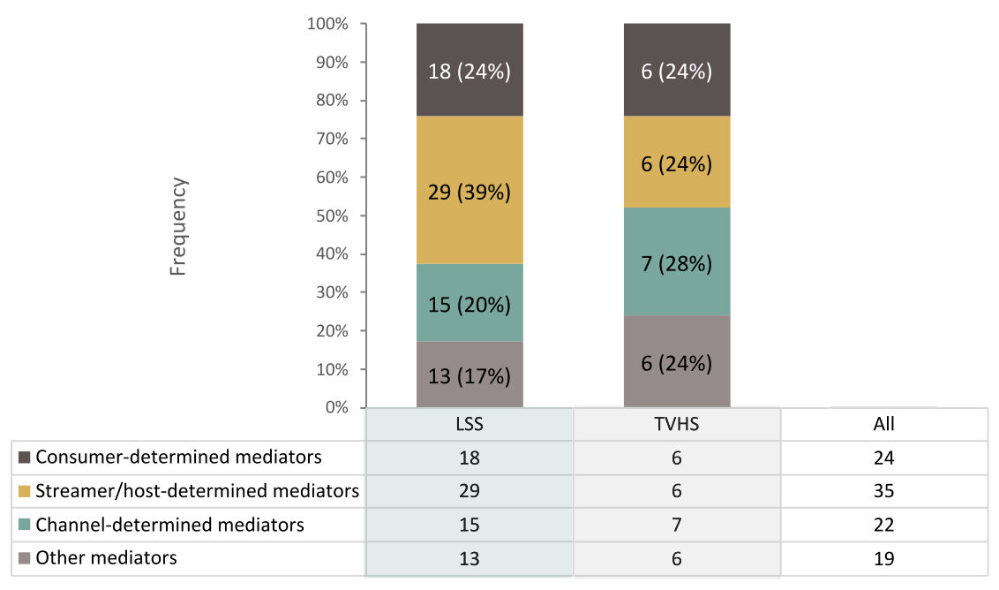

**表 1　论文基本信息**

| 项目 | 内容 |
|---|---|
| 原题 | Is livestream shopping conceptually new? A comparative literature review of livestream shopping and TV home shopping research |
| 作者 | Chung-Wha (Chloe) Ki, Ashley Chenn, Sze Man Chong, and Erin Cho |
| 发表 | Journal of Business Research, 174, 114504 (2024) |
| 在线发表 | 13 January 2024 |
| Keywords | Livestreaming, Livestream shopping, Live streaming commerce, Live commerce, Influencers in livestream and TV home shopping |
| DOI | [10.1016/j.jbusres.2024.114504](https://doi.org/10.1016/j.jbusres.2024.114504) |

**图 1　Elsevier 出版版论文首页（刊头、题名及作者）**

## 一、研究现象：如果两种购物形式都用视频卖货，差别从哪里产生？

一位主持人在镜头前介绍毛衣的面料和尺码，消费者在家观看并决定是否下单。这个场景既适用于电视居家购物（TV Home Shopping，TVHS），也适用于直播购物（Livestream Shopping，LSS）。两者共享视频展示、主持人讲解和远程购买等基本环节。仅从这些环节看，直播购物很像电视购物的互联网版本。

差别出现在观众想进一步了解商品的时候。电视购物的观众通常跟随既定节目观看，部分节目允许电话或短信反馈，由主持人选择回应哪些问题。在直播间，观众可以在演示过程中询问尺码，请主播换个角度，也能看到同场观众的留言和回答。于是，商品信息既来自主播原本准备的展示，也来自当场的问答和反馈。观看者是否能够参与信息生成，以及其他观看者是否能够影响这种过程，是论文判断两种购物形式能否用同一套机制解释的出发点。

## 二、研究问题：直播购物是否构成独立的研究对象？

论文把“直播购物在概念上是否新颖”拆成三个相互衔接的问题。首先，两种渠道的定义和功能有哪些共同点，信息由谁发出、谁能反馈？其次，既有研究分别采用哪些理论，以及把哪些变量放在前因（Antecedents）、中介（Mediators）、调节变量（Moderators）和结果（Consequences）的位置？最后，这些对照能否说明直播购物需要一套独立的解释框架？

作者将系统性文献综述（Systematic Literature Review）分成两个平行的子研究。研究一刻画 42 篇直播购物论文，研究二刻画 29 篇电视居家购物论文。两组研究接受同一套比较维度的整理，再用整合框架解释其相似与差异。这里的分析单位是已发表的研究及其变量，而非同一批观众完成两种购物任务的记录。

## 三、科学问题与设计原理

**表 2　概念比较的三个层次**

| 科学问题 | 比较对象 | 如何用来判断概念差异 |
|---|---|---|
| 沟通结构有何变化？ | 发送者、媒介、接收者，以及信息的流向 | 检查观众能否即时回应、是否能接触同场观众的反馈 |
| 消费者反应怎样形成？ | 理论取向、前因、中介和调节变量 | 比较研究更常从主播与观众的关系出发，还是从渠道功能出发 |
| 研究试图解释什么结果？ | 购买、满意、忠诚、参与、分享等 | 判断交易之外的参与和关系结果是否成为研究对象 |

这三个层次由沟通条件逐步推到行为解释。媒介改变谁能够提供和接收反馈，反馈结构影响人际关系与渠道评价如何形成，进而改变研究者用什么变量解释交易与参与。即便两组论文都研究信任（Trust），也需要区分消费者信任的是主播、商品还是购物渠道，才能判断它们是否在研究相同过程。

## 四、研究方法与整合框架速览

### 4.1 两组文献如何用同一流程筛选？

**图 2　Overview of our systematic review procedure.**

图 2 沿用系统综述程序与依据（Scientific Procedures and Rationales for Systematic Literature Reviews，SPAR-4-SLR），由上至下分为三个阶段。

1. **汇集（Assembling）**。作者在 Scopus 和 Web of Science 搜索与直播购物或电视购物有关的标题、摘要和关键词，去重后得到 231 篇。Google Scholar 补充 165 篇，合计 396 篇。时间范围为 1990 年至 2022 年 7 月，涵盖待刊论文。范围限定在 CABS 或 ABDC 名录所列期刊的英文同行评审论文，关注购物情境中的消费者行为。
2. **整理（Arranging）**。统一提取理论、前因、中介、调节和结果，同时登记出版年份、方法、地域和平台。团队排除 324 篇主题不符合的文章，并排除一篇综述以避免重复计数，最后纳入 71 篇。
3. **评估（Assessing）**。通过内容分析（Content Analysis）归纳两组理论及变量，再综合它们在哪些问题上相似、在哪些问题上有不同侧重。论文另外统计所用方法和市场背景，帮助读者理解这些结论来自什么研究情境。

### 4.2 怎样读懂发送者、媒介与接收者的整合框架？

**图 3　An integrative framework: Comparison of LSS and TVHS literatures.**

图 3 从左向右依次展示发送者（Sender）、媒介（Media）、接收者（Receiver）和研究机制。上半部分的箭头可以双向阅读。主播把商品信息传给观众，观众也可以即时提问，其他观众能看到相关反馈。主播既可能是网红、名人或公司高管，也可能是普通平台用户。观众因此可以参与塑造展示内容，例如要求主播解释自己最在意的细节。右侧将这种结构概括为以参与和关系形成为重心的营销工具（Marketing Tool for Engagement）。

下半部分的箭头主要从主持人指向观众。电视购物节目由专业主持人或名人展示商品，节目提供有用信息并便利购买。部分观众可通过电话等方式反馈，但节目团队决定哪些反馈进入播出，其他观众接触实时反馈的机会也更有限。右侧由此将电视居家购物归纳为以商品和交易为重心的直销渠道（Direct Selling Channel）。

图中的箭头表示信息流向。它们帮助读者理解两种渠道为什么会形成不同的研究重心，相关机制的证据仍来自下文所汇总的原始研究。

## 五、比较结果

### 5.1 共同基础：视频介绍、信息价值和购买结果

两组文献都重视产品展示和远程购买，也都研究实用价值（Utilitarian Value）、便利性（Convenience）和享乐价值（Hedonic Value）。在理论层面，精细加工可能性模型（Elaboration Likelihood Model）与媒介丰富度理论（Media Richness Theory）出现在两组文献中。购买意向、购买行为、冲动消费、满意度和忠诚度也有重叠。这些共同点解释了为什么电视居家购物可以为直播购物研究提供有意义的参照。

### 5.2 前因：直播研究更关注主播与同场观众

**图 4　Antecedents in the LSS versus TVHS literatures.**

每根柱的颜色表示一类前因，括号外的数字是该类前因的编码频数，括号内是其在本组所有前因中的比例。直播购物文献中，主播相关前因占 54%（68/126），是最大类别，例如主播的吸引力、专业知识或互动质量。电视居家购物文献中，渠道相关前因占 38%（19/50），是最大类别，例如信息丰富程度、支付便利性和实用价值。同场观众（Co-viewers）相关前因在直播文献中有 9 项，在纳入的电视购物文献中没有这一类编码。

### 5.3 中介：同样是信任，信任对象可能不同

**图 5　Mediators in the LSS versus TVHS literatures.**

直播购物文献中，主播相关中介占 39%（29/75），例如主播信任、拟社会互动（Parasocial Interaction）、快速关系（Swift Guanxi）和关系强度（Tie Strength）。电视居家购物文献中，渠道相关中介占 28%（7/25），例如对电视购物的依赖、便利性与感知风险（Perceived Risk）。其余三类各占 24%，所以渠道类是该组最大类别，比例只比其它类别高 4 个百分点。

如果主播的即时回复通过主播信任关联到购买，那么信任描述的是消费者如何评价一个人。如果商品信息充分、支付方便通过渠道信任关联到购物态度，那么信任描述的是消费者如何评价一种交易环境。将两者放在同一“信任”标签下可能掩盖这一区别。

### 5.4 理论、调节和结果：从渠道功能延伸到社交关系

**表 3　两组文献的主要比较结果**

| 维度 | 直播购物文献 | 电视居家购物文献 |
|---|---|---|
| 理论取向 | 混合取向（Mixed Orientation）是最大编码类别。常见框架为刺激–机体–反应及可供性理论，也常从依恋、社会交换和拟社会互动解释关系形成 | 使用理论的研究更常取媒介取向（Media Orientation），例如媒介依赖与媒介丰富度。29 篇中有 19 篇未明确使用理论 |
| 机制侧重 | 主播的互动方式、主播信任、同场观众反馈与关系建立 | 商品信息的传递、便利性、支付、渠道依赖与感知风险 |
| 调节因素举例 | 平台类型、节目热度、观看时长或会员资历 | 性别、文化、孤独感等消费者特征 |
| 结果侧重 | 购买、满意度、忠诚，同时重视参与、分享、黏性与赠送虚拟礼物意愿 | 购买、满意度、忠诚，同时关注节目观看与购买频次 |

作者据此认为直播购物具有概念上的新颖性。它延续了视频展示和直接销售，同时将同步、多方可见的交流嵌入购物过程，让主播和同场观众之间的关系进入解释框架。在所纳入的文献中，直播购物的机制主要从社交和关系过程得到解释，电视居家购物则更常从渠道本身的功能得到解释。

## 六、进阶解析

### 6.1 如何读文献频数与理论比例？

综述中的 42 和 29 是论文篇数。图 4 的 126 和 50 是从对应文献提取的前因编码总数，图 5 的 75 和 25 是中介编码总数。一篇论文可以同时使用主播吸引力、同步性和感知价值，也可能测试多个中介。因此，“54% 的直播前因与主播有关”描述的是**编码中的构成**。若要读作论文比例，就必须以每类包含该变量的论文篇数重新统计。

类似的单位差异也出现在理论结果。42 篇直播购物研究使用了 29 种不同理论，刺激–机体–反应框架（Stimulus–Organism–Response，S–O–R）被使用 7 次。混合取向占作者所编码理论应用的 44.2%，社会取向（Social Orientation）占 21.2%。混合框架可以同时纳入技术、主播与消费者变量，因此混合取向是最大的理论类别，与综合判断强调社交及关系机制并不冲突。综述频数描述研究把注意力放在哪里，不能直接用来比较哪一类变量产生的效应更大。

### 6.2 用前因、中介、调节和结果拆开一条解释链

以直播中的互动质量（Interaction Quality）为例。主播是否及时回应或能否针对观众的问题给出有效答复，是研究中的前因。互动可以促进快速关系，即在短时间里形成的相互理解与关系融洽，进而联系到购买意向（Purchase Intention）。在这样的模型里，快速关系是中介，承担的是解释“互动怎样转化成购买意向”的角色。

调节变量回答条件问题。例如纳入的研究考察房间热度和会员资历是否改变互动与关系强度的联系。这里的购买意向、参与或分享是结果。对照电视购物时，可以采用同样的分析句法。电视节目传递信息的丰富度或支付便利性是前因，渠道信任或态度可解释它们如何联系到后续采用意向。这样读，两组文献使用相同的分析角色，却把不同对象和过程放入这些角色。

### 6.3 如何理解互动技术与消费者赋权之间的关系？

技术可供性（Technological Affordance）是媒介提供的行动可能性，例如观众可以提问、看到他人的反馈或要求主播补充展示。消费者赋权（Consumer Empowerment）关心的是消费者能否实际获得对信息和购物体验的控制。二者可以连成一条待检验的链条。互动功能提供行动机会，主播是否回应、其他反馈是否可见会影响消费者能否取得所需信息，消费者随后才可能形成更强的控制感并改变参与或购买行为。

这一拆解解释了作者为什么把消费者赋权列为后续研究主题。它可以作为一个独立变量测量，用来判断直播间提供的交互能力何时真正变成消费者的选择权。

### 6.4 综述提出了哪些可进一步检验的问题？

**表 4　作者提出的直播购物研究方向**

| 方向 | 可以具体检验什么 |
|---|---|
| 细分直播购物机制 | 比较不同平台、主播权威来源、直播内容形式和商品类别如何改变参与与购买的形成过程 |
| 验证消费者赋权 | 检验消费者感受到的自主性与控制是否连接互动功能和后续参与、购买 |
| 使用客观交易数据与新方法 | 将实际销售和观看行为结合，或用图像与视频分析识别与参与有关的画面特征 |
| 开展跨文化研究（Cross-cultural Research） | 在不同语言和市场环境中比较观众对主播、互动和交易的反应 |
| 研究监管与消费者保护 | 检验商业披露、规则治理与消费者保护措施如何影响信任和购物行为 |

这些方向以综述识别出的机制为起点。它们把直播购物的概念特点落实为可观察的问题，例如记录谁提出问题、是否得到回应、消费者能否获取额外信息，以及这些变化如何联系到实际交易。

## 参考文献

Ki, C.-W. (C.), Chenn, A., Chong, S. M., & Cho, E. (2024). Is livestream shopping conceptually new? A comparative literature review of livestream shopping and TV home shopping research. *Journal of Business Research, 174*, 114504. [https://doi.org/10.1016/j.jbusres.2024.114504](https://doi.org/10.1016/j.jbusres.2024.114504)
