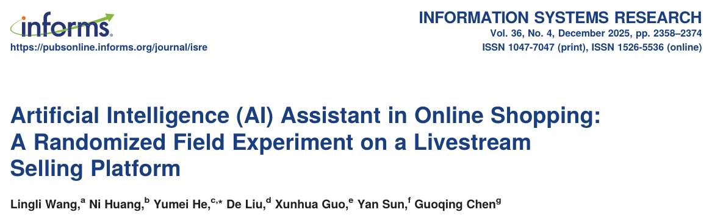
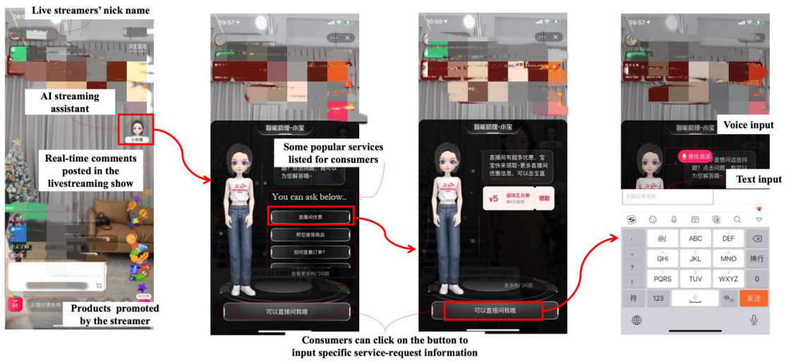
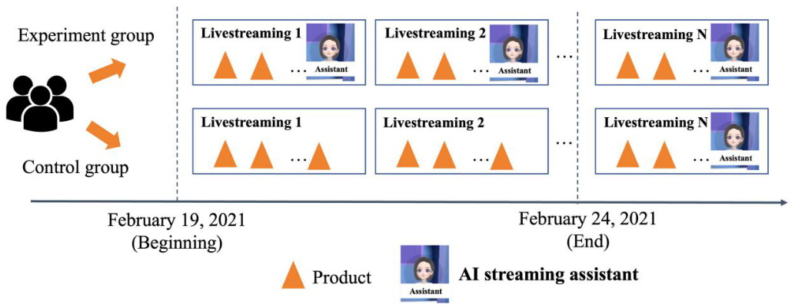
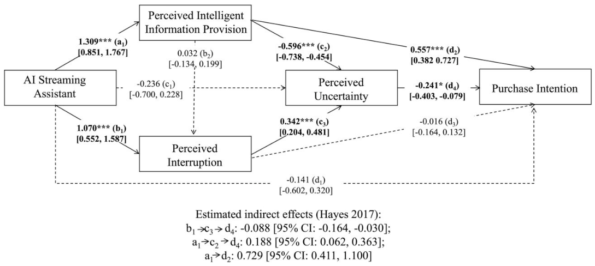

**表 1　论文基本信息**

| 项目 | 内容 |
|---|---|
| 原题 | Artificial intelligence (AI) assistant in online shopping: A randomized field experiment on a livestream selling platform |
| 作者 | Lingli Wang, Ni Huang, Yumei He, De Liu, Xunhua Guo, Yan Sun, and Guoqing Cheng |
| 发表 | Information Systems Research, 36(4), 2358–2374 (2025) |
| 在线发表 | 10 March 2025 |
| DOI | [10.1287/isre.2023.0103](https://doi.org/10.1287/isre.2023.0103) |

**图 1　INFORMS 出版版论文首页（刊头、题名和作者）**

## 一、研究背景：直播电商中的个性化服务约束

直播电商（Livestream Selling）允许主播面向大量消费者同步展示商品，但其个别答疑能力受时间与注意力约束。以服装直播为例，主播通常优先介绍面料、版型和优惠等共性信息，而尺码适配与退换条件可能因消费者需求而异。当直播中的答复不够及时，消费者需要在评论区、商品详情页与售后政策之间自行查找并整合信息。信息获取成本由此上升，也可能使消费者在尚未确认商品是否适用时作出购买决策。

人工智能直播助手（AI Streaming Assistant）通过整合商品、优惠和售后信息，提供个性化答疑。其理论作用具有双重性：及时的信息供给可降低决策不确定性，而界面提示与私聊可能转移消费者对主播讲解的注意力。论文据此考察个性化服务带来的信息收益和观看干扰，以及二者对实际交易结果的综合影响。

## 二、研究目标与核心结论

本文首先评估平台开放 AI 直播助手对消费者行为的影响。作者分别考察购前的商品点击与加购、购买阶段的下单次数与消费支出，以及购后的退货率。这一设置使研究能够识别哪些行为指标随助手可用性而变化，并考察订单增长与退货率下降是否同时出现。

**核心结论是，开放助手使下单次数增加约 3.00%，而点击与加购未出现统计显著变化。** 在已下单样本中，平均退货率从 **4.015% 降至 3.511%**，绝对下降 **0.504 个百分点**，相对下降 **12.55%**。因此，论文观察到的主要变化是订单增加，并伴随已购商品退货比例降低。

独立的在线实验为现场结果提供机制证据。接触 AI 服务场景的参与者报告了更充分的信息供给和更强的感知干扰，购买意向与决策信心也总体较高。序列中介结果表明，信息供给的正向路径强于干扰经不确定性产生的负向路径。对于主动式与响应式互动，论文利用平台日志评估其与购买和退货的相关性。

## 三、科学问题与理论推导

**表 2　理论路径与假设**

| 理论路径 | 决策机制 | 研究假设 |
|---|---|---|
| 智能信息供给（Intelligent Information Provision） | 快速提供与个人问题相关的信息，降低对商品质量或适配性的决策不确定性（Decision Uncertainty） | H1a：开放助手后下单增加 |
| 干扰（Interruption） | 提示和私聊可能打断专注观看的心流体验（Flow Experience），使观众漏掉主播的关键信息 | H1b：开放助手后下单减少 |
| 购前判断改善 | 消费者在下单前更容易检查商品是否适合自己，购买后的不匹配可能减少 | H2：开放助手后退货率降低 |

H1a 与 H1b 是关于下单次数的竞争性假设，分别对应信息供给和观看干扰。现场订单的组间差异反映两种作用并存时的净结果。H2 则关注购后决策，检验已购商品的退回比例是否下降。在线实验中的购买意向与平台记录的退货行为属于不同的结果变量，分别用于探索心理机制与评估购后表现。

## 四、研究设计

### 4.1 研究问题与实证设计的对应关系

**现场随机实验用于估计开放助手的总体效果。** 消费者是否实际使用助手可能与既有购买意愿和咨询需求有关。作者在功能使用之前随机分配访问权限，并按原分配比较结果。处理组包含未实际使用助手的消费者，因此该比较对应平台开放功能的政策问题。

**在线实验用于检验潜在的决策机制。** 现场日志记录行为结果，在线实验则通过随机分配直播视频条件，并对信息供给、干扰、不确定性和购买意向进行测量，补充消费者层面的感知证据。序列中介分析（Sequential Mediation Analysis）用于考察这些感知变量之间的关系是否符合理论预期。

**分组与日志分析用于考察情境差异和交互模式。** 商品历史信息和主播服务压力构成两类理论上的边界条件，分别通过商品新旧与主播人气进行考察。主动提示与用户自行发起咨询则由实际使用日志识别，其结果反映交互模式与购物行为的统计关联。

### 4.2 AI 直播助手的功能与交互方式

**图 2　AI 直播助手的用户界面**

图 2 展示助手入口、常用服务与交互界面。直播画面和评论区保留在原界面，消费者可通过助手图标进入一对一会话。系统提供优惠、商品推荐和订单查询等服务，也接受文字与语音输入。助手通过语音识别与自然语言处理整合商品详情、退换政策和直播优惠等来源的信息。

论文依据服务发起方区分两种互动。**主动式互动（Proactive Interaction）**指助手识别公开评论中的服务需求并发出提示，消费者随后可进入会话。**响应式互动（Reactive Interaction）**指消费者自行打开助手，系统再按需提供服务。两种命名均以 AI 的行为为参照。

### 4.3 现场实验的分配单位与样本构成

**图 3　现场随机实验设计**

实验以**消费者**为随机分配单位。合作平台依据账户 ID 的后两位分配组别，00–49 为处理组，50–99 为对照组。处理组可见助手并可接收提示、发起会话，对照组在实验期间无法访问助手。同一消费者跨直播间观看时维持原分组。图 3 两条虚线之间为现场实验的比较窗口。

现场实验于 2021 年 2 月 19 至 24 日实施，论文将其描述为持续五天。平台报告超过 1,000 万名消费者参与。由于数据共享安排，研究者分析平台随机抽取的约 1% 样本，共 **132,199 人**，其中处理组 **65,902 人**，对照组 **66,297 人**。这些用户在实验期间至少参与过一次直播。平台默认对处理组启用助手。极少数主播关闭助手的相关数据未进入分析。

作者在消费者、主播及直播场次三个层面开展平衡检验（Balance Checks），比较既往消费行为、账户特征及两组接触到的主播和直播场次特征。论文报告所检验的可观测特征均未出现统计显著的组间差异，这为实际分析样本的可比性提供了支持。

### 4.4 结果变量的测量与估计样本

各指标分别对应商品浏览、购买考虑、订单生成、消费规模及购后退回。下单次数反映交易频率，支出反映消费规模，退货率反映购入商品中被退回的比例。分阶段测量可以区分助手主要改变的结果，并将购买行为与购后表现纳入同一研究框架。

**表 3　现场实验结果的测量与分析样本**

| 结果变量 | 操作化定义 | 分母或估计样本 |
|---|---|---|
| 点击、加购与下单 | 分别累计每位消费者实验期间对直播商品的点击、加购与下单次数 | 132,199 名消费者，包含没有发生相应行为的人 |
| 消费支出 | 将每笔购买的商品价格除以实验期直播商品的最高价格，再按消费者加总 | 132,199 名消费者，结果在统一的归一化尺度上比较 |
| 退货率 | 计算每位消费者从实验期购入商品中退回的比例 | 35,164 名已下单消费者，只有购买之后才有退货分母 |

由于点击、加购和下单次数包含大量零值，作者采用零膨胀泊松模型估计处理组与对照组的差异。退货率的分母是已购商品数量，因此退货模型只包含已下单者。下单本身可能受处理影响，作者据此检验购买者样本的可观测特征平衡，并使用粗化精确匹配（Coarsened Exact Matching，CEM）与两阶段选择模型检验估计的稳健性。

### 4.5 在线实验的处理条件与机制测量

为测量现场行为日志无法直接反映的心理过程，作者从中国高校招募参与者，请他们回顾过去一年的直播购物经历，并根据视频代入假设购物情境。参与者随机观看普通直播销售视频或含 AI 助手互动及信息服务的销售视频。168 人完成实验，排除 18 名未通过注意力检查者后，分析样本为 150 人。

观看结束后，参与者以七点评分量表评价**感知信息供给、感知干扰、感知不确定性、购买意向和决策信心**。作者先比较组间平均评分，再检验信息供给与干扰是否分别通过不确定性联系到购买意向。随机化适用于视频处理条件，中介变量是在观看后测得。中介结果因此构成对理论机制的支持性证据，现场交易结果仍由平台实验估计。

### 4.6 情境异质性与交互模式分析

商品层面的异质性分析以实验前无销售记录的新商品作为高不确定性的代理，检验信息补充在既有商品信息较少时是否更有价值。主播层面的分析以实验前的粉丝规模划分人气，检验助手在个别答疑需求较大的情境中是否具有更明显的作用。两项分析分别报告相应情境下的点击、购买、支出及退货结果。

交互模式根据实验日志编码。消费者至少一次因公开评论触发 AI 提示，记为发生主动式互动。至少一次自行打开助手，记为发生响应式互动。两项指标可同时取值为 1，模型据此设置交互项，并单独区分获得权限但未互动者。对照组为回归参照。交互模式的选择发生在处理分配之后，因此相关系数主要用于刻画实际使用行为。

## 五、研究结果

### 5.1 现场实验的主要估计结果

**表 4　AI 助手访问权限的主要现场结果**

| 结果变量 | 模型与处理系数 | 估计结果 |
|---|---|---|
| 商品点击次数 | 零膨胀泊松，0.0081 | 组间差异未达显著 |
| 加购次数 | 零膨胀泊松，0.0052 | 组间差异未达显著 |
| 下单次数 | 零膨胀泊松，0.030，$p<0.05$ | 论文报告相对增加约 3.00% |
| 消费支出 | 普通最小二乘，0.00023，按结果表 $p<0.05$ | 论文按归一化支出的比较基准报告相对增加 10.95% |
| 退货率 | 已下单样本的 GLM，−0.139，$p<0.05$ | 处理组均值 3.511%，对照组 4.015%，相对下降 12.55% |

主分析在消费者层面估计各项行为。归一化支出用于比较两组支出在相同尺度上的差异。下单次数显著增加，而点击与加购未出现显著差异，说明结果集中体现在下单指标。各指标分别建模，具体的阶段转化还需结合同一消费者在购物流程中的状态转换分析。

退货分析以 **35,164 名已下单消费者**为主样本。处理组与对照组的均值相差 **0.504 个百分点**，相对于对照组下降 **12.55%**。匹配分析及两阶段选择模型得到方向一致的结果。

### 5.2 在线实验的机制检验

**图 4　AI 直播助手影响购买意向的序列中介效应**

图 4 从左至右依次呈现视频处理条件、中介变量及购买意向。上方路径显示，AI 服务场景提高感知信息供给，后者与较低的不确定性及较高的购买意向相关。下方路径显示，AI 服务场景也提高感知干扰，干扰经由较高的不确定性与较低的购买意向相关。

作者通过 5,000 次自助抽样（Bootstrap）估计间接效应（Indirect Effect）。经过“信息供给 → 不确定性”的序列间接效应为 **0.188**，经过“干扰 → 不确定性”的序列间接效应为 **−0.088**。仅经信息供给传递至购买意向的间接效应为 **0.729**。处理组购买意向均值为 5.270，对照组为 4.547。上述估计用于解释在线实验中的购买意向，现场订单增量的具体构成仍需独立识别。

### 5.3 分组结果与交互模式的行为关联

作者以无既往销售记录的新商品作为高商品不确定性（Product Uncertainty）的代理，并按实验前粉丝数中位数划分主播人气（Streamer Popularity）。新商品与高人气主播子样本的下单和退货结果较为突出。这与信息补充和服务能力的理论解释一致。判断不同组别之间是否存在显著差异，仍需直接检验组间系数之差。

在实际互动记录中，论文报告主动式互动占 74.66%，响应式互动占 25.34%。两类互动均与下单次数正相关。两者的交互项在下单模型中为正，在退货模型中为负。由于实际触发或发起互动与消费者自身行为有关，这些估计应按相关性解释。

## 六、进阶解析

### 6.1 访问权限的处理效应及其估计

设 $T_i$ 表示消费者 $i$ 对助手的访问权限。作者用下面的基本式说明实验比较，其中 $Y_i$ 代表某项行为结果。

$$
Y_i=\beta_0+\beta_1T_i+\varepsilon_i.
\tag{1}
$$

在线性规格中，$\beta_1$ 比较有权限组与无权限组的平均结果。对点击、加购和下单这些计数，零值较多，主结果采用零膨胀泊松模型（Zero-inflated Poisson Model）。它允许一部分零来自额外的零生成过程，其余来自可能产生非零计数的泊松过程。下单模型的 0.030 处于对数计数尺度，论文据指数换算报告约 3% 的相对增幅。这个结果衡量开放完整功能的效果，处理组中没有点开助手的人也仍然属于处理组。

### 6.2 退货率的效应口径与条件样本

论文用两组均值换算相对降幅。以对照组 4.015% 为基准，计算如下。

$$
\frac{3.511\%-4.015\%}{4.015\%}\times100\%\approx-12.55\%.
\tag{2}
$$

退货率按消费者计算。购买两件并退回一件，对应 50% 的退货率。未下单者的购入件数为零，因此无法定义该比例。分析样本由处理之后发生的下单行为确定，可能具有处理后的选择（Post-treatment Selection）。购买者平衡检验、粗化精确匹配和两阶段 Heckman probit 分析用于考察该问题下结果的稳健性。

### 6.3 主动式与响应式互动的交互项解释

设 $P_i$ 表示消费者是否至少一次触发 AI 主动提示，$R_i$ 表示是否至少一次主动点开助手，$N_i$ 表示可使用助手但两种互动都未发生。作者将对照组作为基准，并估计如下关系。

$$
Y_i=\gamma_0+\gamma_1P_i+\gamma_2R_i+\gamma_3(P_iR_i)+\gamma_4N_i+u_i.
\tag{3}
$$

当同一消费者经历两种互动，$P_iR_i=1$。$\gamma_3$ 衡量两种互动并存时，相对于两项单独关联之和的增量，解释依赖于模型所用尺度。访问权限由实验分配，互动模式则可能受到购物积极性和咨询需求的影响。该项估计可用于形成关于提示策略的后续检验假设。

## 参考文献

Wang, L., Huang, N., He, Y., Liu, D., Guo, X., Sun, Y., & Cheng, G. (2025). Artificial intelligence (AI) assistant in online shopping: A randomized field experiment on a livestream selling platform. *Information Systems Research, 36*(4), 2358–2374. [https://doi.org/10.1287/isre.2023.0103](https://doi.org/10.1287/isre.2023.0103)
