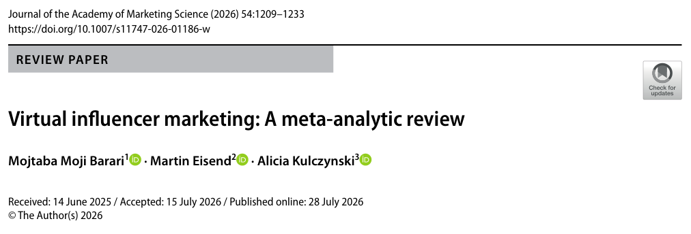
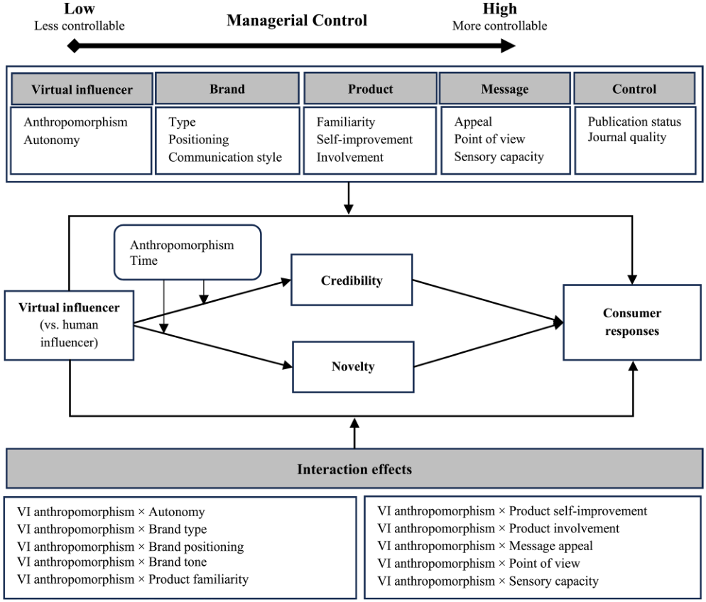
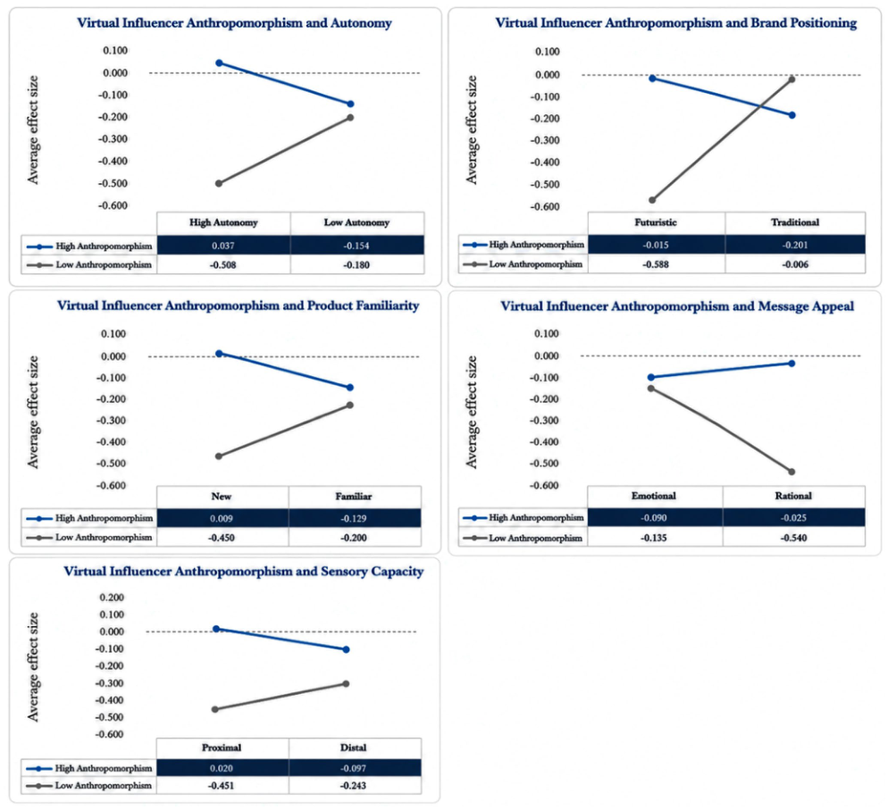

**表 1　论文基本信息**

| 项目 | 内容 |
|---|---|
| 原题 | Virtual influencer marketing: A meta-analytic review |
| 作者 | Mojtaba Moji Barari, Martin Eisend, and Alicia Kulczynski |
| 发表 | Journal of the Academy of Marketing Science, 54, 1209–1233 (2026) |
| 在线发表 | 28 July 2026 |
| 文章类型 | Review paper |
| Keywords | Influencer marketing, Virtual influencer, Anthropomorphism, Credibility, Novelty, Meta-analysis |
| DOI | [10.1007/s11747-026-01186-w](https://doi.org/10.1007/s11747-026-01186-w) |

**图 1　期刊出版版论文首页（刊名、题名及作者）**

## 一、研究现象：虚拟代言人能吸引注意，为什么未必更有说服力？

品牌可以邀请真人博主试用产品，也可以让虚拟影响者（Virtual Influencer）发布同样的推广内容。虚拟角色可能因为外观或身份出乎观众预期而显得新鲜。可当角色进一步声称某款口红很滋润、某种食品口感很好时，观众也会判断它能否提供可信的使用经验。同一种虚拟设计由此可能同时带来新颖性（Novelty）上的优势和可信度（Credibility）上的劣势。

虚拟影响者的拟人化（Anthropomorphism）程度也不同。有些角色外貌和行为接近真人，有些则明显采用卡通化设计。两者即使代言同一产品，也可能引导观众采用不同的评价依据。高度拟人化角色更容易让人联想到对真人代言人的要求，风格化角色则可能凭借独特形象吸引受众。因此，品牌真正面对的问题是：**虚拟代言与真人代言相比有什么优势、代价，以及这些差异会在什么组合下改变？**

## 二、研究问题：平均差异、适用情境与说服路径

1. **总体效果如何？** 在有真人影响者（Human Influencer）作对照的实验里，虚拟影响者在行为意向、互动参与、品牌与广告态度，以及可信度、吸引力和新颖性上分别表现如何？
2. **什么条件会改变相对效果？** 高、低拟人化的角色分别与哪些自主性设定、品牌定位、产品类型及信息诉求更契合？
3. **说服依靠什么？** 可信度与新颖性怎样经由态度或直接联系到消费者行为结果？这些路径在高低拟人化和早晚发表的研究之间如何变化？

这三个问题分别对应总体效应、调节效应（Moderation）与中介路径（Mediation）。例如，新颖性更高是总体对照结果。卡通化角色采用情感诉求时表现相对较好，是条件组合的结果。新颖性怎样进一步联系到态度和行为，则需要用路径模型单独回答。

## 三、科学问题与理论框架

**图 2　虚拟影响者营销概念框架。**

图 2 中间从左到右读。左侧是代言人类型的对照，比较虚拟影响者和真人影响者。中间是可信度与新颖性两条路径。可信度回答“这个代言人是否值得相信、是否有能力提供可靠判断”，新颖性回答“这种代言是否不同于平常所见”。右侧是消费者反应（Consumer Responses）。结构模型进一步把反应分为态度和行为结果，检验两条路径能否通过态度或直接联系到行为。

图上方罗列不同层级的背景条件。角色设定通常在选定合作对象后较难改变，信息措辞和感官线索则可以在制作素材时调整。发表状态和期刊质量是研究层面的控制变量。图下方列出拟人化与其他营销条件的交互。这里问的是同一种条件在两种角色设计中是否产生不同的相对效果。图中央的“拟人化、时间”则说明作者还对说服路径分组估计。

**表 2　理论推导与对应检验**

| 理论问题 | 预期机制 | 检验方式 |
|---|---|---|
| 平均意义上，虚拟身份带来哪些不同评价？ | 虚拟身份可能增强新鲜感，也可能使受众更难相信代言人具有真实体验 | 对七类消费者反应分别合并效应量 |
| 拟人化程度如何改变说服依据？ | H1 预期高度拟人化角色更依赖可信度，低拟人化角色更依赖新颖性 | 高、低拟人化分组的结构方程模型和路径差异检验 |
| 两条路径如何随研究时期变化？ | H2 预期随虚拟代言逐渐常见，新颖性路径减弱，可信度相对更重要 | 以 2022 年为界比较早期与近期发表研究 |
| 哪些传播条件与角色设计契合？ | 角色、品牌、产品及信息线索的搭配会改变虚拟代言的相对表现 | 在多层元回归中估计拟人化与各条件的交互项 |

## 四、研究方法速览

### 4.1 从实验文献到统一效应量

作者检索多类文献数据库与未发表研究，并追溯相关文献的参考书目。截至 2025 年底共找到 1,289 篇候选文献，筛选后纳入 110 篇论文、210 项独立实验、643 个效应量（Effect Sizes），消费者样本总量为 91,058。纳入研究提供虚拟代言与真人代言之间可计算的对照。同一项实验可能同时测量广告态度、购买意向与可信度，因此一项研究可以贡献多个效应量。

作者把效应统一为相关系数，并对结果变量的测量误差进行校正。读数时，可把正值理解为虚拟组在对应指标上高于真人组，负值理解为低于真人组。每类结果分别汇总，避免用一个平均值遮蔽“新颖感更高但行为意向更低”的组合。

### 4.2 三个分析模块各解决什么问题？

**表 3　分析模块与用途**

| 模块 | 分析输入 | 要回答的问题 |
|---|---|---|
| 分层效应量合并 | 虚拟与真人代言的实验对照效应 | 各类反应的平均差异是多少，研究间是否存在异质性（Heterogeneity）？ |
| 三层元回归（Three-level Meta-regression） | 效应量、营销条件、结果类型和研究属性 | 拟人化与哪些条件组合时，相对效果不同？ |
| 元分析结构方程模型（Meta-analytic Structural Equation Modeling，MASEM） | 各组跨研究汇总的相关矩阵 | 可信度、新颖性、态度与行为如何关联，哪些路径在组间不同？ |

调节变量由两名编码者独立编码，总体一致率为 91%。高自主性（High Autonomy）按实验材料中的呈现来编码，指角色被描述为借助 AI 自主生成内容或互动。低自主性指角色依赖人类操控与外部管理。感官线索（Sensory Cues）的近端（Proximal）指味觉、触觉等通常需要近距离或接触的经验，远端（Distal）指视觉、听觉等可以远距离获得的经验。这里的近端与远端是感官类型的区别。

## 五、研究结果

### 5.1 汇总效果：新颖性更高，可信度和多项说服结果较低

**表 4　虚拟影响者相对于真人影响者的平均效应**

| 消费者反应 | 效应量数 | 校正后加权相关系数 | 结果解读 |
|---|---:|---:|---|
| 行为意向（Behavioral Intention） | 199 | −0.130 | 真人组较高 |
| 互动参与（Engagement） | 81 | −0.052 | 正文报告差异未达显著 |
| 品牌态度（Brand Attitude） | 82 | −0.120 | 真人组较高 |
| 广告态度（Ad Attitude） | 51 | −0.192 | 真人组较高 |
| 可信度（Credibility） | 175 | −0.234 | 真人组较高 |
| 吸引力（Attractiveness） | 30 | −0.160 | 按论文正文及所列置信区间，差异未达显著 |
| 新颖性（Novelty） | 28 | 0.217 | 虚拟组较高 |

可信度的 95% 置信区间为 [−0.321, −0.146]，新颖性为 [0.060, 0.374]。两者方向相反，可以同时成立。行为意向包含实验测得的购买或推荐等意向，不能直接换算成真实成交差异。论文报告各结果的异质性检验均显著，因而进一步考察营销条件具有实际意义。

### 5.2 情境匹配：同一个传播条件对两种角色可能产生不同结果

**图 3　交互效应图。**

图 3 的蓝线代表高拟人化，灰线代表低拟人化。横轴是每个条件的两个取值，纵轴是虚拟组相对真人组的平均效应，虚线零点表示二者相当。斜率不同说明条件变化与两种角色的效果关系不同。读图时，某组数值向零靠近也属于相对表现改善，即使仍然低于零。

**表 5　拟人化与营销条件的交互结果**

| 条件对比 | 交互项估计 | $p$ 值 | 主要图示模式 |
|---|---:|---:|---|
| 高自主性 vs. 低自主性 | 0.320 | 0.036 | 高拟人化在高自主性下相对更有利，低拟人化在低自主性下更有利 |
| 未来导向品牌（Futuristic Brand）vs. 传统品牌 | 0.344 | 0.001 | 高拟人化更契合未来导向品牌，低拟人化在传统品牌下表现相对更好 |
| 新产品 vs. 熟悉产品 | 0.216 | 0.025 | 高拟人化与新产品组合的表现相对较好，低拟人化在熟悉产品上劣势较小 |
| 情感诉求（Emotional Appeal）vs. 理性诉求（Rational Appeal） | −0.426 | 0.039 | 低拟人化在情感诉求下相对更有利，高拟人化在两种诉求下差异较小 |
| 近端感官线索 vs. 远端感官线索 | 0.363 | 0.012 | 高拟人化与近端线索匹配较好，低拟人化与远端线索匹配较好 |

以品牌定位面板为例，高拟人化在未来导向品牌和传统品牌下分别为 −0.015 与 −0.201。低拟人化的相应数值为 −0.588 与 −0.006。两条线的变化方向不同。多变量元回归进一步控制其它编码变量，表 5 列的是该模型的交互系数。论文在品牌类型、品牌传播风格、产品是否用于自我提升、产品涉入程度及叙述视角上未发现显著交互。分结果类别的检验中，自主性、品牌定位与感官线索的交互在三类结果组均显著，诉求与产品新颖度的交互则随结果类别而异。

### 5.3 说服机制：两条路径的相对权重随拟人化和研究时期变化

**表 6　高低拟人化及早晚研究时期的代表性标准化路径**

| 路径 | 高拟人化 | 低拟人化 | 近期（2023 年起） | 早期（截至 2022 年） |
|---|---:|---:|---:|---:|
| 虚拟身份 → 可信度 | −0.088 | −0.215 | −0.115 | −0.250 |
| 虚拟身份 → 新颖性 | 0.205 | 0.580 | 0.197 | 0.581 |
| 可信度 → 态度 | 0.407 | 0.239 | 0.408 | 0.261 |
| 可信度 → 行为结果 | 0.227 | 0.214 | 0.238 | 0.209 |
| 新颖性 → 态度 | 0.228 | 0.407 | 0.228 | 0.396 |
| 新颖性 → 行为结果 | 0.106 | 0.307 | 0.109 | 0.258 |
| 态度 → 行为结果 | 0.409 | 0.307 | 0.408 | 0.304 |

**按拟人化看**，高拟人化组的可信度劣势较小，可信度与态度的联系更强。低拟人化组的新颖性优势较大，而且新颖性与态度、行为结果的路径都更强。**按研究时期看**，近期研究的新颖性优势小于早期研究，可信度劣势也较小，可信度与态度的关系更强。可信度到行为结果的直接路径在两种分组比较中均未显示显著差异。

作者将结果归纳为说服依据由新颖性相对转向可信度。研究时期按论文发表年份分组，比较的是两个时期汇总的实验关系。因此，这里的时间变化描述跨研究模式。H2 中的习惯化（Habituation）是解释这一模式的理论依据。

## 六、进阶解析

### 6.1 如何从多个实验估计平均效应？

设 $r_{ij}$ 为研究 $j$ 报告的第 $i$ 个效应量。平均效应模型可以写成

$$
r_{ij}=\gamma_{00}+u_{0j}+e_{ij}.
\tag{1}
$$

$\gamma_{00}$ 是同一结果类别的总体平均效应，$u_{0j}$ 表示研究 $j$ 的平均效应偏离总体均值的部分，$e_{ij}$ 表示研究内单个效应量的剩余差异。由于同一项实验的多个效应量共享样本和设计，模型让它们共享同一个研究层成分。论文使用信度校正的加权相关系数，进一步用 $Q$ 统计量检查观察到的差异是否超出抽样波动。

作者同时报告失安全数（Fail-safe N）、Egger 检验和漏斗图（Funnel Plot）。新颖性以外的结果在 Egger 检验中未显示显著不对称。另对可信度与品牌态度比较包含和排除异常效应量时的结论，最终保留这些观察。

### 6.2 元回归中的拟人化交互项怎么读？

元回归将效应量嵌套于研究，研究再嵌套于论文。它合并不同结果类型，通过结果类别变量区分它们，并将平均表现模式不同的新颖性排除在这一步之外。设 $A=1$ 表示高拟人化，$A=0$ 表示低拟人化，$X$ 表示其中一个二元条件。省略其余控制与随机项后，可写为

$$
\widehat r(A,X)=\beta_0+\beta_A A+\beta_X X+\beta_{AX}AX.
\tag{2}
$$

在低拟人化组，$X$ 从 0 变为 1 时，预测效果改变 $\beta_X$。在高拟人化组则改变 $\beta_X+\beta_{AX}$。因此，$\beta_{AX}$ 回答两组的条件差值相差多少。

以品牌定位为例，$X=1$ 表示未来导向。表中的 $\beta_X=-0.330$ 是低拟人化参照组在这一条件对照下的估计差异。加上交互项 $0.344$ 后，高拟人化组的估计差异为 $0.014$。这一计算采用多变量元回归的系数。图 3 用各条件下的平均效应说明线条如何变化。两者的共同信息是：从传统品牌切换到未来导向品牌时，低拟人化的相对效果下降更明显。

### 6.3 MASEM 如何把可信度、新颖性、态度与行为连起来？

作者从各实验取得或换算变量间相关系数，按拟人化和时期分别组成汇总相关矩阵（Pooled Correlation Matrix），再估计多组结构方程模型（Multi-group Structural Equation Modeling）。态度合并品牌与广告态度，行为结果合并行为意向与互动参与。记 $V$ 为虚拟身份对照，$C$ 为可信度，$N$ 为新颖性，$T$ 为态度，$B$ 为行为结果。用路径系数简写论文的七条连线如下。

$$
\begin{aligned}
C&=a_C V+\varepsilon_C,\qquad N=a_N V+\varepsilon_N,\\
T&=b_C C+b_N N+\varepsilon_T,\\
B&=d_C C+d_N N+gT+\varepsilon_B.
\end{aligned}
\tag{3}
$$

式（3）将两类影响分开。$a_C$ 与 $a_N$ 表示虚拟身份改变评价的方向与幅度。$b_C$ 与 $b_N$ 表示两类评价如何联系到态度。$d_C$、$d_N$ 和 $g$ 表示评价及态度到行为结果的路径。按线性路径追踪，同一机制可以直接联系到行为，也可以先经由态度。

$$
IE_C=a_Cd_C+a_Cb_Cg,\qquad IE_N=a_Nd_N+a_Nb_Ng.
\tag{4}
$$

例如在高拟人化组，$V\to C\to T$ 的系数乘积约为 $(-0.088)\times0.407=-0.036$。尽管可信度与态度是正向关系，虚拟身份到可信度的第一段是负向，因此这个间接贡献也为负。低拟人化组的 $V\to N\to T$ 约为 $0.580\times0.407=0.236$，方向为正。式（4）用于说明如何顺着路径理解符号和贡献，组间统计检验应按论文报告的检验对象解读。

### 6.4 组间检验和时期分组提供什么信息？

沃尔德检验（Wald Test）比较同一条路径在两组中的系数是否存在统计差异。高低拟人化的“虚拟身份 → 可信度”路径差异 $p=0.025$，“虚拟身份 → 新颖性”路径差异 $p=0.001$。近期与早期比较中，对应两个 $p$ 值分别为 0.015、0.001。这些检验针对特定路径的组间差异。从两条路径的方向、幅度及其与态度和行为的后续联系，才可形成关于双路径的完整解释。

## 参考文献

Barari, M. M., Eisend, M., & Kulczynski, A. (2026). Virtual influencer marketing: A meta-analytic review. *Journal of the Academy of Marketing Science, 54*, 1209–1233. [https://doi.org/10.1007/s11747-026-01186-w](https://doi.org/10.1007/s11747-026-01186-w)
