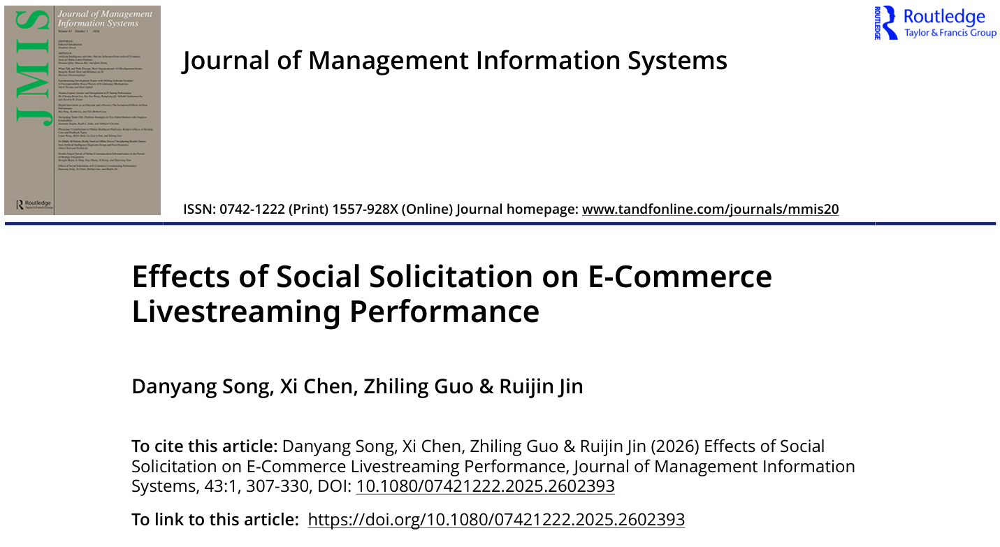
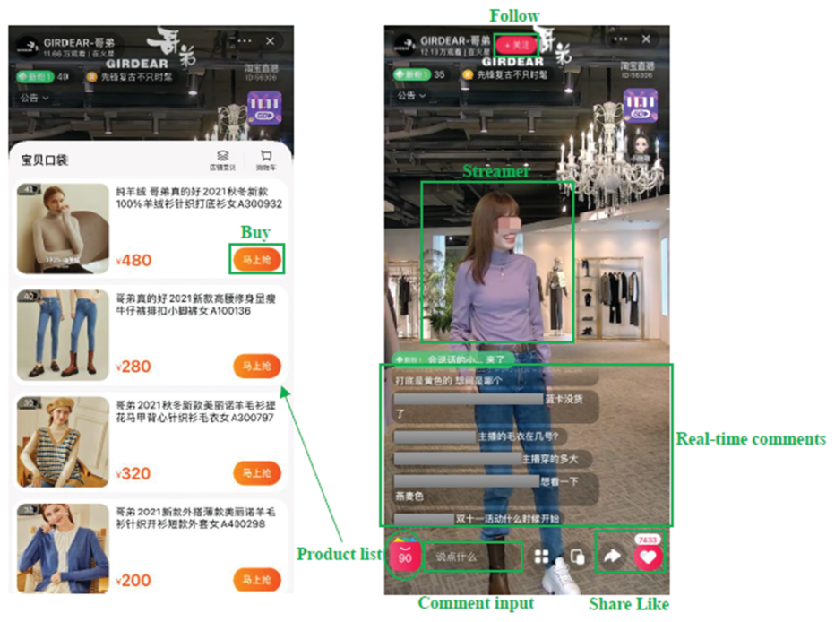

**表 1　论文基本信息**

| 项目 | 内容 |
|---|---|
| 原题 | Effects of social solicitation on e-commerce livestreaming performance |
| 作者 | Danyang Song, Xi Chen, Zhiling Guo, and Ruijin Jin |
| 发表 | Journal of Management Information Systems, 43(1), 307–330 (2026) |
| 在线发表 | 28 February 2026 |
| Keywords | Social commerce, ecommerce livestreaming, social engagement, social solicitation, social exchange, spillover effect |
| DOI | [10.1080/07421222.2025.2602393](https://doi.org/10.1080/07421222.2025.2602393) |

**图 1　Taylor & Francis 出版版论文封面（刊名、题名及作者）**

## 一、研究现象：主播请观众点关注，为何可能影响眼前的成交？

在电商直播（E-commerce Livestreaming）中，主播同时追求两种结果。一种是当场卖出商品，另一种是把当前观众转化为未来可以持续触达的关注者。在讲解服装材质、尺码或上身效果的过程中，主播常穿插“点个关注”“帮忙点赞”“有问题打在评论区”等请求。论文把主播主动要求观众关注、点赞、评论或分享的行为称为**社交请求（Social Solicitation）**。

社交请求和商品讲解共用同一段观看时间，也面对同一群观众。观众可以因为觉得讲解有帮助而愿意关注，同时觉得频繁的互动要求打断了购物过程。于是，一个原本为增粉服务的动作，也可能改变观众是否下单。研究将这种对另一目标产生的影响称为**溢出效应（Spillover Effect）**。

**图 2　正在进行中的电商直播画面截图。**

图 2 左侧是商品列表和购买入口，右侧是主播展示、实时评论、评论输入、分享和点赞入口。观众在同一个页面里就能看商品、问问题、互动和下单。因此，购物与社交可以同时发生。图中的评论或点赞也是**观众已经做出的行为**，而论文的核心解释变量来自**主播有没有开口请求这些行为**。区分请求与回应，才能判断研究是在分析主播的选择，还是观众的反应。

## 二、研究问题：同一句社交请求对增粉和销量的关系是否一致？

论文把直播绩效（Livestreaming Performance）拆成社会资本增长（Social Capital Growth）和销售绩效（Sales Performance）。前者用新增关注者衡量，后者用售出件数衡量。在这两个结果下，作者提出三个相互衔接的问题。

1. **对直接目标有什么关系？** 发出更多社交请求，随后会有更多人关注，还是会因观众抵触而减少关注？
2. **对另一目标有什么关系？** 面向关注、点赞、评论或分享的请求，是否会影响随后售出的商品数量？
3. **哪些情境会改变这种关系？** 主播同时提供更多产品特征信息、发出更多购买请求，或将社交请求换成更贴近购物过程的评论请求时，销售关联是否不同？

研究关注的是同一场直播内相邻时段的变化。它将每场直播切分成三分钟窗口，用上一窗口的主播话语与互动特征解释下一窗口出现的新增关注和销量。

## 三、科学问题与理论推导

### 3.1 同一个请求为什么可能同时引发互惠与抗拒？

社会交换理论（Social Exchange Theory）强调互惠（Reciprocity）。主播提供讲解、试穿演示或答疑，观众可以通过关注、点赞或评论作出回馈。把回馈方式明确说出来，可能更容易让观众采取相应行动。

心理抗拒理论（Psychological Reactance Theory）强调自主性。观众原本想比较款式、尺码或价格，如果主播要求执行一项与判断商品关系不大的动作，观众可能觉得观看节奏或选择受到干扰。由此产生的抗拒既可能表现为拒绝关注，也可能溢出到购买决策。

两种机制可以同时成立。关注是一项对主播明确请求的回馈，购买则涉及另一项独立的交易判断。即使互惠在增粉上占优势，购物过程中感受到的额外要求仍可能对应较低销量。

**表 2　理论机制与可检验预测**

| 编号或分析 | 理论逻辑 | 预期关系 |
|---|---|---|
| H1a | 社交请求明确了回馈方式，互惠占优势 | 社交请求与新增关注正相关 |
| H1b | 社交请求让观众感到被要求行动，抗拒占优势 | 社交请求与新增关注负相关 |
| H2 | 社交请求可能偏离购物目标，抗拒溢出到购买决策 | 社交请求与销量负相关 |
| 商品特征讲解 | 产品信息有助于购前判断，也为观众提供可回馈的价值 | 增强增粉正向关系，减弱销售负向关系 |
| 购买请求及请求类型 | 叠加请求可能增加负担。评论还可以服务于问尺码、材质等购物需求 | 社交与购买请求的销售交互项为负。评论请求的销售关系可能区别于其他类型 |

H1a 与 H1b 是针对同一个净结果的竞争性假设（Competing Hypotheses）。模型在增粉方程中估计的是综合关系，后续交互项和请求类型分析用来考察哪些情境与理论解释一致。

## 四、研究设计速览

### 4.1 从完整直播获得三分钟面板

主样本来自 2021 年 3 月 15 日至 28 日在淘宝晚间 7 点至 10 点开播的女装直播。作者在场次层面抽样，保留完整直播，对时长处于样本两端的场次做筛选。最终获得 1,128 场直播、80,225 个三分钟窗口。不同直播持续时间不同，所以每场对应的窗口数不相同，形成非平衡面板（Unbalanced Panel）。

### 4.2 从主播话语识别请求

作者先用阿里云语音识别（Automatic Speech Recognition，ASR）生成主播转写，再使用面向电商文本的 AliNLP 分词。两位专家从随机抽取的窗口编码典型请求并扩充同义表达。词典（Lexicon）保留“别忘了关注”这类明确措辞和“点赞加关注”这类动作组合。单独出现的“分享”也可能指主播分享自己的使用体验，因此不能只靠这个词判断主播在请求观众转发。

**表 3　核心变量的含义与测量**

| 变量 | 含义 | 窗口内测量 |
|---|---|---|
| `SocialSolicitation` | 社交请求 | 主播请求关注、点赞、评论和分享的词典命中次数 |
| `FollowerGrowth` | 社会资本增长 | 新增关注者人数加 1 后取自然对数 |
| `Sales` | 销售绩效 | 售出件数加 1 后取自然对数 |
| `PurchaseSolicitation` | 购买请求（Purchase Solicitation） | 主播使用“现在下单”等购买号召的次数 |
| `SocialConversation` | 社交对话（Social Conversation） | 社交词在该窗口主播总词数中的占比，反映招呼、称呼等交流 |
| `ProductFeature` | 商品特征讲解（Product Feature） | 主播提供商品特征信息的程度，用于控制与交互分析 |

主播发出社交请求、主播开展一般社交对话、观众实际参与互动，在模型中分别测量。这样可以区分一句“大家晚上好”、一句“点个关注”和随后出现的关注或评论。

### 4.3 从场内比较到两类补充检验

主模型使用直播场次固定效应（Livestream Fixed Effects），以同一场内的时段差异估计关系。它同时控制上一个窗口的观众互动、购买请求、商品信息、促销、主播表达和评论内容等因素，并考虑场内阶段和实际时钟时段。两个结果分开估计，还分别控制上一个窗口的另一项结果。

同时，主播可能因为近期销售或互动情况临时改变话术。论文因此用同一品类、同时段其他主播的平均社交请求作为工具变量（Instrumental Variable，IV），通过两阶段最小二乘（Two-stage Least Squares，2SLS）检查估计方向。交互模型和分类型分析进一步回答商品信息、购买请求及不同社交请求是否对应不同的结果。

## 五、实证结果

### 5.1 主结果：增粉与销售的方向相反

**表 4　社交请求对新增关注和销量的估计**

| 模型 | 上一窗口社交请求 → 新增关注 | 上一窗口社交请求 → 销量 | 观测数 |
|---|---:|---:|---:|
| 场次固定效应 | 0.0023\*\* | −0.0045\*\*\* | 78,794 |
| 工具变量 2SLS | 0.1259\*\* | −0.1447\*\* | 77,485 |

星号按原结果表标注。`***` 表示 $p<0.01$，`**` 表示 $p<0.05$，`*` 表示 $p<0.1$。标准误按直播场次聚类（Clustered Standard Errors）。

固定效应结果支持 H1a 和 H2。按论文采用的近似百分比口径，上一个三分钟窗口每多一次社交请求，下一个窗口的新增关注指标约高 0.23%，销量指标约低 0.45%。两阶段最小二乘得到方向相同的估计。主回归的购买请求与销量正相关（0.0138***），与新增关注的系数为 0.0005，未达统计显著。由此可见，面向社交的请求和面向购买的请求呈现不同的跨目标关系。

### 5.2 商品讲解和购买请求如何改变销售关系？

**表 5　商品特征讲解和购买请求的交互项**

| 交互项 | 新增关注 | 销量 |
|---|---:|---:|
| 社交请求 × 商品特征讲解 | 1.0242\*\* | 0.9063\*\* |
| 社交请求 × 购买请求 | 0.0033 | −0.0057\*\* |

这两行来自分别估计的交互模型，每个模型使用 77,485 个窗口。商品特征讲解越充分，社交请求与新增关注的关系越偏向正向，销售端的负向关系也相应减弱。社交请求与购买请求的销售交互项为负，意味着当两类请求叠加时，增加一类请求的边际销售关联会随另一类请求的增多而减弱。交互系数描述的是斜率变化，不能直接当作销量的百分比变化。

### 5.3 四种社交请求可以分开理解

**表 6　不同类型社交请求的对应行为与销售结果**

| 主播请求 | 对应结果 | 对应结果系数 | 销量系数 |
|---|---|---:|---:|
| 请求关注（Follow Solicitation） | 新增关注 | 0.0028\* | −0.0028\*\* |
| 请求评论（Comment Solicitation） | 评论 | 0.0319\*\*\* | −0.0008 |
| 请求点赞（Like Solicitation） | 点赞 | 0.1828\*\*\* | −0.0166\*\*\* |
| 请求分享（Share Solicitation） | 分享 | 0.0530\*\*\* | −0.0199\*\* |

四类请求与各自目标行为均呈正向关系，对应结果列衡量的是不同的响应变量。关注、点赞与分享请求的销售系数显著为负，评论请求的销售系数未达显著。作者将这一差异与购物目标契合度（Goal Congruence）联系起来。评论可以用来问尺码、面料或使用方法，因而同时服务于社交互动和购前判断。关注、点赞和分享通常更直接服务于社交目标。

### 5.4 稳健性检验

论文改用销售额或购买人数衡量销售，改用对数形式衡量社交请求，并改变零评论窗口、日期控制及时间窗口的处理方式。控制函数（Control Function）分析将第一阶段残差纳入结果模型，并用 1,000 次自助抽样（Bootstrap）估计标准误。各检验得到同方向的主要结果。另一份由 648 场多品类直播组成的样本中，新增关注和销量的系数为 0.0044** 和 −0.0130***，与女装主样本的方向一致。

## 六、进阶解析

### 6.1 结果变量和时间单位如何对应？

设 $i$ 为直播场次，$t$ 为场次内第 $t$ 个三分钟窗口。令 $Q_{it}$ 为该窗口售出件数，$F_{it}$ 为新增关注人数，结果变量为

$$
\mathrm{Sales}_{it}=\ln(1+Q_{it}),\qquad
\mathrm{FollowerGrowth}_{it}=\ln(1+F_{it}).
\tag{1}
$$

加 1 后零售出、零关注的窗口也可以编码为 0。解释变量 $S_{i,t-1}$ 是上一窗口按词典计数的社交请求次数。例如 20:03 至 20:06 的请求次数对应 20:06 至 20:09 的结果。相邻窗口在同一场次内配对，开播时段不提供前一期记录。

### 6.2 固定效应模型在比较什么？

将论文展开的控制项合并为向量后，主模型可表示为

$$
Y_{it}=\beta S_{i,t-1}+\gamma Y^{\mathrm{other}}_{i,t-1}
+X_{i,t-1}^{\mathsf T}\delta+\theta\,\mathrm{Phase}_{it}+\kappa\,\mathrm{Time}_{it}
+f_i+\varepsilon_{it}.
\tag{2}
$$

$Y_{it}$ 分别取式（1）的两个结果。估计销量时，$Y^{\mathrm{other}}_{i,t-1}$ 是上一窗口新增关注指标，估计新增关注时则为上一窗口销量指标。$X_{i,t-1}$ 汇总滞后一期的观众互动、购买请求、社交对话、商品特征、价格激励、稀缺提示、商品或链接切换、主播情绪和语言特征，以及评论内容与情绪。$\mathrm{Phase}_{it}$ 表示窗口所处的场内阶段，$\mathrm{Time}_{it}$ 表示实际时钟时段。$f_i$ 吸收同场内不变的特征，$\varepsilon_{it}$ 表示剩余波动。

理解 $\beta$ 时，要把同一场直播中请求较多和较少的窗口放在一起比较，并考虑模型中的其他变量。不同场次固定的主播特质和基线水平由 $f_i$ 吸收。论文的 Wooldridge 检验发现窗口误差存在一阶序列相关（First-order Serial Correlation），所以推断使用按场次聚类的稳健标准误。

### 6.3 如何从系数得到百分比解释？

在对数结果的模型中，社交请求增加一次，对 $\ln(1+Y^{\mathrm{count}})$ 的估计改变量是 $\beta$。在原尺度上，$1+Y^{\mathrm{count}}$ 的对应变化率为

$$
100\bigl(e^{\beta}-1\bigr)\%.
\tag{3}
$$

当 $\beta$ 很小时，$e^{\beta}-1\approx\beta$。例如销量系数 −0.0045 对应约 −0.449%。这个口径适用于加 1 后的件数，因此不宜直接读成每个窗口售出件数都减少 0.45%，尤其当原计数接近零时。

### 6.4 工具变量如何进入两阶段模型？

作者用同品类同时段其他主播的平均社交请求构造 $Z_{i,t-1}$。用 $W_{it}$ 汇总两阶段共同的控制项，计算过程可写为

$$
\begin{aligned}
S_{i,t-1}&=a+\pi Z_{i,t-1}+W_{it}^{\mathsf T}\rho+f_i+\nu_{it},\\
Y_{it}&=b+\beta_{\mathrm{IV}}\widehat S_{i,t-1}+W_{it}^{\mathsf T}\xi+g_i+u_{it}.
\end{aligned}
\tag{4}
$$

第一阶段估计其他主播请求与当前主播请求之间的关系，产生预测值 $\widehat S_{i,t-1}$。第二阶段用这个预测值解释新增关注或销量。相关性条件（Relevance Condition）要求 $Z$ 能预测 $S$。排除限制（Exclusion Restriction）要求在控制相应变量后，$Z$ 通过当前主播的请求作用于当前直播结果。作者以同品类主播沟通方式相近来解释相关性，并从观众观看对象和关注习惯论证排除限制。第一阶段系数为正，Kleibergen–Paap rk Wald $F$ 统计量为 26.42，用于评估工具变量强度。

### 6.5 交互项如何对应请求的边际关系？

取 $M$ 为上一窗口的商品特征讲解或购买请求。若把其他项略去，交互模型及其对社交请求的边际关系可写为

$$
Y=\beta S+\eta M+\phi(S\times M)+\cdots,\qquad
\frac{\partial Y}{\partial S}=\beta+\phi M.
\tag{5}
$$

因为 $S$ 是计数，对这一线性规格而言，式（5）的斜率也等于在 $M$ 固定时增加一次请求的预测差。商品讲解模型中，销售方程的 $\phi=0.9063$，意味着讲解水平越高，请求的销售斜率越向上移动。购买请求模型中，销售方程的 $\phi=-0.0057$，意味着购买请求越多，增加社交请求的销售关联越偏负向。也可反过来，把同一个交互系数读作社交请求增多时购买请求的销售斜率如何变化。通过这种方式，理论中的“提供信息”与“叠加请求”被落实为可以直接比较的斜率变化。

## 参考文献

Song, D., Chen, X., Guo, Z., & Jin, R. (2026). Effects of social solicitation on e-commerce livestreaming performance. *Journal of Management Information Systems, 43*(1), 307–330. [https://doi.org/10.1080/07421222.2025.2602393](https://doi.org/10.1080/07421222.2025.2602393)
