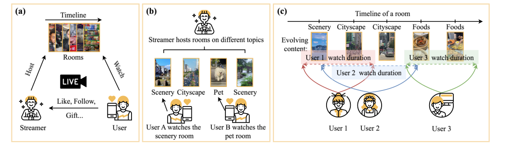
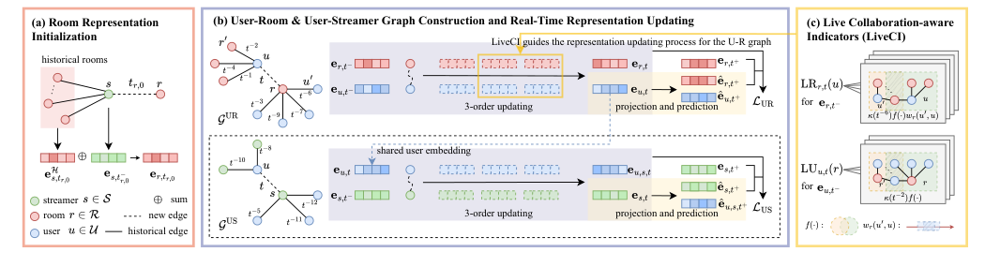

# Room Matters: Dynamic Room-level Collaboration Information Modeling for Live Streaming Recommendation

| 项目 | 内容 |
|---|---|
| 原题 | Room Matters: Dynamic Room-level Collaboration Information Modeling for Live Streaming Recommendation |
| 作者 | Ke Guo, Changle Qu, Xiao Zhang, Liqin Zhao, Shijun Wang, Yanan Niu, and Jun Xu |
| 发表 | Proceedings of the ACM Web Conference 2026 (WWW ’26) |
| 会议 | April 13–17, 2026, Dubai, United Arab Emirates |
| 方法名称 | DCGLive (Dynamic Collaboration-aware Graph learning approach for Live streaming recommendation) |
| Keywords | Live Streaming Recommendation, Dynamic Graph, Intra-room Collaboration |
| DOI | [10.1145/3774904.3792241](https://doi.org/10.1145/3774904.3792241) |
| 代码 | [DCGLive](https://github.com/imgkkk574/DCGLive) |

## 一、研究现象：观众对主播、场次和当前内容的兴趣并不完全相同

直播（Live Streaming）的内容在观看过程中持续生成。一个主播（Streamer）上午可能介绍城市风景，下午可能分享宠物。关注同一主播的两位观众（Users），一位可能只想看风景，另一位可能只想看宠物。如果推荐系统只记录两位观众都看过这位主播，两种兴趣就会被合并到同一个对象上。

即使在同一个直播间（Live Room），观众接触的内容也取决于进入和离开的时间。有人看完街景介绍就退出，有人等到美食环节才进入。两人都有同一直播间的观看记录（Watching Behavior），这两条记录对实时兴趣的含义却不同。观看区间有较长重叠的观众，更有可能接触到相同内容。与此并行，赠送虚拟礼物（Virtual Gifts）记录了观众向主播的支持，可用来补充另一类偏好线索。

图 1 从三个层次展示这个现象。**图 1(a)** 将开播、观看和向主播互动放在同一场景中，突出直播间连接主播与观众的作用。**图 1(b)** 保持主播不变，展示不同场次的主题如何吸引不同观众。**图 1(c)** 保持场次不变，沿同一条时间轴比较三人的观看区间。观众 1 与观众 2 的区间重叠较多，观众 1 与观众 3 则分别出现在前后两个阶段。这让“看过同一间房”进一步细化为“在多大程度上看过同一时段”。图中的点赞、关注等是场景示例，DCGLive 实际构图使用观看与送礼两类行为。

## 二、研究问题：如何预测观众下一次进入的直播间？

研究任务是下一直播间预测（Next-Room Prediction）。模型按时间处理观看和送礼事件，维护观众、场次与主播的当前状态，再预测某位观众下一次将要互动的直播间。研究对象是一次可区分的开播场次。同一主播先后开启的房间分别拥有自己的状态。

**研究问题一：如何同时保留观众对主播的偏好，以及观众对具体场次的实时兴趣？** 两类行为的对象不同。观看发生在具体场次，送礼指向主播。模型需要保留二者各自的关系，又要让它们共同影响对同一观众的判断。

**研究问题二：如何让同场观看的时间与历史关系参与实时更新？** 当前观众进入房间后，模型可利用房间里的其他观众与该观众自己的历史记录。更新幅度应反映这些历史证据与当前场次的关联，包括历史有多近、共同观看过哪些房间、这一场实际重叠了多长时间。

新房间冷启动（Cold Start）是上述任务的起点问题。刚开播时，当前房间还没有丰富的观看记录，模型可先从主播过往的场次和最近状态借用信息，再随着新互动逐步形成该场次自己的表示。

## 三、科学问题与设计原理

| 科学问题 | 设计原理 | 对应机制 |
|---|---|---|
| 如何表示随事件演化的三方交互（Tripartite Interactions）？ | 保留行为的目标对象，通过共享观众状态衔接两类关系 | 观众—直播间图与观众—主播图 |
| 节点状态应如何随事件更新？ | 继承自身历史，吸收当前交互对象，再引入历史邻居 | 零阶继承、一阶传播、二阶聚合 |
| 怎样判断一次互动所带来的同场协同信息（Intra-room Collaboration Information）有多强？ | 结合历史新近性、共同交互集合，以及同房间观看时间的重叠 | LiveCI 的观众指标与房间指标 |
| 怎样在缺少本场交互时形成初始状态？ | 将同主播跨场次的历史特征与开播前最近的主播状态结合 | 直播间表示初始化（Room Representation Initialization） |

这四项设计对应几个不同的时间尺度。历史场次提供跨场次背景，最近的主播状态补充开播前的信息，新互动逐次更新观众与房间的表示。预测时还将当前观众状态投影到目标时刻，使推荐随两次互动之间的时间间隔调整。

## 四、方法速览

### 4.1 左侧：给新直播间一个起点

图 2(a) 的粉色节点表示直播间，绿色节点表示主播。模型先汇总该主播过往直播间结束时的表示，再结合开播前最近的主播表示，形成新直播间的初始向量。前一部分提供同主播历史场次的共性，后一部分提供主播近期状态。

### 4.2 中部：观看和送礼如何共同影响观众状态？

图 2(b) 上方的观众—直播间图（User–Room Graph，U-R）记录观看，边带有观看时长。下方的观众—主播图（User–Streamer Graph，U-S）在发生送礼时记录该事件，边带有礼物数量。两张图都是连续时间动态图（Continuous-Time Dynamic Graph，CTDG）。一条新事件到达时，模型沿时间顺序更新对应图和节点表示。

图中蓝色向量表示观众。中部向下的虚线表示共享观众嵌入（Shared User Embedding）。每次观看先更新观众与直播间。如果这次观看还伴随送礼，U-S 图会接着更新同一个观众向量与主播向量。两个更新器使用各自的参数。

每次节点更新同时使用三方面的信息：节点之前的状态、这次实际互动的对方、通过对方或自身连到的历史邻居。比如，一位观众进入房间后，房间既能吸收这位观众的特征，也能参考该观众过去看过的其他房间。

### 4.3 右侧：同场关系如何调节更新？

图 2(c) 是实时协同感知指标（Live Collaboration-aware Indicators，LiveCI）。上方的房间指标（LiveCI for Room，LR）从当前房间的历史观众出发，判断新进入的观众给房间状态带来多少协同信息。比较时既考虑历史兴趣是否相近，也考虑他们在这个房间的观看时间有没有重叠。下方的观众指标（LiveCI for User，LU）从该观众看过的历史房间出发，判断当前房间给观众状态带来多少协同信息。

两个指标都优先考虑近期邻居。它们分别调节 U-R 图中房间与观众更新时的邻居信息权重，图中黄色箭头指向的正是上方的更新路径。

### 4.4 输出：用预测向量给候选房间排序

模型先根据时间间隔投影观众状态（Projection），再预测下一间房的向量。评估时将预测向量与各房间的表示比较，距离越小，排名越靠前。训练让预测向量接近真实交互房间的向量，并约束观众和房间的状态在相邻事件之间平稳变化。送礼分支还学习预测主播，为共享观众表示补充主播侧信号。

## 五、实验结果

### 5.1 数据与评估

商业数据来自一个直播平台 2024 年 12 月至 2025 年 1 月期间连续三周的日志。公开数据使用快手（Kuaishou）的 KuaiLive 数据集经抽样与筛选后的子集。

| 数据集 | 观众数 | 房间数 | 主播数 | 交互数 | U-R 密度 | U-S 密度 |
|---|---:|---:|---:|---:|---:|---:|
| KuaiLive | 9,574 | 2,951 | 749 | 257,811 | 0.9125% | 0.0051% |
| Commercial | 9,667 | 2,441 | 850 | 493,212 | 2.0901% | 0.0036% |

训练集、验证集与测试集按时间顺序以 80%、10%、10% 划分。评估采用基于交互的全量排序（Interaction-Based All-Ranking），以预测向量到各房间表示的 L2 距离确定真实房间的排名。指标包括归一化折损累计增益（Normalized Discounted Cumulative Gain，NDCG）、召回率（Recall）和平均倒数排名（Mean Reciprocal Rank，MRR）。对每次只有一个真实房间的预测，Recall@K 关注真实房间是否进入前 K 名，NDCG@K 对前 K 名内更靠前的位置给予更高分，MRR 则平均真实排名的倒数。

### 5.2 总体表现

论文比较了四种通用推荐方法与五种动态推荐方法。下表以 NDCG@10、Recall@10 和 MRR 的主要对照为例。

| 数据集 | 方法 | NDCG@10 | Recall@10 | MRR |
|---|---|---:|---:|---:|
| KuaiLive | JODIE | 0.1074 | 0.2028 | 0.0974 |
| KuaiLive | DGCF | 0.1118 | 0.2210 | 0.1081 |
| KuaiLive | DCGLive | **0.1336** | **0.2614** | **0.1170** |
| Commercial | JODIE | 0.1973 | 0.3493 | 0.1683 |
| Commercial | DGCF | 0.2412 | 0.3985 | 0.2091 |
| Commercial | DCGLive | **0.2593** | **0.4463** | **0.2149** |

DCGLive 在两套数据的五项指标上均取得最高数值。以 Recall@10 为例，KuaiLive 比 DGCF 高 4.04 个百分点，Commercial 高 4.78 个百分点。论文表中，KuaiLive 的 MRR 未标注 0.05 水平的显著性，其余九个比较均有对应标记。

### 5.3 消融与新房间表现

消融实验（Ablation Study）分别移除送礼图、直播间初始化和 LiveCI。以下列出每种设置的 Recall@10 与 MRR。

| 设置 | KuaiLive Recall@10 | KuaiLive MRR | Commercial Recall@10 | Commercial MRR |
|---|---:|---:|---:|---:|
| 移除 U-S 图 | 0.2282 | 0.1051 | 0.3903 | 0.2041 |
| 移除直播间初始化 | 0.2468 | 0.1103 | 0.4161 | 0.1980 |
| 移除 LiveCI | 0.2550 | 0.1158 | 0.4321 | 0.2122 |
| 完整模型 | **0.2614** | **0.1170** | **0.4463** | **0.2149** |

三个组件在展示的设置中都带来增益。以 Recall@10 衡量，移除 U-S 图时的降幅最大。进一步的组件比较显示，仅去掉观看时间重叠权重时，表现介于完整模型和移除整个 LiveCI 之间。初始化的比较中，移除最近主播表示带来的下降大于移除历史场次特征。

冷启动评估跟踪在测试阶段首次出现的房间及针对它们的后续预测。KuaiLive 子集的 Recall@10 从移除初始化时的 0.2432 提高到完整模型的 0.2854，商业数据则从 0.4307 提高到 0.4569。这组结果对应新出现房间这一特定集合。

## 六、进阶解析

### 6.1 事件、图边与共享状态

将时间戳为 $t$ 的互动记为一个六元组。$u_t$ 是观众，$r_t$ 是直播间，$s_t$ 是该场次的主播，$w_t$ 是观看时长，$g_t$ 是礼物数量。定义 $t^-$ 为更新前时点，$t^+$ 为后续预测时点。

$$
I_t=(u_t,r_t,s_t,w_t,g_t,t).
\tag{1}
$$

每个事件在 $\mathcal G_t^{UR}$ 添加观看边。只有 $g_t\ne0$ 时才在 $\mathcal G_t^{US}$ 进一步添加送礼边。两个更新器通过观众向量连接。如果没有送礼，U-R 的输出就是观众的最终状态。如果存在送礼，U-R 的输出进入 U-S 的更新过程，后者的输出成为最终状态。

### 6.2 新房间的初始化

设 $t_{r,0}$ 为房间 $r$ 的开播时间，$\mathcal H_{s,t_{r,0}}$ 为主播 $s$ 在此之前的房间集合，$\bar{\mathbf e}_{r_j}$ 为历史房间 $r_j$ 结束时的嵌入（Embedding）。先对历史房间表示求平均，再与主播开播前最近的表示取均值。

$$
\mathbf e^H_{s,t_{r,0}}=\frac{1}{|\mathcal H_{s,t_{r,0}}|}\sum_{r_j\in\mathcal H_{s,t_{r,0}}}\bar{\mathbf e}_{r_j},\qquad
\mathbf e_{r,t_{r,0}}=\frac{\mathbf e^H_{s,t_{r,0}}+\mathbf e_{s,t_{r,0}^{-}}}{2}.
\tag{2}
$$

左侧平均值概括主播过去各场次的内容与互动特征。右侧将这个跨场次概括与主播的最近状态结合。初始化只负责给出新房间的起点，随后每次观看都会通过动态图更新这个房间自己的向量。

### 6.3 LiveCI 如何计算同场协同强度？

记 $\mathcal H_{u,t}$ 为观众 $u$ 的历史观看房间集合，$\mathcal H_{r,t}$ 为房间 $r$ 的历史观众集合。以下用 $\mathcal A_{v,t}=\mathcal H_{v,t}\cup\{v\}$ 简记把中心节点也纳入的邻域集合。$z$ 表示历史房间，$x$ 表示历史观众。$f$ 采用杰卡德相似度（Jaccard Similarity），以交集大小除以并集大小。

$$
f(A,B)=\frac{|A\cap B|}{|A\cup B|},\qquad
\kappa(v,\mathcal H)=\frac{\exp[-(t-t(v))]}{\sum_{v'\in\mathcal H}\exp[-(t-t(v'))]}.
\tag{3}
$$

$t(v)$ 是与历史邻居的交互时间。对同一组邻居，交互越近，$\kappa$ 越大。分母使权重之和为 1，因此比较的是各条历史证据在这次更新中的相对贡献。

$$
\begin{aligned}
\mathrm{LU}_{u,t}(r)&=\sum_{z\in\mathcal H_{u,t}}\kappa(z,\mathcal H_{u,t})\,f(\mathcal A_{z,t},\mathcal A_{r,t}),\\
\mathrm{LR}_{r,t}(u)&=\sum_{x\in\mathcal H_{r,t}}\kappa(x,\mathcal H_{r,t})\,f(\mathcal A_{x,t},\mathcal A_{u,t})\,[1+\mathrm{owt}_r(x,u)].
\end{aligned}
\tag{4}
$$

- **LU 汇总历史房间证据。** 对每个 $z$，比较它与当前房间 $r$ 的观众邻域。若近期看过的房间与当前房间拥有更多共同观众，当前房间为该观众提供的协同信号就更强。
- **LR 汇总历史观众证据。** 对每个 $x$，比较他和当前观众 $u$ 看过的房间是否重合。归一化观看重叠量（Normalized Overlapping Watch Duration）$\mathrm{owt}_r(x,u)$ 进一步调节这条证据的权重，使当前场次中观看时段更接近的观众贡献更多。

例如，同一个历史观众若与当前观众共享较多历史房间，但在当前场次相隔很久才进入，集合相似仍可提供协同证据，重叠因子则提供较少的额外增益。这样，LR 同时使用跨场次的兴趣关系和本场时间信息。LiveCI 由这些统计量直接计算，属于非参数指标（Non-Parametric Indicator）。

### 6.4 零阶、一阶、二阶更新分别读取什么？

用 $i$ 表示当前互动对象。U-R 图中 $i=r$，U-S 图中 $i=s$。以下以观众侧为例，对象侧采用相应的更新。$\mathbf e$ 表示动态向量，$\mathbf f$ 表示输入特征，$W$ 和 $\mathbf w_0$ 为可学习参数，$\phi_u$ 为激活函数。

$$
\begin{aligned}
\mathbf e_{u,t}^{(0)} &= \phi_u(W_0^u\mathbf e_{u,t^-}+\mathbf w_0\Delta t_u+W_0^f\mathbf f_u),\\
\mathbf e_{u,t}^{(1)} &= \phi_u(W_1^u\mathbf e_{i,t^-}+W_1^f\mathbf f_i),\\
\mathbf e_{u,t}^{(2)} &= \sum_{u_k\in\mathcal H_{i,t}}a_{u_k}\,\mathbf e_{u_k,t^-}.
\end{aligned}
\tag{5}
$$

**零阶继承（Zero-Order Inheritance）**保留自身状态，并加入距离上次互动的时间 $\Delta t_u$ 与自身输入特征。**一阶传播（First-Order Propagation）**读取当前互动对象的状态和特征。**二阶聚合（Second-Order Aggregation）**沿 $u\to i\to u_k$ 读取其他观众的历史状态。对于直播间，对称路径是 $r\to u\to r_j$，由当前观众连接到其过去看过的房间。

二阶权重 $a_{u_k}$ 由图注意力（Graph Attention）产生。模型将目标与候选邻居的更新前向量拼接，通过带泄漏的线性整流函数（LeakyReLU）计算分数，再经归一化指数函数（Softmax）转换为权重。这种注意力在二阶邻居之间分配权重。LiveCI 则在融合阶段调节一阶与二阶贡献的整体强度。

### 6.5 LiveCI 加在更新式的哪里？

令 $v$ 表示待更新的观众或房间，$C_v$ 表示该节点对应的 LU 或 LR，$F_v$ 为融合函数。U-R 的两条融合公式可写成一个统一表达式。

$$
\mathbf e_{v,t}=F_v\!\left(
 W_v^{(0)}\mathbf e_{v,t}^{(0)}+
 [\alpha+(1-\alpha)C_v]\left(W_v^{(1)}\mathbf e_{v,t}^{(1)}+W_v^{(2)}\mathbf e_{v,t}^{(2)}\right)
\right).
\tag{6}
$$

系数只乘在邻居相关的一阶、二阶项上。零阶项持续保留节点自身的历史。$\alpha$ 控制基础权重，$1-\alpha$ 控制指标变化的影响。$\alpha=1$ 时邻居项系数固定为 1，论文在两个数据集上采用 $\alpha=0.9$。U-S 图同样融合三个阶次的表示，使用自己的参数直接合并各项。

### 6.6 从时间投影到训练目标

令 $\Delta t=t^+-t$。模型用可学习向量 $\mathbf w_t$ 把时间间隔转成逐维缩放系数。符号 $\odot$ 表示逐元素乘积（Element-Wise Product），$\mathrm{MLP}$ 表示多层感知机（Multi-Layer Perceptron）。

$$
\hat{\mathbf e}_{u,t^+}=\mathrm{MLP}_u\bigl(\mathbf e_{u,t}\odot(\mathbf 1+\mathbf w_t\Delta t)\bigr),\qquad
\hat{\mathbf e}_{r,t^+}=\mathrm{MLP}_r\bigl(W_2\hat{\mathbf e}_{u,t^+}+W_3\mathbf f_u+W_4\mathbf f_r\bigr).
\tag{7}
$$

第一个式子把当前观众表示投影到预测时点。时间间隔相同，缩放因子相同，具体投影仍取决于观众当前的各维状态。第二个式子将投影结果和观众、房间特征组合，输出可用于距离排序的房间预测向量。

按论文的时间下标，U-R 损失将预测房间向量与对应真实交互的房间表示 $\mathbf e_{r,t}$ 对齐，同时约束相邻状态的改变量。

$$
\mathcal L_{UR}=\sum_{I_t}\left[
\|\hat{\mathbf e}_{r,t^+}-\mathbf e_{r,t}\|_2^2+
\lambda_u\|\mathbf e_{u,t}-\mathbf e_{u,t^-}\|_2^2+
\mu_r\|\mathbf e_{r,t}-\mathbf e_{r,t^-}\|_2^2
\right].
\tag{8}
$$

第一项是预测误差（Prediction Error），后两项是时间平滑正则项（Temporal Smoothness Regularization）。$\lambda_u$ 和 $\mu_r$ 分别控制观众与房间状态允许的变化幅度。U-S 使用同类目标预测真实主播表示，只在有送礼的事件上计算对应损失。

### 6.7 时序批处理如何支持并行训练？

时序批处理（T-Batch）按事件顺序扫描，为同一观众或同一主播的连续事件分配不同批次。设 $\operatorname{last}_U[u_t]$ 和 $\operatorname{last}_S[s_t]$ 为二者最近被分配的批次号，则新事件的批次号为

$$
k_t=1+\max\{\operatorname{last}_U[u_t],\operatorname{last}_S[s_t]\}.
\tag{9}
$$

分配后用 $k_t$ 更新两个记录。这样，同一观众或主播的后续事件等到前序事件处理后再使用其状态，同批内不共享这些节点的事件可并行计算。训练时两图的参数分别由 Adam 优化器（Adam Optimizer）更新。

## 参考文献

Guo, K., Qu, C., Zhang, X., Zhao, L., Wang, S., Niu, Y., & Xu, J. (2026). Room Matters: Dynamic Room-level Collaboration Information Modeling for Live Streaming Recommendation. In *Proceedings of the ACM Web Conference 2026 (WWW ’26)* (pp. 6045–6056). Association for Computing Machinery. [https://doi.org/10.1145/3774904.3792241](https://doi.org/10.1145/3774904.3792241)
