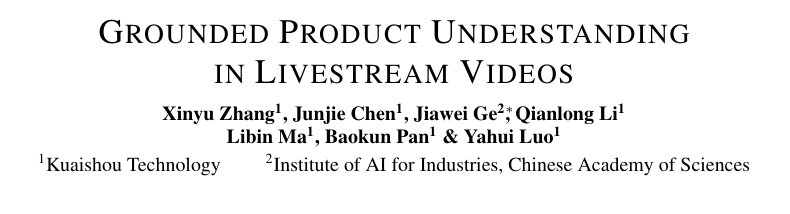
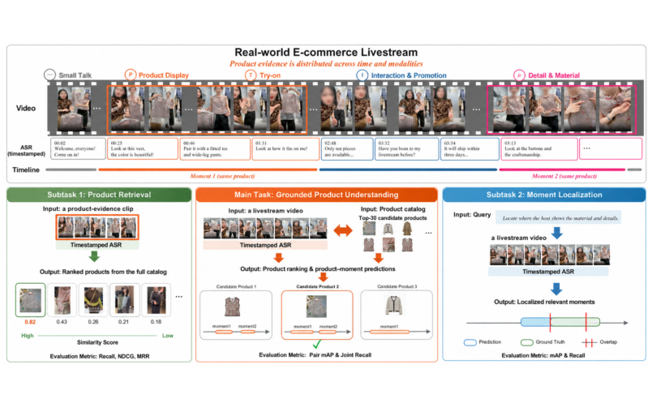
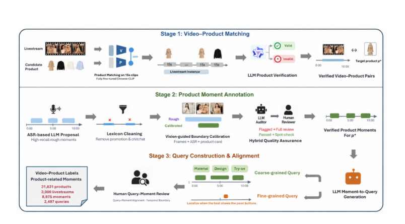
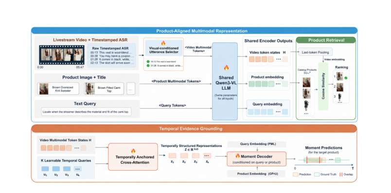

**表 1　论文基本信息**

| 项目 | 内容 |
|---|---|
| 原题 | Grounded product understanding in livestream videos |
| 作者 | Xinyu Zhang, Junjie Chen, Jiawei Ge, Qianlong Li, Libin Ma, Baokun Pan, and Yahui Luo |
| 发表 | arXiv preprint, arXiv:2609.20508v2 [cs.CV] |
| 版本日期 | 28 September 2026 |
| 基准名称 | GPUB (Grounded Product Understanding Benchmark) |
| 方法名称 | UniPro |

**图 1　arXiv 预印本首页（题名、作者及单位）**

## 一、研究现象：同一件商品的信息为什么散落在直播各处？

在直播电商（Livestream E-commerce）中，主播可能先展示衣服的整体版型，过一会儿试穿，回答几条观众留言后才拉近镜头展示面料和纽扣。一部分信息能从画面看到，例如轮廓和细节；另一部分主要由主播口头说明，例如材质和穿着感受。两种信息不一定在同一时刻出现。同一段直播还可能包含其他商品、促销话术和闲聊。

如果平台要自动生成以商品为中心的直播剪辑（Product-centric Livestream Clipping），系统需要知道**这件商品在目录里是哪一款**，也需要知道**哪些片段能说明这件商品的特点**。如果输出是某款上衣的正确编号，但片段来自另一款相似上衣，剪辑仍然无法使用。这就把直播理解的问题推进了一步：系统需要建立商品身份与时间证据之间的对应关系（Product–Moment Correspondence）。

## 二、研究问题：怎样判断系统找对了商品，也找对了证据？

研究提出带证据定位的商品理解（Grounded Product Understanding，GPrU）。输入是一个完整的直播评估窗口、带时间戳的自动语音识别文本（Automatic Speech Recognition，ASR）和 30 件候选商品。每个评估实例围绕一件真实目标商品建立标注。模型需要给候选商品排序，并为候选商品预测一个或多个支持区间。

**图 2　Grounded product understanding in e-commerce livestreams.**

图 2 上半部分把画面、口述和时间轴并排放置。前一段的展示与试穿、后一段的材质与细节可以为同一件衣服提供证据，中间的促销与互动不需要被剪进证据片段。下方三个面板展示任务之间的条件差异：左侧已经给出商品证据片段，模型从目录里找商品；右侧已经给出文字问题，模型在视频里找时间区间；中间没有指定目标的文字问题，模型必须同时决定是哪件商品以及哪些片段属于它。

**表 2　GPUB 三项任务的输入与输出**

| 任务 | 已知条件 | 输出 |
|---|---|---|
| 商品检索（Product Retrieval） | 裁出的证据片段、对应 ASR、完整商品目录 | 目录商品排序 |
| 商品片段定位（Product Moment Localization，PML） | 完整评估窗口、ASR、商品相关文本查询 | 支持该查询的时间区间及置信度 |
| 带证据定位的商品理解（GPrU） | 完整评估窗口、ASR、含目标的固定 30 件候选 | 商品排序及带商品身份的时间区间 |

## 三、科学问题与设计原理

**表 3　科学问题与对应设计**

| 科学问题 | 设计原理 | 对应机制 |
|---|---|---|
| 如何区分看起来十分相似的商品？ | 将直播画面与商品图文对齐，并让模型面对具有辨别难度的相似候选 | 商品对齐表示（Product-aligned Representation）、困难负例（Hard Negatives） |
| 如何从连续直播中提取多段分散证据？ | 保留画面和口述的时间位置，允许相关证据分布于多个区间 | 多时段标注、时间锚定交叉注意力（Temporally Anchored Cross-attention） |
| 如何确保定位到的片段支持所预测的商品？ | 用候选商品约束片段解码，并要求商品身份和时间重合同时满足 | 商品条件解码（Product-conditioned Decoding）、联合评价（Joint Evaluation） |

商品识别侧重服装之间的细微差异，片段定位侧重信息在时间轴上的位置。UniPro 让两个任务共享视听线索，经由不同的输出表示分别完成识别与定位，再在商品–片段对上汇总结果。

## 四、方法速览

### 4.1 GPUB 如何建立商品与时间证据的对应？

**图 3　Video-side construction pipeline.**

**第一阶段核验商品。** 商品目录先统一标识、合并重复的库存量单位（Stock Keeping Unit，SKU）、规范元数据，并为每件商品保留一张通过质量筛选的主图。随后用经过监督微调的 Chinese-CLIP 从 15 秒短片检索候选，再由 Qwen3-VL-32B-Instruct 结合整个窗口、ASR 和商品信息复核。只有能确认匹配的实例进入后续流程。

**第二阶段标记证据区间。** 模型先从带时间戳的 ASR 提出候选，再筛除促销和闲聊，用画面、口述和商品信息确认内容并校正边界。流程将不确定实例交给人工完整复核，也对其余实例做抽样审核。同一商品的展示、试穿和细节讲解如果分隔开来，就分别保留为不同区间。

**第三阶段生成定位查询。** 粗粒度查询（Coarse-grained Query）询问材质、设计或试穿等较宽泛的方面。细粒度查询（Fine-grained Query）指向具体的属性或动作，例如展示珍珠纽扣。标注者核对查询与片段是否对应，并按需要调整边界。这部分标注用于 PML。前两阶段的商品身份与证据区间用于 GPrU。

### 4.2 UniPro 如何同时识别商品与定位证据？

**图 4　Overview of UniPro.**

图 4 上方是商品对齐的多模态表示（Product-aligned Multimodal Representation）。左侧三行分别是直播画面与 ASR、商品主图及标题、定位任务的文本查询。直播侧先用视觉条件话语选择器（Visual-conditioned Utterance Selector）保留与画面相关的完整句段，在有限输入预算内减少无关口述。共享编码器（Shared Encoder）使用 Qwen3-VL-Embedding-2B，将各类输入编码在可比较的空间里。右上角的检索支路汇总视频为全局向量，再用余弦相似度（Cosine Similarity）比较商品向量。

图 4 下方是时间证据定位（Temporal Evidence Grounding）。模型沿视频放置一系列时间锚点，每个锚点从附近或相关的画面和口述标记提取信息。片段解码器（Moment Decoder）再根据问题或候选商品，预测区间的起止位置与置信度。PML 用查询向量条件化解码，GPrU 对每件候选商品分别解码。所有候选共享同一份视频的时间表示，商品条件负责决定应从中提取哪类证据。

## 五、实验结果

### 5.1 数据规模和评估口径

评估商品目录有 31,831 件服装商品。GPrU 对每个窗口预先固定 30 件候选，其中 1 件为目标商品，其余 29 件由嵌入模型选出的最相似非目标商品组成。目标商品在候选中的位置随机。全目录商品检索使用裁出的证据片段输入，候选范围和输入条件均与 GPrU 不同。

**表 4　GPUB 训练、验证与测试划分**

| 统计项 | 训练 | 验证 | 测试 |
|---|---:|---:|---:|
| 直播窗口 | 6,145 | 500 | 3,000 |
| 原始直播场次 | 2,311 | 239 | 1,798 |
| 不同目标商品 | 2,693 | 214 | 1,641 |
| 商品证据区间 | 15,708 | 1,373 | 8,975 |
| PML 查询 | 5,393 | 433 | 2,497 |

划分时，共享原始直播场次或目标商品的窗口被安排到同一个集合。论文报告评估视频平均约 4 至 5 分钟，69.48% 的商品证据区间短于 30 秒，43.13% 的任务标注单元包含多个真实区间。定位任务既要找短片段，也要找全分散出现的证据。

### 5.2 总体表现：商品排第一与证据定位正确是两件事

商品检索采用召回率（Recall）、平均倒数排名（Mean Reciprocal Rank，MRR）等指标。定位与联合任务以时间交并比（Temporal Intersection over Union，tIoU）判断两个区间是否足够重合。以下数值均是论文报告的百分比。

**表 5　全目录检索与商品片段定位的代表性结果（%）**

| 任务 | 模型 | 指标 | 数值 |
|---|---|---|---:|
| 商品检索 | Qwen3-VL-Embedding-8B | R@1 | 15.05 |
| 商品检索 | UniPro | R@1 | **33.47** |
| 商品片段定位 | Qwen3-VL-8B（SFT） | mAP@.3 | 46.28 |
| 商品片段定位 | UniPro | mAP@.3 | **53.50** |

**表 6　固定 30 候选下的联合表现（%）**

| 模型 | 商品 R@1 | Pair mAP@.3 | Pair mAP@.5 | Joint R@1@.3 |
|---|---:|---:|---:|---:|
| Qwen3-VL-8B | 39.10 | 10.13 | 5.03 | 18.03 |
| Qwen3-VL-8B（SFT） | 38.60 | 21.92 | 13.77 | 35.47 |
| UniPro | **39.40** | **24.58** | **14.33** | **38.81** |

Qwen3-VL-8B 与 UniPro 在 30 候选中将正确商品排在首位的比例分别为 39.10% 和 39.40%，相差 0.30 个百分点。加入证据要求后，两者的 Joint R@1@.3 则相差 20.78 个百分点。这个对照体现了联合指标的作用：它能区分商品识别能力相近、证据定位能力不同的模型。与接受任务监督微调（Supervised Fine-tuning，SFT）的 Qwen3-VL-8B 相比，UniPro 的 Pair mAP@.3 高 2.66 个百分点。

### 5.3 消融实验：两类表示和语音文本各起什么作用？

**表 7　表示设计与 ASR 选择的代表性消融结果（%）**

| 设置 | 商品 R@1 | 定位 mAP@.3 | Pair mAP@.3 |
|---|---:|---:|---:|
| 去掉独立检索表示，改用时间结构表示检索 | 13.64 | 44.59 | 10.23 |
| 去掉时间结构表示 | 38.80 | 50.66 | 21.57 |
| 无 ASR | 37.97 | 48.70 | 19.94 |
| 未筛选 ASR | 38.20 | 56.12 | 23.76 |
| 完整 UniPro | **39.40** | **56.76** | **24.58** |

独立检索表示主要负责在相似商品之间辨认身份，去掉后商品 R@1 从 39.40% 降到 13.64%。时间结构表示主要负责定位，去掉后定位 mAP@.3 下降 6.10 个百分点。去掉 ASR 也会降低定位与联合表现，说明口述提供了画面之外的证据。筛选后的 ASR 在控制输入预算的同时取得表中最高的 Pair mAP@.3；定位阈值提高到 0.5 时，未筛选 ASR 的定位 mAP 为 33.52%，略高于筛选后的 32.80%。

## 六、进阶解析

### 6.1 怎样表示一条联合预测？

设共享商品目录为 $G$，评估窗口为 $V$，带时间戳的转写为 $A$，候选集合为 $C\subset G$。真实商品为 $p^*$，它对应的证据集合为 $E^*$。每个证据区间 $e=[t_s,t_e]$ 都描述同一个商品的一段证据。模型为候选商品 $p_i$ 预测第 $j$ 个区间 $\hat m_{ij}=[\hat t_{ij,s},\hat t_{ij,e}]$。评分对象是二元组 $(p_i,\hat m_{ij})$，因此相同的时间段与不同商品配对，会得到不同的评价结果。

### 6.2 时间交并比、Pair mAP 和 Joint Recall 如何计算？

时间交并比是预测区间与真实区间的重叠时长除以并集时长。

$$
\operatorname{tIoU}(\hat m,e)=\frac{|\hat m\cap e|}{|\hat m\cup e|}.
\tag{1}
$$

若预测为第 20–40 秒，真实区间为第 30–50 秒，交集是 10 秒，并集是 30 秒，tIoU 为 $1/3$。因此它通过 0.3 阈值，但达不到 0.5。若该区间被归给另一件商品，即使时间重合也不算正确的商品–片段对。

商品–片段对平均精度均值（Pair mean Average Precision，Pair mAP）对每个窗口内的预测对按置信度排序。对商品身份正确的预测，按最高 tIoU 匹配尚未被占用且达到阈值的真实片段。一段真实证据只匹配一次。未匹配的预测计作假阳性，遗漏的真实证据仍计入平均精度的分母。对 $N$ 个窗口分别求平均精度（Average Precision，AP），再取均值。

$$
\operatorname{Pair\,mAP}@\tau=\frac1N\sum_{n=1}^{N}\operatorname{AP}_{n}^{\tau}.
\tag{2}
$$

联合召回率（Joint Recall）从整条实例判断成功。设第 $n$ 个窗口的真实商品在排序中的位置为 $\operatorname{rank}_n(p_n^*)$，$\hat M_n(p_n^*)$ 为归给该商品的预测区间集合。定义 $\mathbf 1[\cdot]$ 为条件成立时等于 1 的指示函数，则

$$
\operatorname{Joint\,R}@K@\tau=\frac1N\sum_{n=1}^{N}
\mathbf{1}\!\left[\operatorname{rank}_n(p_n^*)\le K\ \land\ \exists\,\hat m\in\hat M_n(p_n^*),\ e\in E_n^*: \operatorname{tIoU}(\hat m,e)\ge\tau\right].
\tag{3}
$$

式（3）要求正确商品排在前 $K$，并至少找到它的一段证据。若目标有三段证据，系统只定位对了一段，这条实例仍可计入联合召回。Pair mAP 还会对另外两段是否找全以及误报是否排在前面作出区分。

### 6.3 商品对齐与口述选择怎样训练？

第一阶段用低秩适配（Low-rank Adaptation，LoRA）微调共享编码器。将同一个证据片段和其目标商品作为正例，批内其余商品作为负例。设 $v_i$ 为第 $i$ 个片段向量，$p_j$ 为第 $j$ 个商品向量，$B$ 为批大小，$\eta$ 为温度参数，则批内对比损失（In-batch Contrastive Loss）为

$$
\mathcal L_{\mathrm{align}}=-\frac1B\sum_{i=1}^{B}\log
\frac{\exp(\operatorname{sim}(v_i,p_i)/\eta)}
{\sum_{j=1}^{B}\exp(\operatorname{sim}(v_i,p_j)/\eta)}.
\tag{4}
$$

分子衡量匹配商品的相似度，分母把同一片段与所有批内商品的相似度纳入比较。减小损失会提高匹配项相对于其他商品的得分。

第二阶段冻结主干，利用视频–商品匹配目标训练话语选择器。设 $u_i$ 为包含起止时间和时长信息的第 $i$ 句表示，$v$ 为全局视觉表示，选择分数为

$$
s_i^{\mathrm{sel}}=\mathrm{MLP}([u_i;v;u_i\odot v;|u_i-v|]).
\tag{5}
$$

分号表示拼接，$\odot$ 表示逐元素乘积，绝对值也按元素计算。选择器同时看到文字和画面各自的表示、两者的逐维交互及差异。高分句段以完整单位保留，并沿用原来的时间戳与顺序。论文实现按 30 秒块选择句段，整体 ASR 预算为 2,048 个标记（Tokens）。这一步由商品匹配结果提供监督，无需逐句标记是否相关。

### 6.4 时间锚点与片段查询有什么区别？

共享编码器输出多模态标记状态 $H\in\mathbb R^{L\times d}$。视觉标记带帧时间，ASR 标记继承对应句段的时间区间。时间锚点均匀铺在归一化时间轴，视频时长为 $T$ 时，锚点数为

$$
K(T)=\operatorname{clip}\!\left(\left\lceil\frac{T}{5\,\mathrm{s}}\right\rceil,16,128\right).
\tag{6}
$$

时长 240 秒的窗口对应 48 个锚点。交叉注意力在锚点与输入标记中加入时间编码，并在注意力分数中加入时间距离偏置，得到按时间排列的表示 $Z$。锚点负责整理整条视频的证据，各候选商品共用 $Z$。随后，三层 Transformer 片段解码器为每个商品或文本条件使用 10 个可学习的片段查询（Moment Queries），输出区间和置信度。

### 6.5 片段怎样匹配监督，又怎样参与联合排序？

训练定位时，匈牙利匹配（Hungarian Matching）将预测片段一对一分配给真实区间。匹配代价同时考虑置信度、归一化边界距离与时间广义交并比（Temporal Generalized IoU，tGIoU）。

$$
C_{\mathrm{match}}=0.5C_{\mathrm{conf}}+5C_1+2C_{\mathrm{tGIoU}}.
\tag{7}
$$

匹配确定哪些预测承担哪些真实区间的监督。训练目标还用边界误差改进区间位置，用排序损失让更准确的提议获得更高置信度，并用前景与边界的辅助监督补充时间信息。

推理时，设 $s_p^{\mathrm{ret}}$ 为商品 $p$ 的检索相似度，$c_{p,j}$ 为其第 $j$ 个区间的置信度对数几率（Logit）。商品–片段对按下式排序：

$$
s_{p,j}=\log\operatorname{softmax}_{p}\!\left(s_p^{\mathrm{ret}}/0.07\right)+\log\sigma(c_{p,j}).
\tag{8}
$$

第一项在候选商品之间归一化，第二项通过逻辑函数（Sigmoid）衡量某个区间对该商品的支持。两项在对数空间相加，等价于在原来的尺度上相乘再取对数。模型既给商品本身打分，也给该商品的每段证据打分，同一商品的不同区间可以在最终排序中处于不同位置。

## 参考文献

Zhang, X., Chen, J., Ge, J., Li, Q., Ma, L., Pan, B., & Luo, Y. (2026). Grounded product understanding in livestream videos. *arXiv preprint arXiv:2609.20508*. [https://arxiv.org/abs/2609.20508v2](https://arxiv.org/abs/2609.20508v2)
