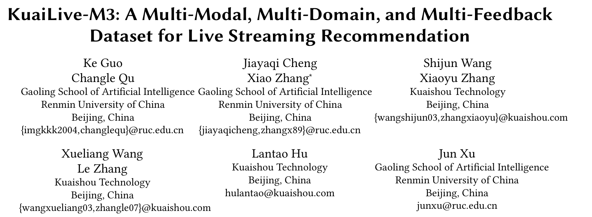
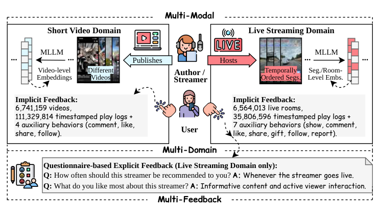
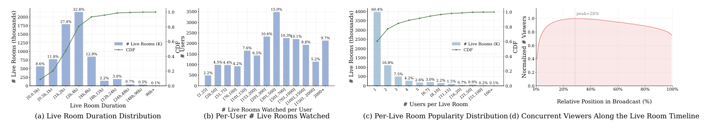

**表 1　论文基本信息**

| 项目 | 内容 |
|---|---|
| 原题 | KuaiLive-M3: A multi-modal, multi-domain, and multi-feedback dataset for live streaming recommendation |
| 作者 | Ke Guo, Changle Qu, Jiayaqi Cheng, Xiao Zhang, Shijun Wang, Xiaoyu Zhang, Xueliang Wang, Le Zhang, Lantao Hu, and Jun Xu |
| 发表 | arXiv preprint, arXiv:2607.24862v1 [cs.IR] |
| 版本日期 | 26 July 2026 |
| Keywords | Dataset, Live Streaming, Cross-Domain Recommendation |
| 项目 | [KuaiLive-M3](https://imgkkk574.github.io/KuaiLive-M3/) |
| 代码 | [KuaiLive-M3](https://github.com/imgkkk574/KuaiLive-M3) |

**图 1　arXiv 预印本首页（题名、作者及单位）**

## 一、研究现象：为什么播放日志不足以描述直播推荐？

直播（Live Streaming）的推荐对象随时间变化。同一场直播可能先讲解商品，再转到现场演示。两位观众虽然点进了同一个直播间，却可能在不同时间进入，看到完全不同的内容。若数据只记录“某人观看过某场直播”，研究者就很难把观众行为与当时的画面、声音或话题联系起来。

直播兴趣还可以来自短视频（Short Video）。例如，观众可能先看过一位创作者的短视频，后来在其开播时进入直播间，也可能被另一位创作者制作的同类内容吸引。短视频中的历史行为、两域共享的创作者身份以及内容相似性，分别提供可以用于直播推荐的线索。

观看、点赞和评论属于隐式反馈（Implicit Feedback）。它们记录实际行为，却只能间接表达下一次还想不想看。同一次观看之后，观众可能希望主播每次开播都被推荐，也可能只想偶尔看到，甚至希望停止推荐。直接询问观众的意愿，可以得到问卷式显式反馈（Questionnaire-based Explicit Feedback）。因此，一个能够研究直播推荐的数据集，需要同时回答三个问题：观众当时**看到了什么**，此前在其他内容场景**看过什么**，以及本人**表达了什么偏好**。

## 二、研究问题：怎样用同一套数据检验三类直播推荐问题？

论文构建 KuaiLive-M3，将实时直播内容、直播与短视频行为以及直播问卷对齐。三项基准任务（Benchmark Tasks）对应三个不同的预测对象。

1. **跨域推荐（Cross-domain Recommendation）**。给定观众的直播与短视频历史，短视频行为能否帮助推荐直播主播？输出是主播排序。
2. **直播高光预测（Live Stream Highlight Prediction）**。给定已经观测到的片段，下一片段是否可能有较高的留存和参与度？输出是下一直播片段的连续分数。
3. **问卷增强推荐（Questionnaire-enhanced Recommendation）**。将明确表达的推荐频率偏好与播放历史结合，能否改善主播排序？输出也是主播排序，但这里关注的新增信号是直播问卷。

前两项分别利用跨域历史和同一场直播的片段序列。第三项比较显式意愿能否补充隐式行为。虽然三者共享同一底层数据，它们在数据筛选、时间划分和评价对象上各有设置。

## 三、科学问题与设计原理

**表 2　现实问题、数据设计及其基准用途**

| 科学问题 | 数据设计 | 支持的检验 |
|---|---|---|
| 如何表达直播内容随时间变化？ | 提供带时间戳的片段级嵌入（Segment-level Embeddings），并提供整场的直播间级嵌入（Room-level Embeddings） | 用已观测片段预测下一片段的参与程度 |
| 如何连接短视频消费与直播兴趣？ | 用一致的匿名标识连接两域的观众与创作者，并保留各域播放记录和内容向量 | 比较只使用直播历史与同时利用短视频历史的推荐方法 |
| 如何区分参与行为与观众明确表达的推荐偏好？ | 提供观看及互动日志，并保存直播场景中的问卷选项和开放式回答 | 检验在播放历史上加入问卷选项的排序收益 |

这三种设计分别对齐时间、实体和反馈。时间对齐把行为连到直播片段，实体对齐把同一观众或创作者连到两个内容域，反馈对齐把观看历史与用户对主播的显式意愿联系起来。对齐后的数据可以按研究任务选取相应信号。

## 四、数据与方法速览

### 4.1 M3 分别对应哪些数据？

**图 2　KuaiLive-M3 数据集概览**

图 2 中央上方的创作者（Author）可以向左发布短视频，也可以向右开播。中央下方的观众可以在两侧观看和互动。这两种共享身份让研究者把原本分开的日志连起来。短视频侧按整条视频生成视频级嵌入（Video-level Embeddings）。直播侧则切成按时间排列的片段，并提供片段级和直播间级两种表示，因此既能比较整场，也能追踪同一场内的内容变化。

图 2 下方是直播域专有的问卷。第一问让观众在“每次开播都推荐”“偶尔推荐”“不再推荐”之间选择。随后的开放式问题根据选择询问喜欢之处、改进之处或不愿再看的原因。播放、点赞和送礼记录的是行为，问卷记录的是用户表达的推荐意愿。下方基准只使用第一问的选项，开放式回答作为可单独研究的文本信号保留在数据中。

### 4.2 数据如何采集与组织？

研究从快手（Kuaishou）抽取在 2026 年 3 月 4 日至 31 日每周至少产生一次播放日志的活跃用户，同期收集直播与短视频行为。短视频交互经过随机抽样。直播侧记录播放和七种辅助行为：曝光未进入、评论、点赞、分享、送礼、关注与举报。短视频侧记录播放以及评论、点赞、分享和关注。

**表 3　KuaiLive-M3 两个内容域的数据规模**

| 内容域 | 内容数 | 播放记录数 | 多模态嵌入（Multimodal Embeddings） | 问卷回答数 |
|---|---:|---:|---|---:|
| 直播 | 6,564,013 个直播间 | 35,806,596 | 6,502,107 个直播间级向量，88,223,794 个片段级向量 | 25,403 |
| 短视频 | 6,741,159 条视频 | 111,329,814 | 5,498,631 个视频级向量 | — |

数据覆盖 21,938 位观众和 2,185,201 位创作者。其中，1,061,343 位创作者在观察期内开播，186,895 位开播者同期也发布短视频，占开播创作者的 17.6%。这是观察窗口内的跨域身份重叠比例，可用来理解为什么除用户历史外，创作者也能连接两个域。数据按 CC BY-NC-SA 4.0 发布，用于非商业研究和教育。

### 4.3 内容和观看怎样随时间变化？

**图 3　直播领域互动模式分析**

图 3(a) 以场次开播总时长分组，2 至 4 小时组的占比最高，为 32.8%。图 3(b) 换到观众视角，统计四周内每人看过多少个不同直播间，中位数为 415。图 3(c) 再换到直播间视角，统计一场被多少位样本观众看过，60.4% 的直播间只有一位样本观众留下观看记录。一个人可以看很多房间，而许多房间在样本里只有很少观看记录。这两个分布共同说明为什么丰富的用户历史与稀疏的单房间交互可以并存。

图 3(d) 将每场直播的开始与结束分别映射到 0% 和 100%，再比较各相对时点的并发观看人数。图中平均曲线在约 28% 的位置达到峰值，之后逐步下降。纵轴是归一化后的并发观看量，曲线描述的是观察样本中不同相对时点的整体走势。它为时序预测提供了动机，因为整场平均观看量会抹去场内变化。

## 五、基准实验结果

### 5.1 跨域推荐：丰富的短视频历史需要合适的迁移方式

按域分别进行 5 核筛选（5-core Filtering），之后直播域包含 7,075,864 条交互、21,762 位观众及 302,643 位创作者，短视频域包含 49,881,858 条交互、21,823 位观众及 2,686,313 条视频。直播正例使用有效播放，短视频正例要求观看进度超过 10%。数据按时间以 8:1:1 划分，推荐对象为直播主播，评价采用召回率（Recall）与归一化折损累计增益（Normalized Discounted Cumulative Gain，NDCG）。

**表 4　单域与跨域推荐方法的代表性结果**

| 方法 | 类型 | Recall@10 | NDCG@10 | Recall@20 | NDCG@20 | Recall@40 | NDCG@40 |
|---|---|---:|---:|---:|---:|---:|---:|
| BPRMF | 单域 | 0.0376 | 0.0965 | 0.0606 | 0.0917 | 0.0934 | 0.0953 |
| LightGCN | 单域 | 0.0556 | 0.1358 | 0.0873 | 0.1278 | 0.1313 | 0.1315 |
| BiTGCF | 跨域 | 0.0379 | 0.0898 | 0.0592 | 0.0852 | 0.0895 | 0.0889 |
| MGCCDR | 跨域 | **0.0817** | **0.1795** | **0.1164** | **0.1651** | **0.1579** | **0.1633** |

MGCCDR 在论文比较的十三种方法中各项数值最高。以 Recall@10 为例，比第二名 LightGCN 高 2.61 个百分点。LightGCN 仅使用单域信号，但超过除 MGCCDR 外的跨域方法。这组对照说明，辅助数据的用途取决于迁移模型能否利用观众、主播和短视频之间的异构关系（Heterogeneous Relations）。

### 5.2 高光预测：时序上下文有助于预测下一片段

实验从播放互动最多的 10,000 个直播间中筛选至少含五个有效片段、五位观众的场次。模型输入是已观测片段的 128 维嵌入，播放、点赞和评论日志用于计算监督标签（Supervision Labels）。直播间按开播时间排序，以 70%、10%、20% 划分训练、验证和测试集。肯德尔等级相关系数（Kendall’s $\tau$）衡量房间内预测排序与真实排序的一致性，平均精确率均值（Mean Average Precision，mAP）评价二值高光识别。

**表 5　不同方法的下一片段高光预测结果**

| 方法 | Kendall’s τ（Δ=0） | Kendall’s τ（Δ=0.2） | Kendall’s τ（Δ=0.4） | mAP |
|---|---:|---:|---:|---:|
| MLP | 0.1474 | 0.1248 | 0.0872 | 0.5149 |
| GRU | **0.5068** | **0.3070** | 0.2777 | **0.7776** |
| AntPivot-style | 0.5000 | 0.3055 | **0.2917** | 0.7744 |
| KuaiHL-style | 0.4988 | 0.3042 | 0.2887 | 0.7747 |

仅用当前片段的多层感知机（Multilayer Perceptron，MLP）低于三个时序模型。门控循环单元（Gated Recurrent Unit，GRU）取得最高 mAP，采用分层因果注意力的 AntPivot-style 在更严格的片段分差阈值 $\Delta=0.4$ 下排序最好。在这个基准中，保留已观测片段的先后顺序带来的差异大于三种时序模型之间的差异。

### 5.3 问卷增强推荐：少量显式选择可以补充播放历史

基准用直播播放记录作为隐式反馈，将“每次开播都推荐”和“偶尔推荐”视为正向问卷反馈，将“不再推荐”视为负向反馈。全期做 5 核筛选后，采用按时间留一（Chronological Leave-one-out）。每个保留的正例主播与 99 个从未与该用户交互的随机主播共同排序。指标包括命中率（Hit Ratio，HR）、NDCG 与平均倒数排名（Mean Reciprocal Rank，MRR）。

**表 6　问卷增强主播推荐的代表性结果**

| 方法 | NDCG@5 | NDCG@10 | HR@1 | HR@5 | HR@10 | MRR |
|---|---:|---:|---:|---:|---:|---:|
| GRU4Rec | 0.8942 | 0.9022 | 0.8326 | 0.9431 | 0.9673 | 0.8826 |
| GRU4Recₘ | 0.9063 | 0.9126 | 0.8511 | 0.9497 | 0.9689 | 0.8957 |
| SASRec | 0.9153 | 0.9211 | 0.8646 | 0.9554 | 0.9731 | 0.9054 |
| SASRecₘ | **0.9231** | **0.9281** | **0.8742** | 0.9613 | 0.9768 | **0.9133** |
| FMLP-Rec | 0.9190 | 0.9248 | 0.8694 | 0.9583 | 0.9758 | 0.9093 |
| FMLP-Recₘ | 0.9216 | 0.9269 | 0.8722 | 0.9602 | 0.9762 | 0.9119 |
| DFN | 0.9203 | 0.9255 | 0.8671 | **0.9618** | **0.9778** | 0.9095 |

下标 m 表示将问卷作为额外行为信号。三组加入问卷的版本在六项指标上均高于各自的仅播放版本。SASRecₘ 的优势主要体现于首位命中和排名质量，DFN 在前五与前十的命中率上领先。这里的分数是在每例 100 个候选主播的协议下得到的，适合解释同一任务内的对照。

## 六、进阶解析

### 6.1 从原始日志到可对齐的研究单元

数据发布结构包含 18 个表或集合。共享匿名标识使同一观众、创作者和内容对应的记录可以连接。搭建任务时应先确定预测单位，再选择连接键与信息的可用时间。

**表 7　代表性数据表与对齐单位**

| 数据 | 代表性文件或目录 | 连接单位与时间语义 |
|---|---|---|
| 创作者画像（Author Profile） | `author_profile.csv` | `author_id` 连接开播、短视频及创作者属性 |
| 直播观看与场次信息 | `live_interaction.csv`、`live_room_meta.parquet` | `user_id` 和 `live_id` 连接观看记录与场次。观看记录有进入与退出时间，场次有开播与结束时间 |
| 曝光及带时间戳的反馈 | `live_show.parquet`、`live_like.csv`、`live_comment.csv` | 曝光未进入可作为负向行为线索。点赞与评论事件可按时间归入片段 |
| 直播片段向量 | `live_emb_128_ts/` | `live_stream_id`、`segment_id` 和片段末端时间戳 |
| 直播问卷 | `live_questionnaire.csv` | 通过观众、主播及场次标识关联问卷选项与后续回答 |
| 短视频播放与内容 | `photo_play.parquet`、`photo_emb_128.parquet` | `photo_id` 连接播放事件与视频向量，同一观众和视频可以对应多次播放 |

多模态大语言模型（Multimodal Large Language Model，MLLM）使用视听片段、自动语音识别（Automatic Speech Recognition，ASR）转写、题名、简介和创作者画像等输入。通过主成分分析（Principal Component Analysis，PCA），直播片段向量降到 128 维，已经保留的片段汇总到房间级再降到 64 维。短视频提供 128 维视频级向量。直播片段仅保留有交互的部分，嵌入时间戳记录片段结束时间。高光基准将前一个保留片段的结束时间用作当前片段的开始时间，首片段以开播时间为起点。

### 6.2 高光分数怎样由观看与互动构成？

设 $r$ 表示直播间，$k$ 表示该直播间的一个片段。$N^{\mathrm{entered}}_{r,k}$ 是截至片段开始时已进入房间的记录观众数，$N^{\mathrm{stay}}_{r,k}$ 是这批观众中留到片段结束的人数。直播观众留存率（Live Viewer Retention Rate，LVTR）为

$$
\mathrm{LVTR}_{r,k}=\frac{N^{\mathrm{stay}}_{r,k}}{\max(N^{\mathrm{entered}}_{r,k},1)}.
\tag{1}
$$

式（1）用当前片段开始前的进入人数作比较基数，并用 1 保证分母为正。若 20 人已进入且其中 12 人留到结束，留存率为 0.60。片段内新加入的观众不属于这次留存计算的起始人群。

互动密度（Engagement Density，ED）衡量主动反馈。$N^{\mathrm{like}}_{r,k}$ 和 $N^{\mathrm{comment}}_{r,k}$ 分别是这个片段内的点赞事件数和评论事件数。

$$
\mathrm{ED}_{r,k}=\frac{N^{\mathrm{like}}_{r,k}+2N^{\mathrm{comment}}_{r,k}}{\max(N^{\mathrm{entered}}_{r,k},1)}.
\tag{2}
$$

式（2）按事件计数，并给评论两倍权重。例如，同样以 20 人为基数，片段内有 4 次点赞、3 条评论，互动密度为 $(4+2\times3)/20=0.50$。由于点赞与评论属于事件，互动密度描述的是每单位观众基数对应的加权互动次数。

随后，模型监督使用房间内分别做最小–最大归一化（Min–max Normalization）的两个分量。记归一化结果为 $\widetilde{\mathrm{LVTR}}$ 与 $\widetilde{\mathrm{ED}}$，片段标签为

$$
y_{r,k}=0.6\,\widetilde{\mathrm{LVTR}}_{r,k}+0.4\,\widetilde{\mathrm{ED}}_{r,k}.
\tag{3}
$$

式（3）把留存与主动互动统一到房间内的相对尺度。若两个归一化分量分别为 0.8 和 0.5，则该片段得分为 0.68。不同房间各自归一化，所以同一分数表示各自在本场的相对表现。进行二值评价时，以该房间内分数的第 70 百分位为界，达到或超过阈值的片段标记为高光。

### 6.3 下一片段预测的时间边界

设 $\mathbf x_{r,j}$ 为直播间 $r$ 的第 $j$ 个片段向量。将论文的预测设置写成输入与输出的关系，可以直观看出标签与特征的时间错位。

$$
\hat y_{r,k+1}=F_\theta(\mathbf x_{r,1},\ldots,\mathbf x_{r,k}).
\tag{4}
$$

式（4）右侧最晚用到 $k$，左侧预测 $k+1$。下一片段的观看、点赞与评论事后用于生成目标 $y_{r,k+1}$。MLP 仅取 $\mathbf x_{r,k}$，GRU 依序汇总前序状态，AntPivot-style 先用局部窗口建模近邻变化，再用全局因果注意力（Causal Attention）整合较长历史。KuaiHL-style 直接在已观测序列上使用因果自注意力（Causal Self-attention）。四者共用内容特征和监督定义，差别主要在于如何利用过去的片段。

### 6.4 两项主播推荐基准如何构造监督？

跨域任务将用户的短视频播放作为辅助行为，目标是从直播侧的创作者集合中排序。共享 `user_id` 让模型沿同一观众的两域历史学习，`author_id` 则提供两域可对齐的创作者身份。短视频观看进度超过 10% 的规则决定哪些辅助交互成为正例，直播侧保持有效播放规则。

问卷任务把第一问的三个选择按意愿方向处理。前两个选项同属正向，最后一个属负向。序列模型的 m 版本增加一个问卷行为通道，因此可与其原始版本逐一比较。SAQRec 采用另一条路径，先训练问卷响应倾向与满意度预测，再用训练好的满意度模型为推荐器提供监督。两种方式分别利用问卷作为直接行为特征或间接训练信号。

## 参考文献

Guo, K., Qu, C., Cheng, J., Zhang, X., Wang, S., Zhang, X., Wang, X., Zhang, L., Hu, L., & Xu, J. (2026). KuaiLive-M3: A multi-modal, multi-domain, and multi-feedback dataset for live streaming recommendation. *arXiv preprint arXiv:2607.24862*. [https://arxiv.org/abs/2607.24862](https://arxiv.org/abs/2607.24862)
