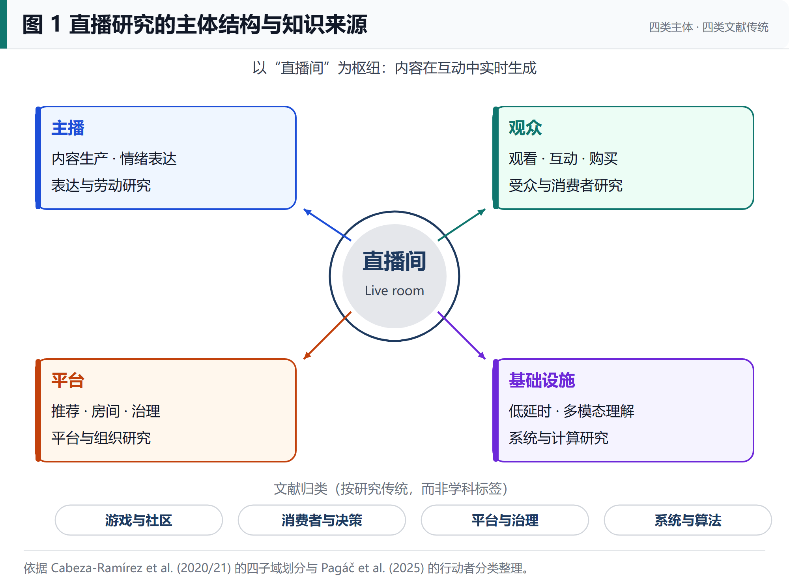
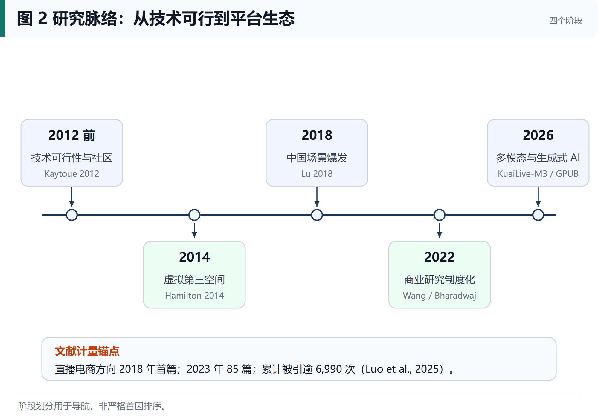
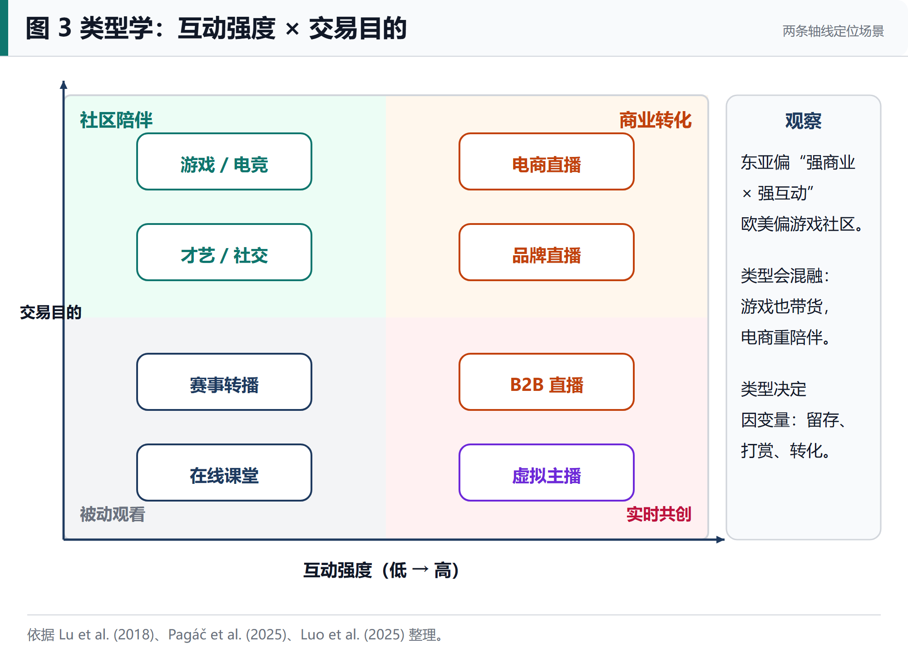
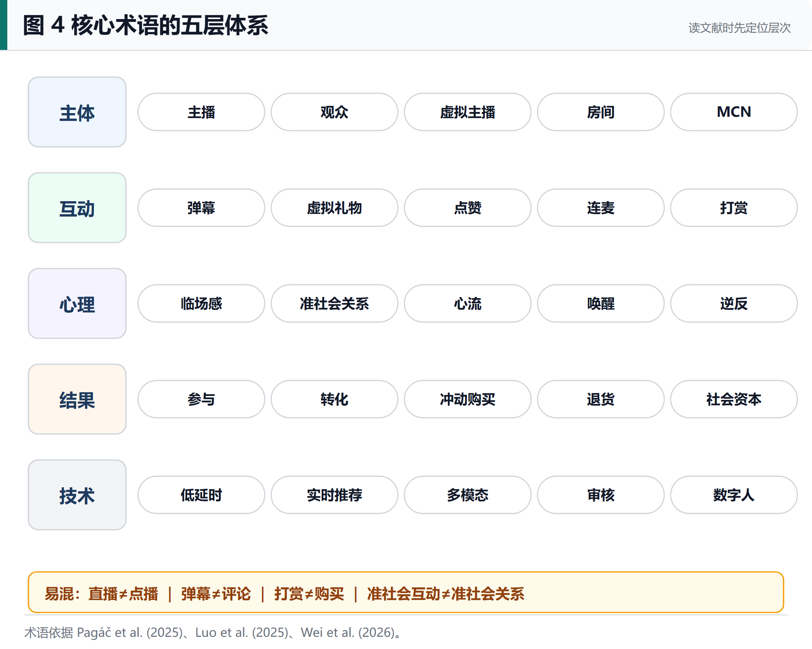
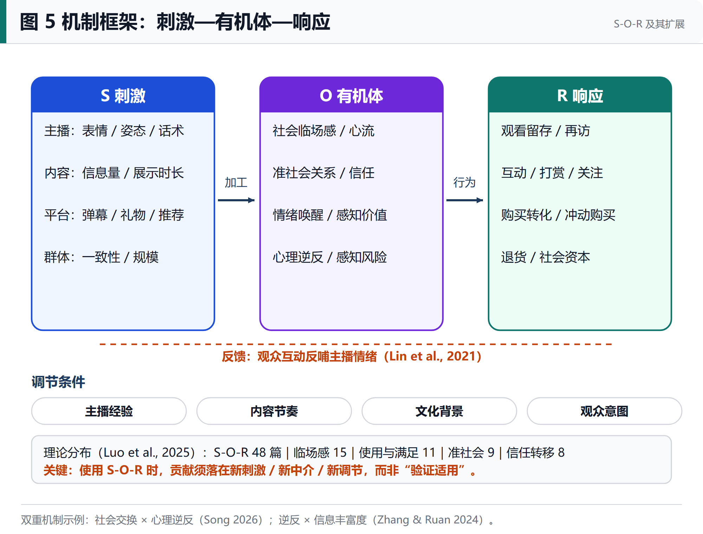
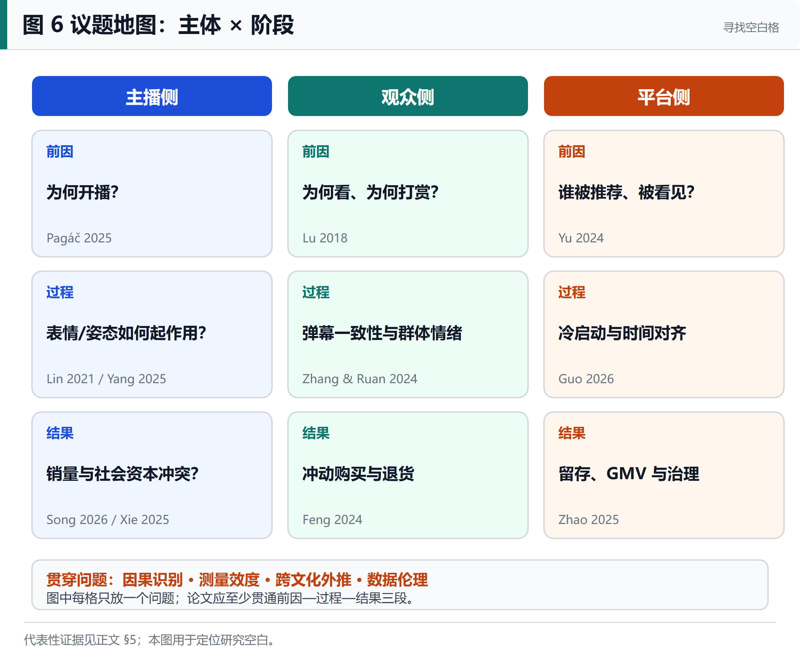
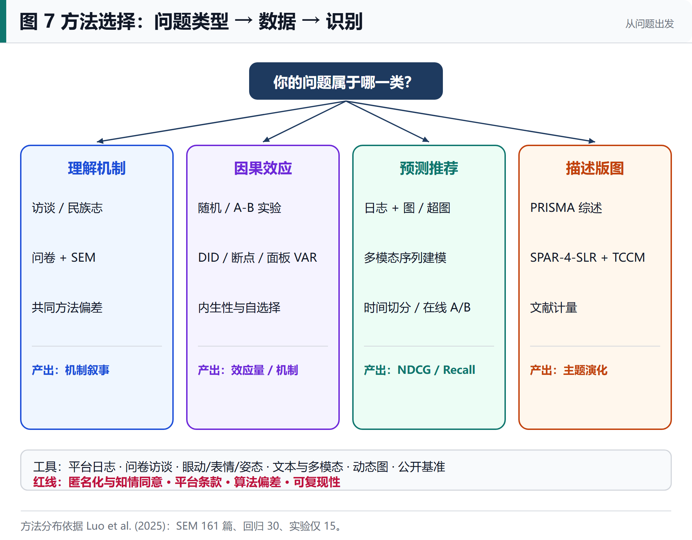
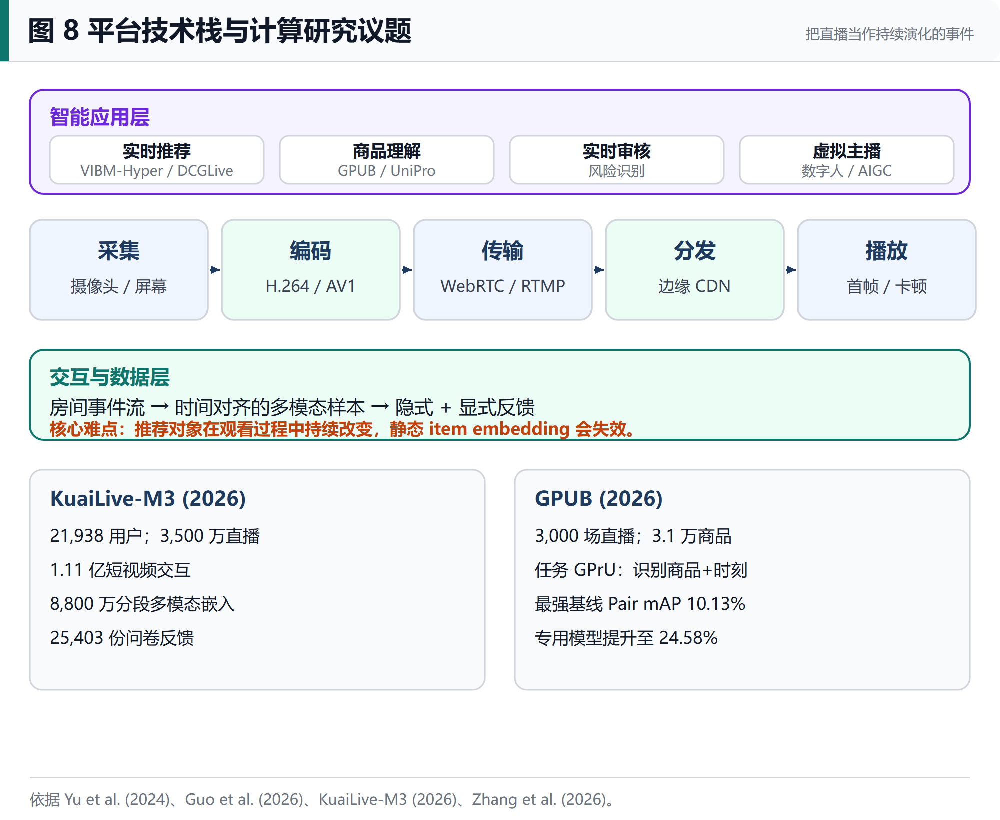
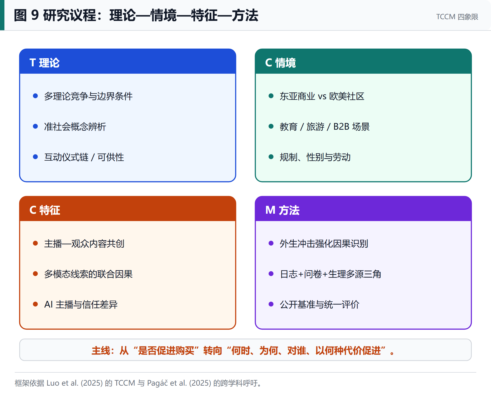
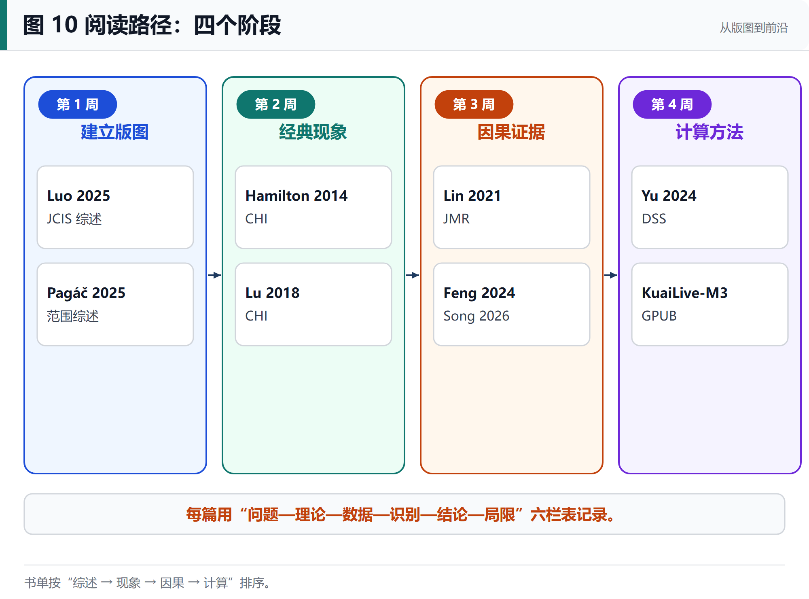

# 直播研究：文献版图、核心议题与方法路径

## 0. 速览

1. **直播不是"视频+评论区"**，而是**实时生成的内容—互动—交易耦合系统**：内容在观看过程中被共同生产，研究对象从静态"物品"变成动态"事件/房间"（Guo et al., 2026a, 2026b）。
2. **文献可归为四类研究传统**：游戏与社区、受众与消费者决策、平台与组织治理、系统与算法（图 1）。这四类传统对应不同的问题意识与证据标准。
3. **研究重心存在显著的东西方差异**：欧美以游戏/电竞与社区参与为主，东亚（尤其中国）以秀场与电商直播为主；二者在理论与方法上尚未充分互通（Lu et al., 2018；Pagáč et al., 2025）。
4. **理论高度分散但高度集中**：Luo et al.（2025）在 168 篇理论驱动研究中识别出 84 种理论，其中 S-O-R 独占 48 篇；社会临场感、使用与满足、准社会互动、信任转移紧随其后（图 5）。
5. **主流方法是问卷 + SEM，最稀缺的是实验**：161 篇用 SEM，仅 15 篇用实验；因果证据仍是领域短板（Luo et al., 2025；图 7）。
6. **核心机制不是单向说服，而是双向反馈**：主播情绪影响观众打赏，观众互动又反哺主播情绪（Lin et al., 2021）；**"过度"说服会抬升退货**（Feng et al., 2024）。
7. **系统与算法研究的难点不在"看清画面"，而在时间对齐**：直播内容是持续演化的多模态流，推荐对象在观看中改变，**静态 item embedding 与离线评估都会失效**（图 8）。
8. **商业与组织研究的难点不在"促进购买"，而在权衡代价**：**社交 solicitation 能涨社会资本却可能伤销售**（Song et al., 2026）；弹幕一致性会抑制购买（Zhang & Ruan, 2024）。
9. **最值得投入的空白**：非游戏场景、跨文化比较、长期效应、多模态线索的因果识别、公开可复现基准（图 9）。
10. **阅读顺序**：综述 → 经典现象 → 因果证据 → 计算研究，四阶段路径见图 10。

*引用口径：正文采用 APA 7 作者—年份制，文末参考文献按 APA 7 排列；凡涉具体数值均标注来源。*

---

## 1. 定义、边界与类型：什么算"直播研究"

### 1.1 三层定义

"直播"在不同文献传统中指称不同对象。为避免检索与理论对话中的错位，建议采用三层定义：

| 层次 | 定义 | 关键判据 | 典型文献传统 |
|---|---|---|---|
| **技术层** | 以连续流方式在网络上实时传输音视频（Pagáč et al., 2025 区分 streaming 与 live-streaming） | 实时性、连续性、低延时 | 系统与传输研究 |
| **交互层** | 主播与观众、观众与观众之间存在**同步的双向沟通**（弹幕、礼物、连麦） | 双向性、共时性 | 受众、互动与媒介研究 |
| **制度/商业层** | 平台以房间为单位组织流量、激励与交易，形成可持续的生产—分配—变现结构 | 平台中介、可商业化 | 平台、组织与消费研究 |

**操作性定义建议**：若研究对象缺少"同步双向互动"，应明确标注为"网络电视/赛事转播"；若缺少"实时生成内容"，应标注为"点播/短视频"。这一区分直接决定因变量选择：转播研究看观看规模与体验，互动直播研究看参与、关系与转化。

### 1.2 与相邻概念的边界

| 概念 | 与直播的关键差别 | 研究后果 |
|---|---|---|
| 点播视频（VOD） | 内容先生产后消费；无共时反馈 | 推荐对象是静态 item；可用传统离线评估 |
| 短视频 | 时长短、编辑完成、算法分发优先 | 侧重内容特征与完播率，而非房间内互动 |
| 电视直播/赛事转播 | 单向广播，观众间互动弱或外置 | "集体观看"研究而非"共创"研究 |
| 社交电商 | 可基于图文/预录内容；无需实时同步 | 信任机制来自人际网络而非临场互动 |
| 直播电商（LSC） | 在直播中完成讲解—问答—下单闭环 | 因变量扩展到 GMV、冲动购买、退货 |
| 虚拟主播 / 数字人 | 主体是人机混合身份 | 真实性与信任机制需要重新理论化 |

Luo et al.（2025）将直播电商进一步分为三类渠道：电商平台内嵌直播（如淘宝、Amazon Live）、直播平台加入商业功能（如斗鱼、Live.me）、社交媒体加入直播售卖（如 Facebook、Instagram）。三类渠道的可供性不同，不宜混为一谈。

### 1.3 主体结构与文献来源

**图 1　直播研究的主体结构与知识来源。** 以"直播间"为枢纽，上游是主播与内容生产，下游是观众与行为结果，平台与基础设施构成约束条件。围绕这一结构，已有文献可归为四类研究传统：**游戏与社区**、**受众与消费者决策**、**平台与组织治理**、**系统与算法**。

最早的系统综述之一来自游戏直播研究：Li et al.（2020）将文献组织为**主播需求、观众需求、互动行为、平台影响**四类主题；Cabeza-Ramírez et al.（2021）进一步用文献计量方法描绘该领域的知识版图。Pagáč et al.（2025）则以观众体验为核心，归纳出四类行动者（community、player、streamer、viewer）与六类直播体裁（creative、education、esport、game、shopping、social）。三种划分的差异说明：领域尚无统一本体（ontology），这正适合按文献传统逐条梳理。

### 1.4 研究脉络的四个阶段

**图 2　研究脉络。** 2014 年前以"技术可行性与社区形成"为主（Kaytoue et al., 2012；Hamilton et al., 2014）；2016—2018 年中国秀场与电商直播催生大量现象级研究（Lu et al., 2018）；2020 年后研究制度化并快速吸收计量与机器学习方法（Wang et al., 2022；Bharadwaj et al., 2022；Yu et al., 2024）。2023 年后，多模态大模型与生成式 AI 使"实时理解直播间"成为可行任务（KuaiLive-M3, 2026；Zhang et al., 2026）。

### 1.5 类型学：互动强度 × 交易目的

**图 3　直播类型学。** 单一维度（如"游戏 vs 电商"）无法刻画现实：游戏主播会带货，电商主播也提供陪伴。用**互动强度**与**交易目的**两个维度定位，可以解释为什么某些机制（如准社会关系）跨场景有效，而另一些（如冲动购买）只在右下象限突出。Lu et al.（2018）早已指出，中国直播的用户场景远比北美研究中的"赛事直播/熟人分享"宽泛；这一差异至今仍塑造着文献分布。

---

## 2. 文献版图：产出、理论与方法

### 2.1 两幅全景图的关键数字

| 维度 | 直播电商（LSC）综述 | 观众体验范围综述 |
|---|---|---|
| 样本 | 2018—2023.10，201 篇期刊论文（初检 2,884 篇） | 348 篇同行评议文献 |
| 增长 | 2018 年 1 篇 → 2023 年 85 篇；累计被引 > 6,990 次 | 稳步增长，游戏/电竞占主导 |
| 地理 | 中国 76.12%，中国台湾地区 11.44%，韩国 9.95%；样本中 85.07% 在中国大陆 | 中国与美国的合作网络最活跃 |
| 研究对象 | 消费者 86.07%，主播 4.48%，两者兼有 9.45% | 观众、主播、社区、玩家四类行动者 |
| 平台 | 56.22% 未指定具体平台 | 以 Twitch 等游戏平台为主 |
| 新兴主题 | 旅游、农业、服装、食品、奢侈品 | 电商、心理健康、教学协作、旅游 |
| 来源 | Luo et al. (2025) | Pagáč et al. (2025) |

> **解读**：直播研究呈现"**场景高度集中、理论高度分散、证据以横截面为主**"三重特征。对中国学者而言，这是机会（本土现象丰富）也是陷阱（外推性受质疑）。

### 2.2 理论使用分布

Luo et al.（2025）在 168 篇理论驱动的 LSC 论文中发现 84 种理论，33 篇未使用明确理论。使用频次前五：

| 理论 | 篇数 | 主要解释对象 |
|---|---:|---|
| 刺激—有机体—响应（S-O-R） | 48 | 平台/主播/社会线索 → 认知情感状态 → 行为 |
| 社会临场感理论（SPT） | 15 | "他人在场"带来的沉浸与信任 |
| 使用与满足理论（UGT） | 11 | 为何观看、为何参与 |
| 准社会互动理论（PSI） | 9 | 单向媒介人格带来的拟似亲密关系 |
| 信任转移理论（TTT） | 8 | 对主播的信任如何迁移到产品/商家 |

其余理论包括 AIDMA、心流、唤醒、心理契约、心理逆反、社会交换、社会认同、调节聚焦、社会学习等。Wei et al.（2026）专门综述了准社会互动与准社会关系（parasocial interaction vs. relationship）在直播中的概念争论，指出二者在实时互动环境下的边界仍需澄清——**这是尚未解决的概念问题**。

### 2.3 方法分布与证据强度

| 方法环节 | 分布（Luo et al., 2025） | 含义 |
|---|---|---|
| 数据收集 | 问卷/访谈 148 篇；实地/爬取数据 44 篇；混合 9 篇 | 自报数据占绝对多数 |
| 数据分析 | SEM 161 篇；回归 30 篇；质性 12 篇；混合 13 篇 | 相关/协方差结构为主 |
| 实验 | 15 篇 | **因果识别严重不足** |
| 样本情境 | 中国大陆 85.07% | 跨文化外推有限 |

**对希望深入平台数据与因果识别的读者而言**，这里有一个明确的机会窗口：把丰富的平台行为日志与自然实验/随机实验结合，比再做一份横截面问卷更有边际贡献。已有良好范例：Feng et al.（2024）比较直播场次与重播场次（唯一差异是实时社交互动存在与否）识别退货效应；Lin et al.（2021）用分钟级面板向量自回归刻画主播与观众的双向动态。

### 2.4 主要发表阵地

- **互动与技术会议**：CHI、CSCW、WWW、SIGIR、KDD、ICWSM、EuroITV/ICMI。
- **信息系统期刊**：MIS Quarterly、Information Systems Research、JMIS、Decision Support Systems、Information & Management、Internet Research、Journal of Computer Information Systems。
- **营销/消费期刊**：Journal of Marketing、Journal of Marketing Research、Journal of the Academy of Marketing Science、Journal of Retailing and Consumer Services、Production and Operations Management、Psychology & Marketing。
- **传播/媒介期刊**：Computers in Human Behavior、Entertainment Computing、New Media & Society、Information, Communication & Society。

投稿之前先判断：你的贡献是**机制解释**（管理/营销期刊）、**系统/算法**（技术会议）、还是**人与界面的互动设计**（HCI 会议）。三者的论证标准不同。

---

## 3. 术语与构念体系

**图 4　核心术语的五层体系。** 建议把术语按"主体—互动—心理—结果—技术"五层记忆：读文献时先判断作者在谈哪一层，再判断其因果箭头方向；写论文时避免把不同层次的变量放进同一个假设（例如把"弹幕一致性"当作心理构念）。

### 3.1 主体与行为

| 中文 | 英文 | 简明释义 |
|---|---|---|
| 主播 / 播主 | streamer, broadcaster, anchor | 实时内容生产者；电商语境也称"主播/达人" |
| 观众 / 观看者 | viewer, spectator, audience | 既可被动观看也可实时互动 |
| 虚拟主播 | VTuber, virtual streamer | 以虚拟化身呈现的主播，身份真实性是核心议题 |
| 房间 / 场次 | live room, session | 推荐与计量分析的基本单位；同一主播的连续场次应区分 |
| 弹幕 | danmaku, bullet chat | 叠加在画面上的实时评论，兼具社交信号与信息线索 |
| 虚拟礼物 | virtual gift, tipping | 观众用真实货币购买的非交易性回馈 |
| 连麦 | co-streaming, live co-hosting | 主播间或主播与观众的实时音视频连接 |
| 打赏 | tipping | 与"购买"不同的价值流向：回馈主播而非取得商品 |

### 3.2 心理与机制

| 中文 | 英文 | 简明释义 |
|---|---|---|
| 社会临场感 | social presence | "他人在场"的主观感受，影响信任与沉浸 |
| 准社会互动 / 关系 | parasocial interaction / relationship | 单次互动体验 vs. 长期累积的拟似亲密关系；概念边界仍在争论（Wei et al., 2026） |
| 心流 | flow | 沉浸状态，常作为观看留存的前因 |
| 情绪唤醒 | arousal | 生理/心理激活程度，常作为情绪传播的中介 |
| 感知风险 / 信任 | perceived risk / trust | 直播间降低信息不对称的两条路径 |
| 心理逆反 | psychological reactance | 感到自由受威胁时的抵抗，解释"劝说过度" |
| 信息丰富度 | information richness | 媒介传递信息的能力，在弹幕研究中作为另一条并行机制 |

### 3.3 结果与技术

| 中文 | 英文 | 简明释义 |
|---|---|---|
| 参与 | engagement | 观看、评论、点赞、关注等综合行为；需拆分测量 |
| 转化 / GMV | conversion / gross merchandise volume | 从观看到下单的转化与成交总额 |
| 冲动购买 | impulse buying | 直播高压销售情境下的低 deliberation 购买 |
| 退货 | product returns | 常被忽视的负向结果；与实时互动强度正相关（Feng et al., 2024） |
| 社会资本 | social capital | 粉丝规模、关系网络资源；可能与销售目标冲突（Song et al., 2026） |
| 可供性 | affordance | 技术特性为行动者提供的可能性（如"可弹幕""可打赏"） |
| 多模态理解 | multimodal understanding | 联合视频、音频、文本、弹幕的表示与推理 |
| 实时推荐 | live recommendation | 推荐对象持续演化，需时间对齐与在线更新 |

---

## 4. 机制框架与理论视角

**图 5　机制框架。** S-O-R 是当前最通用的"骨架"，但它本身不提供具体机制；真正的理论贡献来自在 O 层填入何种心理状态、在 S 层识别出何种新刺激。图中虚线反馈回路强调直播区别于传统广告的关键：**结果会反作用于前因**（Lin et al., 2021）。

### 4.1 S-O-R：通用骨架而非理论贡献

S-O-R 的价值在于组织变量：刺激可来自主播（表情、姿态、话术）、内容（信息量、展示时长）、平台（弹幕、礼物、推荐）与群体（一致性、规模）；有机体是临场感、准社会关系、信任、唤醒、逆反等；响应则包括留存、互动、转化与退货。使用 S-O-R 时，**论文的创新点必须落在新刺激、新中介或新调节**，而非"验证 S-O-R 适用"。

### 4.2 社会临场感与准社会关系：解释"为什么陌生人也可信"

社会临场感强调媒介让人感到"他人在场"，在直播中由实时视频、即时回应与弹幕共同构建。准社会关系则解释观众对主播产生的、类似面对面关系的情感联结。二者常被并用，但需警惕概念重叠：Wei et al.（2026）指出直播中的实时互动使传统"单向准社会"定义失效，并归纳出四种理论立场；写作时应明确采用哪一种，并说明其与信任、认同的区别。

### 4.3 使用与满足、社会认同、心流：解释"为什么看、为什么留"

UGT 回答观看动机：信息获取、娱乐、社交、身份表达。社会认同与"双重认同"解释观众对主播及社区的归属。心流解释长时间停留。这些理论更适合作为**前因层理论**而非结果层解释。

### 4.4 信任与不确定性降低：电商直播的核心机制

直播通过实时展示、即时答疑、第三方主播背书降低产品不确定性。Wang et al.（2022）发现主播与商家之间的**独立身份**是关键：主播作为中介提升消费者的购买意识并影响决策。Liao et al.（2023）进一步从主播胜任力视角解释 B2B 场景的销售提升。

### 4.5 情绪劳动与双向反馈：直播的"过程性"

- Lin et al.（2021）对 1,450 场直播的分钟级面板 VAR 显示：更快乐的主播使观众更快乐并带来更多打赏，观众参与又促使主播回报更多微笑；这些效应只在开播一段时间后、且主播经验/人气较高时显著。
- Bharadwaj et al.（2022）分析 99,451 段销售陈述，发现六类情绪表达（含快乐）随时间的销售效应均呈 **U 形负向**：中段抵抗最强，并推导出面部出现与情绪展示的最优分配曲线。
- Yang et al.（2025）在 9,641 段抖音推销中发现主播肢体动作与销售呈**曲线关系**，机制是信息过载；Liu et al.（2025）基于 522 万帧视频发现姿态丰富度与强度正向影响小微企业经销商采购。

> **方法论启示**：情绪/动作效应普遍是**非线性、时间依赖**的。若只做"有无微笑"的组间比较，很可能得到相互矛盾的结论。

### 4.6 可供性与社会技术系统：把平台设计纳入理论

可供性理论（affordance）把弹幕、礼物、房间、推荐视为"行动可能性"而非单纯功能。Sjöblom et al.（2019）分析了游戏直播的关键可供性；Luo et al.（2025）的文献计量显示可供性视角在社交商务与直播商务间起到理论桥接作用。**对平台设计者而言**，可供性提示"改一个按钮"可能改变整个互动生态。

### 4.7 双过程、心理逆反与社会交换：解释"好心办坏事"

- Zhang and Ruan（2024）通过三项实验发现：**弹幕一致性降低购买**，中介机制是心理逆反与信息丰富度（双过程），并受"发布弹幕的内在动机"调节。
- Song et al.（2026）在 1,128 场淘宝直播中发现：社交 solicitation（求关注、求评论、求点赞）提升社会资本，却对销售产生**负向溢出**；提供更多产品信息可缓解，增加购买 solicitation 会强化；若所请求的社交行为与观众购买意图一致，负向效应消失。
- Feng et al.（2024）比较直播与重播场次：实时社交互动显著提高退货率，互动强度每提高一个标准差，绝对退货率上升约 8.59 个百分点（超过平均退货率的 20%）。

三者共同指向一条重要命题：**直播中的"参与"与"销售"并非同一目标，甚至可能相互冲突**。绩效指标必须分层设计（见 §8.1）。

---

## 5. 研究议题地图：主体 × 阶段

**图 6　议题地图。** 横轴是研究主体，纵轴是前因—过程—结果。选题时可在此图上定位"空白格"；审稿时可用它检查论文是否只覆盖了单格而缺少机制链条。

### 5.1 主播侧：从"表达什么"到"如何持续表达"

| 研究问题 | 理论透镜 | 可用方法 | 代表性证据 |
|---|---|---|---|
| 主播表情/姿态如何影响销售，何时"过犹不及"？ | 情绪感染、信息过载 | 视频深度学习 + 回归 | Bharadwaj 2022；Yang 2025；Liu 2025 |
| 商品展示时长如何分配？ | 注意力经济、信息处理 | 平台日志 + 计量模型 | Xie et al. 2025（POM）：单品时长↑提升单品收入，但平均时长↑降低场次收入 |
| B2B 直播中解释性线索与情感线索如何保持一致？ | 沟通一致性、信号理论 | 内容编码 + 销售绩效 | Liu et al. 2026（JBR）；Liao et al. 2023 |
| 主播的情绪劳动、倦怠与激励如何演化？ | 情绪劳动、劳动过程 | 访谈 + 纵向日志 | Pagáč et al. 2025 指出心理健康为新兴主题 |

### 5.2 观众侧：动机、群体与"非理性"的边界

| 研究问题 | 理论透镜 | 可用方法 | 代表性证据 |
|---|---|---|---|
| 为何观看、互动与打赏？ | UGT、认同、社会交换 | 问卷 + SEM；访谈 | Lu et al. 2018；Wohn et al. 2018 |
| 社会线索是促进还是削弱注意？ | S-O-R | 眼动实验 | Fei et al. 2021（DSS 142, 113466） |
| 弹幕一致性为何抑制购买？ | 双过程、心理逆反 | 行为实验 | Zhang and Ruan (2024) |
| 群体情绪如何引发即时撤单？ | 群体情绪、情绪传染 | 平台日志 + 计量 | Wang et al. 2024（DSS 179, 114147） |
| 群体规模与内容审核如何塑造参与？ | 去个体化、治理 | 在线实验/日志 | Zhao et al. 2025（ISR） |
| 冲动购买与退货是否一体两面？ | 劝说知识、后悔 | 自然实验对照 | Feng et al. 2024 |

### 5.3 平台侧：推荐、治理与生态

| 研究问题 | 计算任务 | 关键难点 | 代表性证据 |
|---|---|---|---|
| 下一个进入哪个直播间？ | 动态图/超图推荐 | 多行为对象不同（观看指向场次，送礼指向主播） | Yu et al. (2024)；Guo et al. (2026b) |
| 新房间冷启动如何借用主播历史？ | 表示初始化、跨域迁移 | 本场尚无交互 | Guo et al. (2026b) |
| 短视频与直播的偏好如何迁移？ | 跨域推荐 | 99.44% 观众两类内容都看 | KuaiLive-M3 2026 |
| 哪个商品在哪些时刻被展示？ | 多模态时序定位 | 证据分散、非连续 | GPUB / UniPro 2026 |
| 内容审核如何避免"群体失焦"？ | 实时治理、异常检测 | 规模与审核的交互 | Zhao et al. 2025 |

### 5.4 贯穿性问题（跨格）

- **因果识别**：观看与购买高度内生；自选择、反向因果、同时性普遍存在。
- **测量效度**："参与"是构念还是行为集合？打赏、评论、留存的权重应如何确定？
- **外推性**：中国场景的结论能否迁移到欧美、B2B、非游戏场景？
- **伦理**：打赏诱导、算法放大、主播劳动权益、未成年人保护。

---

## 6. 研究方法：设计、数据与识别

**图 7　方法选择决策树。** 先问"我要回答什么类型的问题"，再选方法；不要从"我会什么方法"倒推研究问题。

### 6.1 选择矩阵

| 问题类型 | 首选方法 | 数据 | 主要威胁 | 示例 |
|---|---|---|---|---|
| 理解机制 | 访谈、民族志、扎根；问卷 + SEM | 访谈转录、问卷 | 自报偏差、构念重叠 | Lu 2018；Wang 2022 |
| 因果效应 | 随机实验、A/B；自然实验、DID、断点；面板 VAR | 平台日志 + 外生冲击 | 内生性、选择偏差 | Feng 2024；Lin 2021；Song 2026 |
| 预测/推荐 | 图/超图、动态图、多模态序列模型 | 行为日志 + 内容表示 | 数据泄漏、离线—在线不一致 | Yu et al. (2024)；Guo et al. (2026b) |
| 描述/版图 | PRISMA 系统综述；SPAR-4-SLR + TCCM；文献计量 | 论文元数据 | 检索式覆盖、语言偏倚 | Luo 2025；Pagáč 2025 |

### 6.2 四种方法路径的操作要点

**（1）问卷 + SEM**：适合测量"心理链"。注意现有文献中 SEM 已过度使用；除非提出新构念或新边界条件，否则边际贡献有限。建议与行为日志配对以检验共同方法偏差。

**（2）实验与准实验**：适合识别机制方向。Zhang and Ruan（2024）的三实验设计是良好模板：主效应 → 中介 → 调节。准实验可利用"直播 vs 重播"（Feng et al., 2024）、平台规则变更、主播排班外生性等。

**（3）日志计量**：直播日志天然是**事件流 + 面板 + 时间序列**的混合体。可用方法包括固定效应面板、面板 VAR（Lin et al., 2021）、断点回归（开播/下播时刻）、双重差分（政策或功能上线）。关键是明确"处理"是什么、对照组是否可比。

**（4）计算建模**：这里的评估必须处理"内容在工作流中变化"。离线指标常用 NDCG@K、Recall@K、MRR；但必须补充时间外推切分（按时间而非随机划分）与在线 A/B。KuaiLive-M3（2026）特别指出现有基准缺少显式反馈，因此提出问卷增强推荐任务。

### 6.3 测量工具箱

- **行为**：进入/退出、观看区间、弹幕、点赞、礼物、关注、下单、退货、取消订单。
- **生理与注意**：眼动（Fei et al., 2021）、面部表情、姿态、语音韵律、心率/皮电。
- **内容**：文本情绪与话题、ASR 转录、视频帧特征、多模态嵌入、商品对齐。
- **综述方法**：PRISMA/PRISMA-ScR（Pagáč et al., 2025）、SPAR-4-SLR + TCCM（Luo et al., 2025）、VOSviewer/CiteSpace 知识图谱。

### 6.4 伦理与可复现性

平台日志通常涉及可识别行为与未成年人；需做匿名化、最小必要采集与知情同意（实验）。爬取数据应遵守平台条款。计算研究应尽量公开数据/代码或提供可复现的划分协议；**目前只有少数工作提供公开基准**（KuaiLive-M3、GPUB、Yang et al. 2025 的 Mendeley 数据集），这本身就是领域短板。

---

## 7. 平台技术与计算研究

**图 8　平台技术栈。** 从底层传输到上层智能应用，每一层都产生研究问题。计算取向研究最容易犯的错误是把直播当"带评论的视频推荐"：直播的推荐对象是**持续演化的房间**，用户兴趣在**单次观看过程中**变化，行为信号跨越**短视频—直播两个域**。

### 7.1 系统与实时性约束

采集 → 编码（H.264/AV1、低码率高质量）→ 传输（WebRTC/RTMP、弱网适应）→ 边缘分发 → 播放（首帧时延、卡顿、清晰度自适应）。Zheng et al.（2017）关于众包游戏直播的云转码与分发研究是基础设施层的早期代表。技术约束会传导为体验约束：卡顿与延时直接影响临场感与转化。

### 7.2 直播推荐：从物品到事件

| 方法 | 核心思想 | 对应论文 |
|---|---|---|
| 超图建模多行为 | 用两条超图分别刻画观众—频道与观众—频道的多方互动，突破二元边限制 | VIBM-Hyper, Yu et al. 2024 (DSS) |
| 动态图 + 房间级协同 | 以连续时间动态图维护观众、房间、主播状态；用观看时段重叠度量"同场协同" | DCGLive；Guo et al. (2026b) |
| 跨域迁移 | 短视频与直播行为联合建模；分段多模态嵌入对齐时间 | KuaiLive-M3, 2026 |
| 显式反馈增强 | 用问卷反馈连接隐式行为与感知质量 | KuaiLive-M3, 2026 |

评估注意：DCGLive 使用按时间排序的 80/10/10 划分与全量排序（NDCG、Recall、MRR）；报告中同时给出 KuaiLive 与商业数据两套结果。这类"双数据集 + 时间切分"的做法值得借鉴。

### 7.3 多模态内容理解

GPUB（Zhang et al., 2026）定义 **Grounded Product Understanding（GPrU）**：给定直播视频与候选商品集合，联合识别"正在展示哪个商品"和"哪些时刻提供了证据"。商品证据分散在多个非连续片段，视觉与语音线索互补。**最强现成基线仅 10.13% Pair mAP@.3**，专用模型 UniPro 提升到 24.58%（Joint R@1@.3 为 38.81%）——说明该任务远未解决。相关下游包括以商品为中心的片段裁切、自动摘要、实时导购与合规审核。

### 7.4 治理与安全

内容审核不是外挂模块，而是互动生态的一部分：Zhao et al.（2025）表明群体规模与内容审核共同塑造参与，为"大房间是否需要更强治理"提供了实证依据。计算侧可研究实时风险识别、弹幕异常检测、诱导性 solicitation 识别（Song et al., 2026 用 NLP 识别社交诉求）。

### 7.5 公开基准一览

| 数据集 | 规模 | 信号 | 适合任务 |
|---|---|---|---|
| KuaiLive-M3 (2026) | 21,938 用户；3,500 万直播 + 1.11 亿短视频交互；8,800 万分段多模态嵌入；25,403 份问卷 | 时间戳、跨域、显式反馈 | 跨域推荐、直播高光预测、问卷增强推荐 |
| GPUB (2026) | 3,000 场电商直播；3.1 万+ 时尚商品 | 多时刻人工标注 | 商品识别、时间定位、联合 GPrU |
| KuaiLive（Guo et al., 2026b, 抽样） | 9,574 用户、2,951 房间、257,811 交互 | 观看 + 送礼 | 下一直播间预测 |
| Mendeley 姿态数据（Yang et al., 2025） | 9,641 条商品推销片段 | 动作抽取 + 销售 | 非语言行为与销售 |

**数据获取**：KuaiLive 项目页（含 Zenodo 下载）为 https://imgkkk574.github.io/KuaiLive/ ；KuaiLive-M3 项目页与代码见 https://imgkkk574.github.io/KuaiLive-M3/ 和 https://github.com/imgkkk574/KuaiLive-M3 ；GPUB 的任务定义见参考文献 30。文中提及的商业数据不公开，仅用于说明研究设计。

---

## 8. 商业绩效、组织行为与平台治理

### 8.1 绩效指标必须分层

| 层级 | 指标 | 为什么单独看 |
|---|---|---|
| 流量层 | 曝光、进入率、观看时长、留存 | 推荐与内容吸引力的直接结果 |
| 互动层 | 弹幕、点赞、关注、礼物 | 衡量关系与参与，但可能侵蚀销售 |
| 交易层 | 转化、GMV、客单价 | 传统商业目标 |
| 关系层 | 粉丝增长、社会资本、复访 | 长期资产，与短期销售可能冲突 |
| 质量层 | 退货率、撤单率、投诉、主播倦怠 | 负向外部性，最常被忽视 |

Song et al.（2026）的"社会资本↑但销售↓"与 Feng et al.（2024）的"互动↑但退货↑"说明：**用单一 GMV 或单一互动率评价直播间会产生系统性偏误**。

### 8.2 主播激励与劳动过程

打赏与佣金构成主播的直接激励，粉丝群与排名构成间接激励。Lu et al.（2018）指出奖励机制与粉丝群聊是参与的核心；Lin et al.（2021）说明情绪投入有可量化的经济回报。但情绪劳动的长期成本（倦怠、表演性异化）在西方研究中刚开始被讨论（Pagáč et al., 2025）。设计激励时要同时看短期回报与长期可持续。

### 8.3 平台治理与流量分配

推荐算法决定谁被看见，因而影响主播收入分布与内容多样性。房间级动态推荐（Guo et al., 2026b）与超图多行为推荐（Yu et al., 2024）在提升准确率的同时，也可能放大马太效应。治理研究应把审核、冷启动扶持与流量分配视为同一个机制设计问题。

### 8.4 品牌与供应链视角

直播压缩了"认知—购买"漏斗，但也压缩了消费者的审慎决策时间，从而产生退货。Xie et al.（2025）发现展示时长的作用在**单品层面为正、场次层面为负**，且官方店与第三方直播间存在差异——这类层级效应在实践中极易被误读。B2B 场景（Liao et al., 2023；Liu et al., 2026）则提示：直播的价值不止于成交，还包括询盘与信任建立，需要不同的归因模型。

---

## 9. 研究空白与议程

**图 9　研究议程（T = 理论，C = 情境，C = 特征，M = 方法）。** 框架沿用 Luo et al.（2025）的 TCCM，并吸收 Pagáč et al.（2025）对非游戏场景与跨学科合作的呼吁。

### 9.1 十个可立即着手的研究问题

1. **理论整合**：S-O-R 之外的理论（互动仪式链、可供性、社会技术系统）在何种情境下解释力更强？能否建立理论的边界条件图谱？
2. **概念辨析**：准社会互动与准社会关系在实时互动环境中是否可分离？测量量表是否需要重构（Wei et al., 2026）？
3. **跨文化**：为什么直播电商在东亚比欧美更普遍？制度、支付、物流与文化各自贡献多少？
4. **场景拓展**：教育、旅游、农业、B2B 直播中的机制是否可迁移，还是场景特异？
5. **负面结果**：退货、撤单、冲动购买后的后悔、主播倦怠——能否建立"增长的代价"模型？
6. **多模态因果**：表情、姿态、语音、弹幕的联合效应如何识别？能否用外生扰动（如设备、网络、排班）做因果推断？
7. **AI 主播**：数字人/VTuber 的真实性、信任与消费者反应与真人主播有何系统性差异？
8. **时间尺度**：直播间的"生命周期"如何调节情绪—绩效关系（Lin et al., 2021 已给出初步证据）？
9. **方法创新**：能否建立"日志 + 问卷 + 生理 + 多模态"的多源三角数据集，并配套公开基准？
10. **评价协议**：离线推荐指标与在线业务指标（含退货、留存）如何统一？是否需要新的直播推荐评价标准？

### 9.2 主线转向

领域正从"**直播是否促进购买**"转向"**何时、为何、对谁、以何种代价促进**"。这一转向要求研究者同时具备三种训练：识别因果的计量训练、建模实时多模态数据的计算训练、以及把机制落到实践的理论训练。

---

## 10. 阅读路径与资料

**图 10　阅读路径。** 从建立版图到复现计算研究。每篇论文建议用"研究问题—理论—数据—识别—结论—局限"六栏表记录。

### 10.1 按主题的基础书目

| 主题 | 必读 |
|---|---|
| 领域综述 | Luo et al. (2025)；Pagáč et al. (2025)；Li et al. (2020)；Cabeza-Ramírez et al. (2021)；Wei et al. (2026) |
| 现象与社区 | Kaytoue et al. (2012)；Hamilton et al. (2014)；Lu et al. (2018)；Taylor (2018) |
| 消费者决策 | Wang et al. (2022)；Fei et al. (2021)；Zhang and Ruan (2024) |
| 情绪与绩效 | Lin et al. (2021)；Bharadwaj et al. (2022)；Yang et al. (2025)；Liu et al. (2025)；Xie et al. (2025) |
| 负面结果 | Feng et al. (2024)；Wang et al. (2024)；Zhao et al. (2025)；Song et al. (2026) |
| 计算与数据 | Yu et al. (2024)；Guo et al. (2026a, 2026b)；Zhang et al. (2026) |
| 系统基础设施 | Zheng et al. (2017, IEEE TCSVT) |

**资料获取**：本节所列文献均可依据文末题录，在出版方页面、DOI / arXiv / SSRN 或学术检索系统中定位；公开数据集的下载与代码入口见 §7.5。

### 10.2 三条实操建议

1. **先复现，再创新**：从文末第 5 项 KuaiLive-M3 或第 30 项 GPUB 出发，按论文公开的任务定义与基线设置跑通一个模型，你会迅速理解"时间对齐"与"显式反馈"的实际困难。
2. **把公开文献当作方法样本库**：按"识别策略 / 建模方法"而非"主题"重排第 11 节参考文献，分别比较实验与观察、档案与平台数据、计量识别、图建模与多模态学习等路径；原文可依据文末题录（DOI / arXiv / 出版信息）检索。
3. **写作时明确层次**：在引言里说清你的贡献位于图 1 的哪一层、图 5 的哪一段因果链、图 7 的哪一类问题。审稿人最常质疑的正是"层次混乱"。

---

## 11. 参考文献

1. Bharadwaj, N., Ballings, M., Naik, P. A., Moore, M., & Arat, M. M. (2022). A new livestream retail analytics framework to assess the sales impact of emotional displays. *Journal of Marketing, 86*(1), 27–47. https://doi.org/10.1177/00222429211013042
2. Cabeza-Ramírez, L. J., Fuentes-García, F. J., & Muñoz-Fernandez, G. A. (2021). Exploring the emerging domain of research on video game live streaming in Web of Science: State of the art, changes and trends. *International Journal of Environmental Research and Public Health, 18*(6), Article 2917. https://doi.org/10.3390/ijerph18062917
3. Feng, X., Rong, Y., Tian, X., Wang, M., & Yao, Y. (2024). *When persuasion is too persuasive: An empirical analysis of product returns in livestream e-commerce*. SSRN. https://ssrn.com/abstract=4079214
4. Fei, M., Tan, H., Peng, X., Wang, Q., & Wang, L. (2021). Promoting or attenuating? An eye-tracking study on the role of social cues in e-commerce livestreaming. *Decision Support Systems, 142*, Article 113466. https://doi.org/10.1016/j.dss.2020.113466
5. Guo, K., Qu, C., Cheng, J., Zhang, X., Wang, S., Zhang, X., Wang, X., Zhang, L., Hu, L., & Xu, J. (2026a). *KuaiLive-M3: A multi-modal, multi-domain, and multi-feedback dataset for live streaming recommendation*. *arXiv*. https://doi.org/10.48550/arXiv.2607.24862
6. Guo, K., Qu, C., Zhang, X., Zhao, L., Wang, S., Niu, Y., & Xu, J. (2026b). Room matters: Dynamic room-level collaboration information modeling for live streaming recommendation. In *Proceedings of the ACM Web Conference 2026*. ACM. https://doi.org/10.1145/3774904.3792241
7. Hamilton, W. A., Garretson, O., & Kerne, A. (2014). Streaming on Twitch: Fostering participatory communities of play within live mixed media. In *CHI ’14: Proceedings of the SIGCHI Conference on Human Factors in Computing Systems* (pp. 1315–1324). ACM. https://doi.org/10.1145/2556288.2557048
8. Hilvert-Bruce, Z., Neill, J. T., Sjöblom, M., & Hamari, J. (2018). Social motivations of live-streaming viewer engagement on Twitch. *Computers in Human Behavior, 84*, 58–67. https://doi.org/10.1016/j.chb.2018.02.013
9. Hu, M., Zhang, M., & Wang, Y. (2017). Why do audiences choose to keep watching on live video streaming platforms? *Computers in Human Behavior, 75*, 594–606. https://doi.org/10.1016/j.chb.2017.06.006
10. Kaytoue, M., Silva, A., Cerf, L., Meira, W., Jr., & Raïssi, C. (2012). Watch me playing, I am a professional: A first study on video game live streaming. In *Companion proceedings of the 21st World Wide Web Conference* (pp. 1181–1188). ACM. https://doi.org/10.1145/2187980.2188259
11. Li, Y., Wang, C., & Liu, J. (2020). A systematic review of literature on user behavior in video game live streaming. *International Journal of Environmental Research and Public Health, 17*(9), Article 3328. https://doi.org/10.3390/ijerph17093328
12. Liao, M., Fang, J., Han, L., Wen, L., Zheng, Q., & Xia, G. (2023). Boosting eCommerce sales with livestreaming in B2B marketplace: A perspective on live streamers’ competencies. *Journal of Business Research, 167*, Article 114167. https://doi.org/10.1016/j.jbusres.2023.114167
13. Lin, Y., Yao, D., & Chen, X. (2021). Happiness begets money: Emotion and engagement in live streaming. *Journal of Marketing Research, 58*(3), 417–438. https://doi.org/10.1177/00222437211002477
14. Liu, L., Fang, J., & Ji, Z. (2025). Posture as information: Streamer postures and the purchase of micro and small enterprise resellers in livestreaming. *Journal of the Academy of Marketing Science*. Advance online publication. https://doi.org/10.1007/s11747-025-01117-1
15. Liu, L., Fang, J., Ji, Z., & Hossin, M. A. (2026). Communication consistency in B2B livestreaming: Effects of explanatory and affective cues on streamer’s sales performance. *Journal of Business Research, 205*, Article 115909. https://doi.org/10.1016/j.jbusres.2025.115909
16. Lu, Z., Xia, H., Heo, S., & Wigdor, D. (2018). You watch, you give, and you engage: A study of live streaming practices in China. In *CHI ’18: Proceedings of the 2018 CHI Conference on Human Factors in Computing Systems* (pp. 1–13). ACM. https://doi.org/10.1145/3173574.3174040
17. Luo, X., Lim, W. M., Cheah, J.-H., Lim, X.-J., & Dwivedi, Y. K. (2025). Live streaming commerce: A review and research agenda. *Journal of Computer Information Systems, 65*(3), 376–399. https://doi.org/10.1080/08874417.2023.2290574
18. Pagáč, T., Bernhaupt, R., & Kriglstein, S. (2025). A scoping literature review on influencing factors in live-streaming spectatorship experience. *Entertainment Computing, 52*, Article 100872. https://doi.org/10.1016/j.entcom.2024.100872
19. Sjöblom, M., Törhönen, M., Hamari, J., & Macey, J. (2019). The ingredients of Twitch streaming: Affordances of game streams. *Computers in Human Behavior, 92*, 20–28. https://doi.org/10.1016/j.chb.2018.10.012
20. Song, D., Chen, X., Guo, Z., & Jin, R. (2026). Effects of social solicitation on e-commerce livestreaming performance. *Journal of Management Information Systems, 43*(1), 307–330. https://doi.org/10.1080/07421222.2025.2602393
21. Taylor, T. L. (2018). *Watch me play: Twitch and the rise of game live streaming*. Princeton University Press.
22. Wang, Y., Lu, Z., Cao, P., Chu, J., Wang, H., & Wattenhofer, R. (2022). How live streaming changes shopping decisions in e-commerce: A study of live streaming commerce. *Computer Supported Cooperative Work, 31*, 701–729. https://doi.org/10.1007/s10606-022-09439-2
23. Wang, Z., Luo, C., Luo, X. R., & Xu, X. (2024). Understanding the effect of group emotions on consumer instant order cancellation behavior in livestreaming e-commerce: Empirical evidence from TikTok. *Decision Support Systems, 179*, Article 114147. https://doi.org/10.1016/j.dss.2023.114147
24. Wei, G. G. Z., Lee, Z. W. Y., Chan, T. K. H., Liu, W., & Su, W. T. (2026). Revisiting parasocial and trans-parasocial concepts in live streaming: A literature review and research agenda. *Internet Research*. Advance online publication. https://doi.org/10.1108/INTR-07-2024-1170
25. Wohn, D. Y., Freeman, G., & McLaughlin, C. (2018). Explaining viewers’ emotional, instrumental, and financial support provision for live streamers. In *CHI ’18: Proceedings of the 2018 CHI Conference on Human Factors in Computing Systems*. ACM. https://doi.org/10.1145/3173574.3174048
26. Xie, S., Sharma, S., & Mehra, A. (2025). Designing e-commerce livestreams: How product presentation duration affects sales? *Production and Operations Management, 34*(12), 1–18. https://doi.org/10.1177/10591478251314455
27. Yang, Y., Zhao, J., & Li, Y. (2025). More than enough is too much: Curvilinear relationship between anchor body movements and sales in live streaming e-commerce. *Journal of Retailing and Consumer Services, 84*, Article 104211. https://doi.org/10.1016/j.jretconser.2024.104211
28. Yu, L., Gong, W., & Zhang, D. (2024). Live streaming channel recommendation based on viewers’ interaction behavior: A hypergraph approach. *Decision Support Systems, 184*, Article 114272. https://doi.org/10.1016/j.dss.2024.114272
29. Zhang, N., & Ruan, C. (2024). Danmaku consistency reduces consumer purchases during live streaming: A dual-process model. *Psychology & Marketing*. Advance online publication. https://doi.org/10.1002/mar.22074
30. Zhang, X., Chen, J., Ge, J., Li, Q., Ma, L., Pan, B., & Luo, Y. (2026). Grounded product understanding in livestream videos. *arXiv*. https://doi.org/10.48550/arXiv.2609.20508
31. Zhao, K., Hong, Y., Ma, T., Lu, Y., & Hu, Y. (2025). Lost in the crowd: How group size and content moderation shape user engagement in live streaming. *Information Systems Research*. Advance online publication. https://doi.org/10.1287/isre.2022.0086
32. Zheng, Y., Wu, D., Ke, Y., Yang, C., Chen, M., & Zhang, G. (2017). Online cloud transcoding and distribution for crowdsourced live game video streaming. *IEEE Transactions on Circuits and Systems for Video Technology, 27*(8), 1777–1789. https://doi.org/10.1109/TCSVT.2016.2556584
