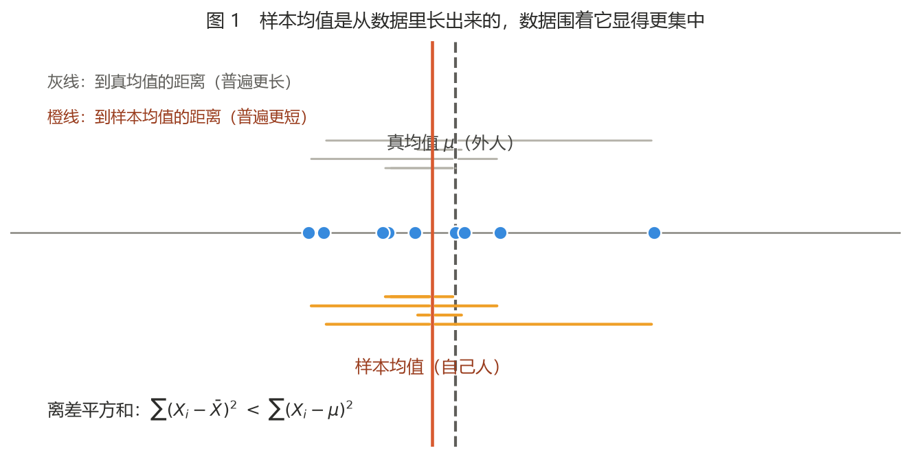
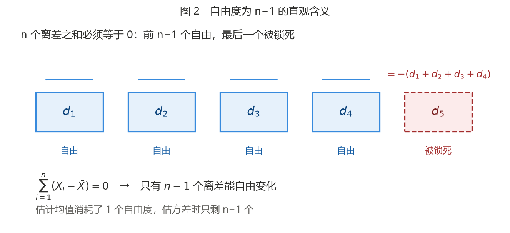

# 一个分母引发的困惑：样本方差为什么要除以 $n-1$？

假设你测了 100 个电阻的阻值。你算好平均值，又算好方差，把结果写进报告，交给导师。

导师扫了一眼，说：你的方差算错了。

你愣住了。加减乘除是计算器做的，一个数字都没敲错。哪里错了？

导师说：数没算错，但你问错了问题——你想报的，是这 100 个电阻自己波动多大，还是想通过它们，猜工厂里所有电阻的波动？如果是后者，你的分母就不该是 100，而是 99。

这个结论背后，藏着统计推断里最容易被忽略的一个念头。

## 一、你手里的数据，和你真正想知道的东西

100 个电阻是你实际测到的，叫**样本**。工厂里所有的电阻——包括那些你没测、也永远不会测的——叫**总体**。

这两个东西不是一回事。样本是你捞上来的一瓢水，总体是整片海。一瓢水的咸淡很好算，但你写报告，多半不是为了让这一瓢水满意，而是要推断整片海。

总体的波动记作 $\sigma^2$，它客观存在、固定不变，只是你不知道。你要做的，是用手上这 100 个数造一个估计量，去猜它。

假设总体的均值 $\mu$ 是已知的，这件事就没有悬念：

$$
\frac{1}{n}\sum_{i=1}^{n}(X_i-\mu)^2
$$

每个电阻都跟真正的中心 $\mu$ 比一次，平方，加起来，除以 $n$。它的期望恰好就是 $\sigma^2$，不偏不倚。除以 $n$，天经地义。

问题在于，现实里 $\mu$ 几乎从来不知道。你碰得到的，只有样本自己算出来的均值 $\bar X$。

于是把 $\mu$ 换成 $\bar X$，分母照旧留着 $n$：

$$
\frac{1}{n}\sum_{i=1}^{n}(X_i-\bar X)^2
$$

看起来顺理成章，问题恰恰出在把 $\mu$ 换成 $\bar X$ 这一步。

## 二、$\bar X$ 是自己人

$\mu$ 是外人。它是客观的真中心，待在哪儿跟你的样本无关，不会迁就任何人。

$\bar X$ 不一样。它是从你这 100 个数里算出来的，天生就待在这堆数据的正中间。$\bar X$ 的定义本身就是"让所有点到它的平方距离之和最小"的那个位置——按这个定义，它离这堆数据的平均距离，比任何别的数都近。

麻烦就在这儿。

你拿一把尺子去量数据的分散程度，如果这把尺子的零点，是数据自己选的，那它当然会显得数据"没那么分散"。用一个围着数据转的中心去量，量出来的离差，系统性偏小。

打个比方：让学生给自己打分，再算全班分数的波动，一定比让考官统一打分算出来的波动小。自己给自己打，大家不约而同往好处靠。

$\bar X$ 就是那个"自己给自己打分"的中心。你用它当中心，等于让数据占了便宜——离差被压缩了。而除以 $n-1$，就是把这个便宜找补回来。

## 三、从一个数看穿这件事

看一个极端的情形就明白了。

假设你只测了一个电阻，$n=1$。它的样本均值就是它自己：

$$
\bar X=X_1
$$

它对自身的离差是：

$$
X_1-\bar X=0
$$

如果你坚持除以 $n$，也就是除以 1，那你就要理直气壮地宣布：这批电阻的方差是 0，它们一点波动都没有。

只测了一个，就断言全世界毫无波动。荒唐。

而除以 $n-1$ 呢？分母是 0，方差没有定义。

"没定义"听着像缺点，其实是诚实：只给一个数，就是给不出结论。它老实承认了自己的无能，而不是编一个"0"来骗你。

一个敢说"我不知道"的估计量，比一个信口开河的可靠得多。

## 四、少掉的"1"到底去哪了

直觉说完了，下面把这笔账算清楚。

我们想知道的是：围绕 $\bar X$ 的平方离差和，期望是多少。答案是 $(n-1)\sigma^2$——那个少掉的 1 就在这里。

推导只用一步：把 $X_i-\bar X$ 拆成两段，一段连着真均值 $\mu$，一段连着 $\bar X$：

$$
X_i-\bar X=(X_i-\mu)-(\bar X-\mu)
$$

平方展开，会跑出一个交叉项 $-2(\bar X-\mu)\sum(X_i-\mu)$。这个交叉项可以化简：因为 $\sum X_i=n\bar X$，所以 $\sum(X_i-\mu)=n(\bar X-\mu)$。代回去，交叉项成了 $-2n(\bar X-\mu)^2$，再加上末尾的 $+n(\bar X-\mu)^2$，合起来正好是 $-n(\bar X-\mu)^2$。

于是得到一个干净的恒等式：

$$
\sum_{i=1}^{n}(X_i-\bar X)^2=\sum_{i=1}^{n}(X_i-\mu)^2-n(\bar X-\mu)^2
$$

它说的是：围绕样本均值的离差和，比围绕总体均值的离差和，少了正好 $n(\bar X-\mu)^2$。少的这块，就是"拿 $\bar X$ 顶替 $\mu$"付出的代价，是 $\bar X$ 占的便宜——上一节的直觉，在这里变成了精确的代数。

现在两边取期望。

第一项好办，每个 $X_i$ 都贡献一个 $\sigma^2$，加起来是 $n\sigma^2$。

第二项是关键。它等于 $nE[(\bar X-\mu)^2]$。因为 $\bar X$ 的平均就是 $\mu$，所以 $(\bar X-\mu)^2$ 的期望，正是 $\bar X$ 的方差：

$$
\operatorname{Var}(\bar X)=\frac{\sigma^2}{n}
$$

于是第二项是 $n\cdot\dfrac{\sigma^2}{n}=\sigma^2$。

两项相减：

$$
E\left[\sum_{i=1}^{n}(X_i-\bar X)^2\right]=n\sigma^2-\sigma^2=(n-1)\sigma^2
$$

于是：围绕样本均值的平方离差和，平均下来只有 $(n-1)$ 份 $\sigma^2$，不是 $n$ 份。

所以除以 $n-1$：

$$
E\left[\frac{1}{n-1}\sum_{i=1}^{n}(X_i-\bar X)^2\right]=\frac{1}{n-1}\cdot(n-1)\sigma^2=\sigma^2
$$

正好对准总体方差，不偏。

而除以 $n$，得到的是 $\dfrac{n-1}{n}\sigma^2$，系统性偏小。样本越小，亏得越多——这就是导师说你"算错了"的真正含义。

## 五、换一种说法：自由度

数学算完了，再看一个更直观的理解，它叫自由度。

$n$ 个样本围绕 $\bar X$ 的离差，有一个躲不掉的约束：

$$
\sum_{i=1}^{n}(X_i-\bar X)=0
$$

它们加起来必须为零。你只能自由地挑前 $n-1$ 个离差，最后一个是被逼出来的——它得负责把总和拉回零。

比如三个离差，已知 $d_1=2$、$d_2=-5$，那 $d_3$ 没得选，只能是 3。

$n$ 个数，只有 $n-1$ 个能自由动。有一个自由度，在你算出 $\bar X$ 的那一刻就被消耗掉了——因为 $\bar X$ 本身正是用这 $n$ 个数算的，它得遵守"总和为零"这条规矩。

所以"除以 $n-1$"真正的意思是：你在估均值时用掉了一个自由度，估方差时就只剩 $n-1$ 个独立的量可用。拿 $n-1$ 去除，才是诚实的平均。

## 六、亲手验一遍

我们再用一个能算到底的小例子验证一遍。

假设总体只有两个数：0 和 2，各占一半。真均值 $\mu=1$，真方差 $\sigma^2=1$。

每次抽两个（$n=2$），一共四种等可能的组合：

| 样本 | 平方离差和 | 除以 $n=2$ | 除以 $n-1=1$ |
| --- | ---: | ---: | ---: |
| 0, 0 | 0 | 0 | 0 |
| 0, 2 | 2 | 1 | 2 |
| 2, 0 | 2 | 1 | 2 |
| 2, 2 | 0 | 0 | 0 |

除以 $n$ 的平均：$(0+1+1+0)/4=0.5$。

除以 $n-1$ 的平均：$(0+2+2+0)/4=1$。

而真方差，正好是 1。除以 $n-1$ 的那个，分毫不差。

## 七、导师到底想说什么

现在可以回答开头那个场景了。

"除以 100 还是除以 99？"——这从来不是一道纯数学题，而是一道关于**目的**的题。

如果你要报告的，就是手上这 100 个电阻的离散程度——这 100 个就是你的全部世界，不打算往外推——那除以 100 是对的，那是描述性方差的定义。导师不会说你错。

但如果你要通过这 100 个电阻，去猜工厂里整批电阻的脾气，那你就得除以 99。因为你用样本均值顶替了总体均值，占了一份便宜，除以 $n-1$ 是把这份便宜还回去的税。

同样的道理，最大似然估计里正态方差的估计会除以 $n$；机器学习里很多时候也除以 $n$，因为在那些场景里，人们关心的是优化目标、是预测效果，不是估计量无偏。它们都没错，只是回答的问题不同。

所以，除以 $n-1$ 不是什么死记硬背的规定，而是你做出的一个诚实的选择：

> 你承认自己不知道总体的中心，只能从数据里估它；而每一次估，都要付出一个自由度的代价。

导师那句"算错了"，说的是：先想清楚你要回答的问题，再决定分母用哪个。想清楚了，分母自然就定了。
