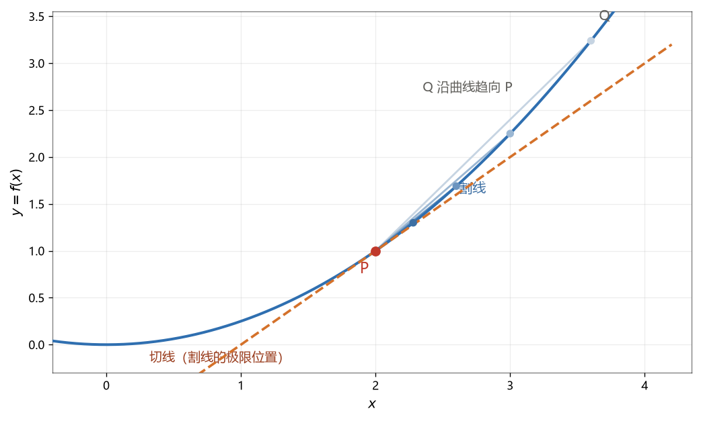
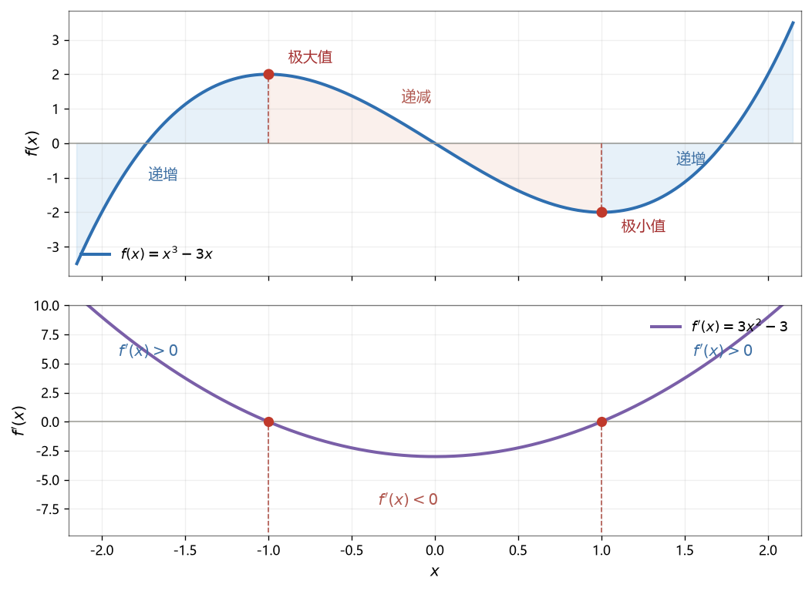

# 导数：从平均变化率到瞬时变化率

假设你开车经过一个测速摄像头。仪表盘指针指向 80，你知道那是此刻的速度。但停下来想一想：速度等于路程除以时间，而"此刻"的时间长度是零。零秒里走过的路程是零。零除以零，没有意义。

那 80 是怎么来的？

这个问题困扰了人类上千年。它其实问的是：一个**瞬间**，能不能有速度？下面这条路上，我们从小学算术出发，一步一步走到导数的门口。你会发现，每一步都只是把熟悉的事情往前推了一点点。

## 1. 平均变化率

从你十岁就会算的东西开始。

假设一辆车 2 点到 4 点走了 120 公里。平均速度是路程除以时间：

$$
\frac{120\ \text{公里}}{2\ \text{小时}} = 60\ \text{公里/小时}
$$

换成数学语言。设位置是时间的函数 $s(t)$，从时刻 $t$ 到 $t+\Delta t$——这里 $\Delta t$ 表示一段很短的时间变化量，读作"delta t"——位置从 $s(t)$ 变到 $s(t+\Delta t)$。这段时间的平均速度是

$$
\bar v = \frac{s(t+\Delta t)-s(t)}{\Delta t} \qquad\mathrm{(1)}
$$

在图上，把 $(t, s(t))$ 和 $(t+\Delta t, s(t+\Delta t))$ 两点连起来，这条线叫**割线**，它的斜率正是公式 (1) 给出的比值。

平均速度没有问题，人人会算。麻烦在于，测速摄像头关心的不是两小时的平均，而是你经过它的那**一瞬间**。

## 2. 从平均到瞬时：极限

既然瞬间不好算，那就退而求其次：算一小段时间内的平均速度，再把这段时间越缩越短。

假设自由落体的位置是 $s(t)=\dfrac{1}{2}gt^2$（$g$ 是重力加速度）。我们想知道 $t=1$ 秒那一瞬的速度。在公式 (1) 中取 $s(t)=\dfrac{1}{2}gt^2$、$t=1$，先算从 1 秒到 $1+\Delta t$ 秒的平均速度：

$$
\frac{s(1+\Delta t)-s(1)}{\Delta t}
= \frac{\frac{1}{2}g(1+\Delta t)^2 - \frac{1}{2}g}{\Delta t}
$$

展开 $(1+\Delta t)^2 = 1 + 2\Delta t + (\Delta t)^2$，代入化简：

$$
\bar v = \frac{g\Delta t + \frac{1}{2}g(\Delta t)^2}{\Delta t}
= g + \frac{1}{2}g\,\Delta t \qquad\mathrm{(2)}
$$

注意公式 (2) 中，$\Delta t$ 已从分母里消失。取 $g=9.8\ \mathrm{m/s^2}$，则 $\dfrac{1}{2}g=4.9$，公式 (2) 化为 $\bar v = 9.8+4.9\Delta t$。把 $\Delta t$ 依次取小，逐一代入计算：

| $\Delta t$（秒） | 代入计算 | 平均速度 $\bar v$（m/s） |
|---:|---|---:|
| 0.1 | $9.8+4.9\times 0.1 = 9.8+0.49$ | 10.29 |
| 0.01 | $9.8+4.9\times 0.01 = 9.8+0.049$ | 9.849 |
| 0.001 | $9.8+4.9\times 0.001 = 9.8+0.0049$ | 9.8049 |
| 0.0001 | $9.8+4.9\times 0.0001 = 9.8+0.00049$ | 9.80049 |
| 0.00001 | $9.8+4.9\times 0.00001 = 9.8+0.000049$ | 9.800049 |
| 0.000001 | $9.8+4.9\times 0.000001 = 9.8+0.0000049$ | 9.8000049 |

$\Delta t$ 每缩小到原来的十分之一，结果就向 9.8 靠近一位。$\Delta t$ 越小，平均速度越接近 9.8，而这个一路靠近的目标值正是 $g$。

这个不断趋近的过程，就是**极限**。我们永远不让 $\Delta t$ 真正等于零（那样分母就没意义了），而只看它趋向零时结果趋向哪里。答案是 $g$。于是我们说：$t=1$ 秒那一瞬的瞬时速度是 $g$。

一个瞬间，就这样被"算"出来了。方法不是直接测量瞬间，而是让越来越短的时间段逼近它，看平均速度趋向哪个确定的数。

## 3. 导数的定义

把上一节的做法抽出来，就得到导数。

对一般的函数 $y=f(x)$，让自变量的增量 $\Delta x$ 趋向零。公式 (1) 中的平均变化率这时写成

$$
\frac{f(x+\Delta x)-f(x)}{\Delta x} \qquad\mathrm{(3)}
$$

如果它趋向一个确定的极限，就称 $f$ 在 $x$ 处**可导**，并把这个极限叫作 $f$ 在 $x$ 处的**导数**，记作 $f'(x)$：

$$
\textcolor{#d9480f}{f'(x) = \lim_{\Delta x \to 0} \frac{f(x+\Delta x)-f(x)}{\Delta x}} \qquad\mathrm{(4)}
$$

公式 (4) 中的每个零件你都见过：分子是函数值的改变量，分母是自变量的改变量，比值就是公式 (3) 的平均变化率，前面的 $\lim$ 表示让分母趋向零。唯一的新东西，是把"越来越接近"这件事写成了严格的记号。导数与极限的这种严格表述直到 19 世纪才由柯西确立（Cauchy, 1821），而导数概念的雏形可追溯到牛顿的流数术与莱布尼茨的微分学（Newton, 1687；Leibniz, 1684）。

当 $x$ 变化时，$f'(x)$ 一般也跟着变，所以它本身是一个函数，叫**导函数**。导数 $f'(x)$ 刻画的是函数在 $x$ 这一点的变化有多快。

## 4. 几何意义：切线

导数的几何图像，能让这个定义变得看得见。

**图 1　点 Q 沿曲线滑向点 P，割线绕 P 转动并趋于切线；切线的斜率就是导数**

在图 1 中固定曲线上一点 P，再取另一点 Q，把两点连成割线。割线的斜率，就是区间上的平均变化率。现在让 Q 沿曲线向 P 滑动：$\Delta x$ 越来越小，割线越来越贴近曲线在 P 附近的走向。当 Q 无限接近 P，割线趋于一个极限位置——这就是曲线在 P 点的**切线**。

于是导数有了第二重身份：它既是瞬时变化率，也是切线的斜率。代数上的"变化快慢"和几何上的"倾斜程度"，在这里是同一个数。这正是导数威力的一半——把一个抽象概念和一个能画出来的图形绑在了一起。

## 5. 导数的计算：一个例子

定义若只能看不能用，就没有意义。用它来真的算一次。

设 $f(x)=x^2$，求它在任意 $x$ 处的导数。按公式 (4) 的定义，先写出差商：

$$
\frac{f(x+\Delta x)-f(x)}{\Delta x}
= \frac{(x+\Delta x)^2 - x^2}{\Delta x}
$$

展开分子：$(x+\Delta x)^2 = x^2 + 2x\Delta x + (\Delta x)^2$，减去 $x^2$ 后只剩 $2x\Delta x + (\Delta x)^2$。代回去并约去 $\Delta x$：

$$
= \frac{2x\Delta x + (\Delta x)^2}{\Delta x}
= 2x + \Delta x
$$

最后令 $\Delta x \to 0$：

$$
f'(x) = (x^2)' = 2x \qquad\mathrm{(5)}
$$

结果 $2x$ 是一个函数：$x=1$ 处斜率是 2，$x=3$ 处斜率是 6。抛物线 $y=x^2$ 越往右越陡，$2x$ 忠实地把这件事记了下来。

用同样的办法还能算出一批基本函数的导数：$(c)'=0$、$(x)'=1$、$(\sin x)'=\cos x$、$(\mathrm{e}^x)'=\mathrm{e}^x$。它们不用背，需要时从定义推一遍就能得到。

## 6. 导数的应用

导数真正的价值，在于它给出了一套描述"变化"的通用语言。

物理里，位置对时间求导是速度，速度再求导是加速度。开头那个测速摄像头的问题，答案就是导数：仪表盘显示的，是位置函数在某一时刻的导数。

经济里，成本对产量求导是**边际成本**——多生产一件产品，成本增加多少。做决策时关心的往往是"再多一点会怎样"，这正是导数回答的问题。

导数还能找极值。看图 2：函数 $f(x)=x^3-3x$ 上升的区间，导数 $f'(x)>0$；下降的区间，导数 $f'(x)<0$。那么从上升转为下降的转折点——极大值——导数恰好为零；从下降转为上升的转折点——极小值——导数也为零。

**图 2　$f$ 递增时 $f'>0$，递减时 $f'<0$；导数零点对应极值点**

于是求一个量的最大值或最小值——利润、产量、效率——就变成了解方程 $f'(x)=0$，再看公式 (4) 给出的导数在零点两侧的符号变化。在导数出现之前，极值问题要靠精巧的技巧逐个攻克；有了导数，它成了一套可以照着走的流程。

## 7. 小结

现在回到开头的 80。

它是一个极限：把测量时间压到无限短，看平均速度趋向哪个数。摄像头未必真的用极限去算，但它显示的读数，和导数表达的是同一件事——一个瞬间的变化率。

从平均变化率到瞬时变化率，从割线到切线，从一个具体函数到一套通用方法，这就是导数概念建立的全过程。每一步都只是把熟悉的事情向前推进：把公式 (1) 中一段较长区间的平均，压缩到一个瞬间；把割线的两个端点，靠拢为一点；把 $\frac{0}{0}$ 的未定式，转化为公式 (4) 所定义的极限。

导数概念的价值，正在于它用严格的极限语言，回答了"一个瞬间可以有变化率吗"这个看似矛盾的问题。

## 参考文献

Cauchy, A.-L. (1821). *Cours d'analyse de l'École royale polytechnique*. <https://doi.org/10.1017/cbo9780511693328>

Leibniz, G. W. (1684). Nova methodus pro maximis et minimis. *Acta Eruditorum*, 467–473. <https://doi.org/10.1007/978-3-476-05728-0_10235-1>

Newton, I. (1687). *Philosophiæ naturalis principia mathematica*. <https://doi.org/10.5479/sil.52126.39088015628399>

Stewart, J. (2015). *Calculus: Early transcendentals* (8th ed.). Cengage Learning. <https://www.stewartcalculus.com/>
