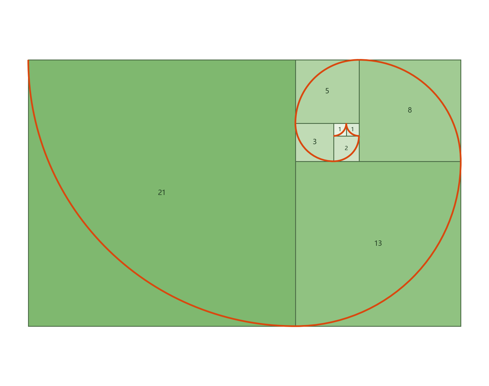
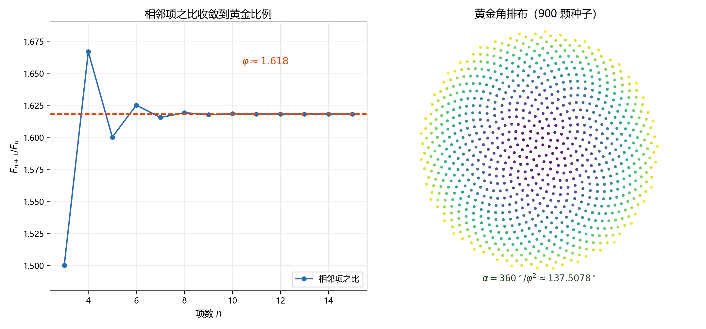

# 斐波那契数列：递推、黄金比例与植物的螺旋

今天是 11 月 23 日，是斐波那契日。

为什么定在今天？把日期写成 11/23，读出来就是 1、1、2、3——斐波那契数列的前四项（若从 $F_0=0$ 起数，则紧接在 0、1 之后）。1、1、2、3、5、8、13、21……往后每一项，都是前两项之和。

生活中也常见类似的螺旋。蕨类嫩叶刚长出来时，顶端紧紧卷曲，像小提琴琴头的涡卷；这团卷曲保护着柔嫩的生长点，等叶片长成，再慢慢舒展。向日葵的花盘上，种子也排成两组反向螺线。这些图案与那串数字有什么关系？

**图 1　蕨类嫩叶的顶端卷成螺旋，随着生长会逐渐舒展**

## 1. 递推关系的来源与定义

1202 年，比萨的莱昂纳多（后人称斐波那契）在《计算之书》中提出一道算题：把一对刚出生的兔子关进围栏，兔子出生一个月后成熟，此后每月生一对；假设兔子永不死亡（Sigler, 2002）。第 1 个月有 1 对，第 2 个月仍是 1 对；第 3 个月原来的兔子生下一对，共 2 对；第 4 个月，老兔子再生一对，第 3 个月出生的那对也已成熟，共 3 对。

把每个月的兔子对数写下来：

1，1，2，3，5，8，13，21，34，55，89，144……

第 12 个月是 144 对。规律只有一条：每个月的总数，等于前两个月总数之和。取 $F_0=0$、$F_1=1$，写成递推式：

$$
F_n=F_{n-1}+F_{n-2},\quad n\ge 2 \qquad\mathrm{(1)}
$$

图片里列出的 0、1、1、2、3、5、8，正是公式 (1) 从 $F_0$ 开始的前七项。兔子的设定并不真实——没有哪群兔子永不死亡——但这条递推式活了下来，它后来被证明能描述的东西，远远超出那道围栏。

## 2. 通项公式的推导

递推式回答"下一项是什么"，却不能直接回答"$F_{100}$ 是多少"，除非先把前面 99 项逐一算出。能不能写一个只依赖 $n$ 的式子？

试一试指数形式：假设解可以写成 $F_n=r^n$，其中 $r$ 是不随 $n$ 变化的常数。把它代入公式 (1)，三项分别是 $r^n$、$r^{n-1}$、$r^{n-2}$：

$$
r^n=r^{n-1}+r^{n-2}
$$

两边同除以 $r^{n-2}$（$r=0$ 给出全零解，与 $F_1=1$ 不符），得到特征方程

$$
r^2=r+1 \qquad\mathrm{(2)}
$$

这一步把递推关系翻译成了代数方程："后一项等于前两项之和"的结构，变成了 $r$ 的二次方程。移项得 $r^2-r-1=0$，由求根公式解出

$$
r_1=\frac{1+\sqrt5}{2}\approx1.618,\qquad r_2=\frac{1-\sqrt5}{2}\approx-0.618
$$

两个根都满足公式 (2)，所以 $r_1^n$ 和 $r_2^n$ 都满足原递推式。递推式是线性的，它们的线性组合也满足，于是通解可写成

$$
F_n=Ar_1^n+Br_2^n
$$

再代入初始条件 $F_0=0$、$F_1=1$：前者给出 $A+B=0$，后者给出 $Ar_1+Br_2=1$。由 $A+B=0$ 得 $B=-A$，代入第二式：

$$
A(r_1-r_2)=1
$$

而 $r_1-r_2=\sqrt5$，于是 $A=1/\sqrt5$、$B=-1/\sqrt5$，得到通项

$$
F_n=\frac{r_1^n-r_2^n}{\sqrt5} \qquad\mathrm{(3)}
$$

这就是比内公式。它给出的是整数，用的却全是无理数。取 $n=10$，$r_1^{10}/\sqrt5\approx55.0036$，四舍五入正好是 $F_{10}=55$。原因在于 $r_2$ 的绝对值小于 1：$n$ 一大，$r_2^n$ 就小到可以忽略，$F_n$ 就是最接近 $r_1^n/\sqrt5$ 的整数。

一道关于兔子的算术题，就这样和 $\sqrt5$ 连在了一起。更重要的是，公式 (3) 还预告了下一节的主角：随着 $n$ 增大，决定比值的是较大的那个根 $r_1$——下一节会给它一个名字。

## 3. 相邻项之比的极限

拿后一项除以前一项，比值怎么变？

| $n$ | $F_n$ | $F_{n+1}/F_n$ |
|---:|---:|---:|
| 3 | 2 | 1.5000 |
| 4 | 3 | 1.6667 |
| 5 | 5 | 1.6000 |
| 6 | 8 | 1.6250 |
| 7 | 13 | 1.6154 |
| 8 | 21 | 1.6190 |
| 9 | 34 | 1.6176 |
| 10 | 55 | 1.6182 |
| 11 | 89 | 1.6180 |

比值在 1.618 附近来回摆动，摆幅越来越小。它的极限正是 $r_1$，这个数有个专门的名字：黄金比例，记作 $\varphi$：

$$
\lim_{n\to\infty}\frac{F_{n+1}}{F_n}=\varphi=\frac{1+\sqrt5}{2} \qquad\mathrm{(4)}
$$

从公式 (3) 一眼能看出原因：分子分母同除以 $r_1^n$，剩下 $(r_2/r_1)^n$；因为 $r_2/r_1$ 的绝对值小于 1，这一项趋向零，极限就是 $r_1=\varphi$。这个极限最早由西姆松于 1753 年证明（Weisstein, n.d.）。$\varphi$ 满足 $\varphi^2=\varphi+1$，它的倒数 $\varphi-1\approx0.618$。

把前几项当作正方形的边长依次贴上去：1、1、2、3、5、8、13、21。在每个正方形里画一段四分之一圆，让圆弧首尾相接，就得到图 2 的螺旋。

**图 2　以斐波那契数为边长的正方形与四分之一圆弧；它逐段逼近对数螺旋，但不是同一条曲线**

开头那片蕨叶的卷曲，形状上更接近对数螺旋：每转一圈，半径按固定比例放大。斐波那契螺旋只是用圆弧拼出来的近似。把两者说成同一条曲线，是把"看起来像"当成了"就是"。不过，斐波那契数列与植物之间还有更扎实的一层联系，它在种子的排布上。图片里提到的向日葵，就是最典型的例子。

## 4. 黄金角与植物叶序

向日葵的花盘上，种子排成两组方向相反的螺线。顺着其中一组数过去，常见的螺线数目是 34 与 55，或 55 与 89——相邻的两个斐波那契数（Vogel, 1979）。植物并没有在数数，这些数字是生长规则的副产品。

设想叶片或种子依次从生长中心冒出来，每长出一个，就绕中心转过固定角度 $\alpha$；第 $n$ 个离中心的距离取 $r_n=c\sqrt n$，让半径的平方正比于序号，从而每个器官平均分到的面积大致相同（Vogel, 1979）。如果 $\alpha$ 是圆周的简单分数，比如 $90^\circ=360^\circ/4$，第 5 个器官就落回第 1 个的方向，种子排成 4 条辐条，中间留下大片空隙。要让方向尽量不重复，$\alpha/360^\circ$ 必须是无理数。

在无数无理数中，$\varphi$ 的连分数 $[1;1,1,1,\ldots]$ 收敛最慢，最难被分数逼近。按它取角，最不容易形成辐条。这个角是

$$
\alpha=\frac{360^\circ}{\varphi^2}\approx137.5078^\circ \qquad\mathrm{(5)}
$$

称为黄金角。这里有个容易忽略的细节：常说的 137.5° 只是近似值。$137.5/360$ 恰好等于 $55/144$，是有理数——若严格按 137.5° 摆放种子，第 144 颗之后方向就会重复，而 144 本身也是斐波那契数。要避开辐条，得用真正的无理数角。

图 3 把两件事放在一起看：左边是相邻项之比向 $\varphi$ 收敛，右边是按黄金角排布的 800 颗"种子"——两组反向螺线自己长了出来，图中没有任何一条线被预先画成螺旋。

**图 3　相邻项之比趋向黄金比例；黄金角排布使种子密集而均匀，并自发形成反向螺线**

这种自组织并不需要一张设计图。Douady 与 Couder（1996）用物理系统重现了叶序的螺旋模式，说明图案来自局部相互作用与空间约束。蕨叶卷曲是为了在穿过土壤和落叶层时保护柔嫩的生长端；螺线数目和黄金角则来自排列效率。把它们都归功于"植物懂斐波那契数列"，恰好倒因为果。

## 5. 小结

回到 11 月 23 日。11/23 读成 1、1、2、3，只是人为的日期游戏；真正值得记住的，是这组数字背后的机制。一条两步递推，能给出只依赖 $n$ 的通项公式，给出相邻项之比的极限，也给出了植物避开辐条、紧密排列种子所需的角度。蕨叶会舒展，向日葵会结籽，这些图案并非出自某个会算数的园丁——它们遵循的是生长与空间的约束，斐波那契数只是约束留下的痕迹。

下一年 11 月 23 日，1、1、2、3 还会准时出现；野外的蕨叶也会再次卷起。一个 1202 年的兔子问题，至今仍能在植物身上找到回声。

## 参考文献

[1] Douady, S., & Couder, Y. (1996). Phyllotaxis as a dynamical self organizing process part I: The spiral modes resulting from time-periodic iterations. *Journal of Theoretical Biology, 178*(3), 255–273. <https://doi.org/10.1006/jtbi.1996.0024>

[2] Sigler, L. E. (Trans.). (2002). *Fibonacci's Liber Abaci: A translation into modern English of Leonardo Pisano's book of calculation*. Springer. <https://doi.org/10.1007/978-1-4613-0079-3>

[3] Vogel, H. (1979). A better way to construct the sunflower head. *Mathematical Biosciences, 44*, 179–189. <https://doi.org/10.1016/0025-5564(79)90080-4>

[4] Weisstein, E. W. (n.d.). Fibonacci number. *MathWorld—A Wolfram Web Resource*. <https://mathworld.wolfram.com/FibonacciNumber.html>
